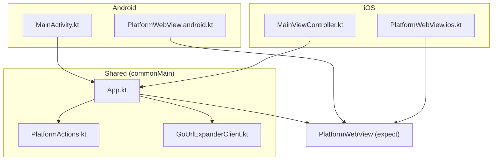
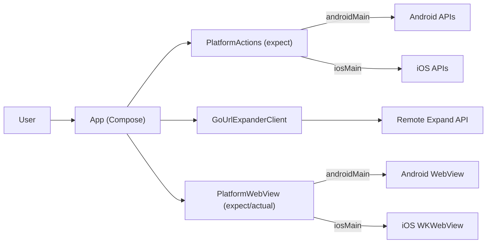
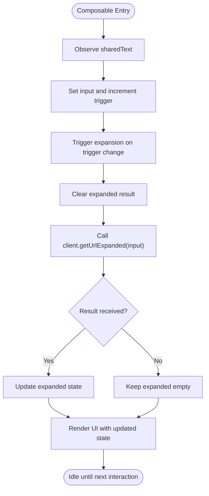
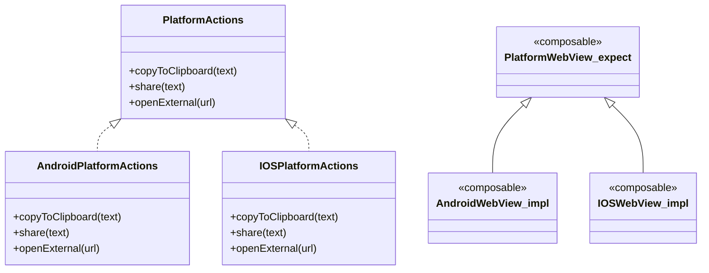
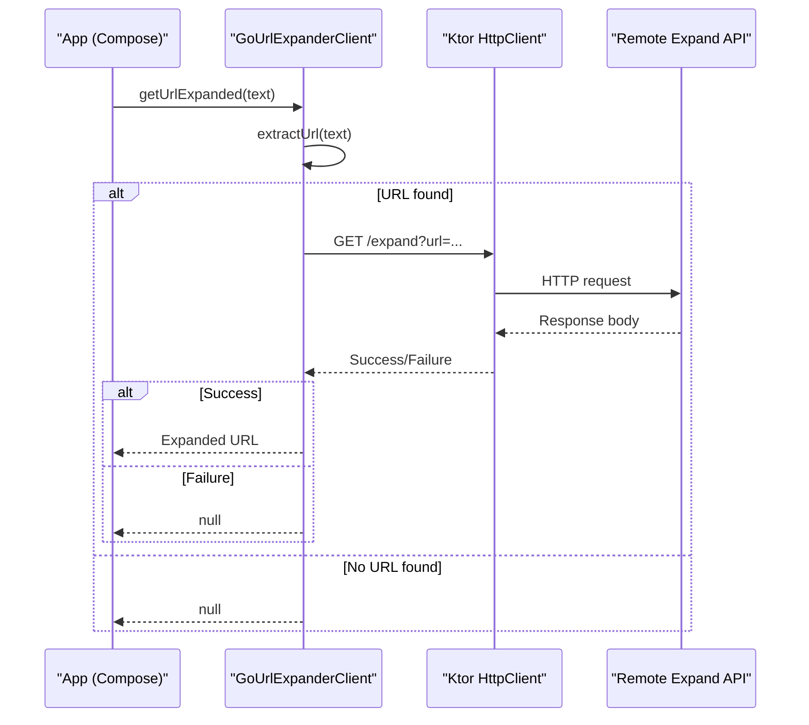
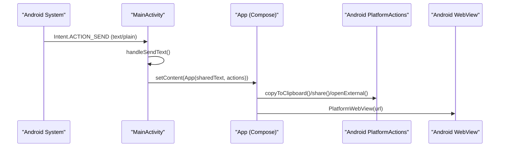
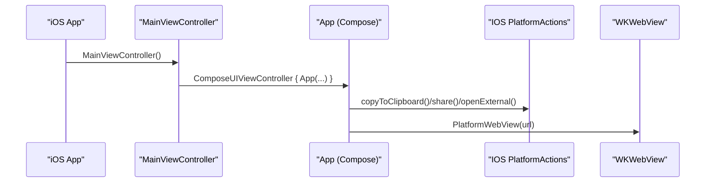
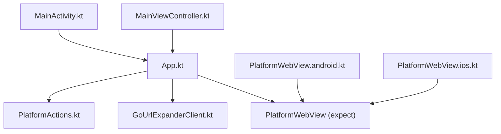

# Architecture Overview

<cite>
**Referenced Files in This Document**
- [README.md](file://README.md)
- [App.kt](file://composeApp/src/commonMain/kotlin/com/brunoshiroma/url_expander/App.kt)
- [PlatformActions.kt](file://composeApp/src/commonMain/kotlin/com/brunoshiroma/url_expander/PlatformActions.kt)
- [GoUrlExpanderClient.kt](file://composeApp/src/commonMain/kotlin/com/brunoshiroma/url_expander/GoUrlExpanderClient.kt)
- [MainActivity.kt](file://composeApp/src/androidMain/kotlin/com/brunoshiroma/url_expander/MainActivity.kt)
- [PlatformWebView.android.kt](file://composeApp/src/androidMain/kotlin/com/brunoshiroma/url_expander/PlatformWebView.android.kt)
- [MainViewController.kt](file://composeApp/src/iosMain/kotlin/com/brunoshiroma/url_expander/MainViewController.kt)
- [PlatformWebView.ios.kt](file://composeApp/src/iosMain/kotlin/com/brunoshiroma/url_expander/PlatformWebView.ios.kt)
</cite>

## Table of Contents
1. [Introduction](#introduction)
2. [Project Structure](#project-structure)
3. [Core Components](#core-components)
4. [Architecture Overview](#architecture-overview)
5. [Detailed Component Analysis](#detailed-component-analysis)
6. [Dependency Analysis](#dependency-analysis)
7. [Performance Considerations](#performance-considerations)
8. [Troubleshooting Guide](#troubleshooting-guide)
9. [Conclusion](#conclusion)

## Introduction
This document describes the architecture of the Kotlin URL Expander multiplatform application. The app is built with Kotlin Multiplatform and Compose Multiplatform, sharing UI and business logic in commonMain while delegating platform-specific operations to androidMain and iosMain. It follows an MVVM-like pattern where the shared Composable acts as a view model–like controller that manages state, invokes a network client, and delegates native actions through expect/actual abstractions.

The application integrates with:
- An external HTTP service for URL expansion via Ktor.
- Android system features (clipboard, share sheet, WebView).
- iOS system features (pasteboard, share sheet, WKWebView).

## Project Structure
The project is organized by platform source sets under composeApp:
- commonMain: Shared UI (Compose), domain logic, and HTTP client.
- androidMain: Android entry point, clipboard/share/open-url implementations, and WebView.
- iosMain: iOS entry point, clipboard/share/open-url implementations, and WKWebView.

**Diagram sources**
- [MainActivity.kt:15-60](file://composeApp/src/androidMain/kotlin/com/brunoshiroma/url_expander/MainActivity.kt#L15-L60)
- [PlatformWebView.android.kt:11-21](file://composeApp/src/androidMain/kotlin/com/brunoshiroma/url_expander/PlatformWebView.android.kt#L11-L21)
- [MainViewController.kt:9-25](file://composeApp/src/iosMain/kotlin/com/brunoshiroma/url_expander/MainViewController.kt#L9-L25)
- [PlatformWebView.ios.kt:11-22](file://composeApp/src/iosMain/kotlin/com/brunoshiroma/url_expander/PlatformWebView.ios.kt#L11-L22)
- [App.kt:36-125](file://composeApp/src/commonMain/kotlin/com/brunoshiroma/url_expander/App.kt#L36-L125)
- [PlatformActions.kt:7-14](file://composeApp/src/commonMain/kotlin/com/brunoshiroma/url_expander/PlatformActions.kt#L7-L14)
- [GoUrlExpanderClient.kt:13-23](file://composeApp/src/commonMain/kotlin/com/brunoshiroma/url_expander/GoUrlExpanderClient.kt#L13-L23)

**Section sources**
- [README.md:1-18](file://README.md#L1-L18)

## Core Components
- App (shared UI + state): Manages input, expanded result, and navigation between text view and web view. Triggers URL expansion and exposes platform actions for copy/share/open.
- PlatformActions (expect interface): Declares platform-specific operations used by shared UI.
- GoUrlExpanderClient (network layer): Extracts URLs from text and calls the remote expand endpoint using Ktor.
- MainActivity (Android host): Receives shared text, wires PlatformActions, and hosts the shared UI.
- MainViewController (iOS host): Wires PlatformActions and hosts the shared UI.
- PlatformWebView (expect/actual): Renders the expanded URL in a platform-native web view.

Key responsibilities:
- UI state and orchestration: App.kt
- Network request: GoUrlExpanderClient.kt
- Platform integration: PlatformActions.kt + androidMain/iosMain implementations
- Native web rendering: PlatformWebView.*.kt

**Section sources**
- [App.kt:36-125](file://composeApp/src/commonMain/kotlin/com/brunoshiroma/url_expander/App.kt#L36-L125)
- [PlatformActions.kt:7-14](file://composeApp/src/commonMain/kotlin/com/brunoshiroma/url_expander/PlatformActions.kt#L7-L14)
- [GoUrlExpanderClient.kt:9-23](file://composeApp/src/commonMain/kotlin/com/brunoshiroma/url_expander/GoUrlExpanderClient.kt#L9-L23)
- [MainActivity.kt:15-60](file://composeApp/src/androidMain/kotlin/com/brunoshiroma/url_expander/MainActivity.kt#L15-L60)
- [MainViewController.kt:9-25](file://composeApp/src/iosMain/kotlin/com/brunoshiroma/url_expander/MainViewController.kt#L9-L25)
- [PlatformWebView.android.kt:11-21](file://composeApp/src/androidMain/kotlin/com/brunoshiroma/url_expander/PlatformWebView.android.kt#L11-L21)
- [PlatformWebView.ios.kt:11-22](file://composeApp/src/iosMain/kotlin/com/brunoshiroma/url_expander/PlatformWebView.ios.kt#L11-L22)

## Architecture Overview
The application uses a layered approach:
- Presentation layer (Compose): App composable renders UI and coordinates user interactions.
- Domain/network layer: GoUrlExpanderClient performs URL extraction and HTTP requests.
- Platform integration layer: PlatformActions abstracts clipboard, share, and open-url; PlatformWebView renders the URL natively.

**Diagram sources**
- [App.kt:36-125](file://composeApp/src/commonMain/kotlin/com/brunoshiroma/url_expander/App.kt#L36-L125)
- [PlatformActions.kt:7-14](file://composeApp/src/commonMain/kotlin/com/brunoshiroma/url_expander/PlatformActions.kt#L7-L14)
- [GoUrlExpanderClient.kt:13-23](file://composeApp/src/commonMain/kotlin/com/brunoshiroma/url_expander/GoUrlExpanderClient.kt#L13-L23)
- [PlatformWebView.android.kt:11-21](file://composeApp/src/androidMain/kotlin/com/brunoshiroma/url_expander/PlatformWebView.android.kt#L11-L21)
- [PlatformWebView.ios.kt:11-22](file://composeApp/src/iosMain/kotlin/com/brunoshiroma/url_expander/PlatformWebView.ios.kt#L11-L22)

## Detailed Component Analysis

### Shared UI and State Management (App.kt)
Responsibilities:
- Holds UI state: input text, expanded result, web view visibility, and trigger counter.
- On receiving shared text or manual trigger, it clears previous results and calls the client to expand the URL.
- Provides buttons to copy/share/open the result and to switch between text view and internal web view.
- Uses SnackbarHostState to show feedback after copying.

Data flow:
- LaunchedEffect observes sharedText and triggers expansion when present.
- Another LaunchedEffect reacts to trigger to call getUrlExpanded and update expanded state.
- UI binds to these states to render controls and content.

**Diagram sources**
- [App.kt:49-61](file://composeApp/src/commonMain/kotlin/com/brunoshiroma/url_expander/App.kt#L49-L61)
- [App.kt:65-124](file://composeApp/src/commonMain/kotlin/com/brunoshiroma/url_expander/App.kt#L65-L124)

**Section sources**
- [App.kt:36-125](file://composeApp/src/commonMain/kotlin/com/brunoshiroma/url_expander/App.kt#L36-L125)

### Expect/Actual Abstractions (PlatformActions and PlatformWebView)
- PlatformActions defines clipboard, share, and open-url operations. Implementations live in androidMain and iosMain.
- PlatformWebView is declared as an expect composable in commonMain and implemented with Android WebView and iOS WKWebView.

**Diagram sources**
- [PlatformActions.kt:7-14](file://composeApp/src/commonMain/kotlin/com/brunoshiroma/url_expander/PlatformActions.kt#L7-L14)
- [MainActivity.kt:19-36](file://composeApp/src/androidMain/kotlin/com/brunoshiroma/url_expander/MainActivity.kt#L19-L36)
- [MainViewController.kt:9-23](file://composeApp/src/iosMain/kotlin/com/brunoshiroma/url_expander/MainViewController.kt#L9-L23)
- [PlatformWebView.android.kt:11-21](file://composeApp/src/androidMain/kotlin/com/brunoshiroma/url_expander/PlatformWebView.android.kt#L11-L21)
- [PlatformWebView.ios.kt:11-22](file://composeApp/src/iosMain/kotlin/com/brunoshiroma/url_expander/PlatformWebView.ios.kt#L11-L22)

**Section sources**
- [PlatformActions.kt:7-14](file://composeApp/src/commonMain/kotlin/com/brunoshiroma/url_expander/PlatformActions.kt#L7-L14)
- [PlatformWebView.android.kt:11-21](file://composeApp/src/androidMain/kotlin/com/brunoshiroma/url_expander/PlatformWebView.android.kt#L11-L21)
- [PlatformWebView.ios.kt:11-22](file://composeApp/src/iosMain/kotlin/com/brunoshiroma/url_expander/PlatformWebView.ios.kt#L11-L22)

### Network Layer (GoUrlExpanderClient)
Responsibilities:
- Extracts the first URL from input text using a regex helper.
- Calls the remote expand endpoint with the extracted URL.
- Returns the expanded string if the response is successful; otherwise returns null.

**Diagram sources**
- [GoUrlExpanderClient.kt:9-23](file://composeApp/src/commonMain/kotlin/com/brunoshiroma/url_expander/GoUrlExpanderClient.kt#L9-L23)
- [App.kt:56-61](file://composeApp/src/commonMain/kotlin/com/brunoshiroma/url_expander/App.kt#L56-L61)

**Section sources**
- [GoUrlExpanderClient.kt:9-23](file://composeApp/src/commonMain/kotlin/com/brunoshiroma/url_expander/GoUrlExpanderClient.kt#L9-L23)

### Android Integration (MainActivity and PlatformWebView.android)
- MainActivity receives shared text via ACTION_SEND, stores it, and passes it to the shared App composable along with a PlatformActions implementation.
- Clipboard, share sheet, and opening external URLs are delegated to Android APIs.
- PlatformWebView.android renders the expanded URL using Android WebView with JavaScript enabled.

**Diagram sources**
- [MainActivity.kt:38-60](file://composeApp/src/androidMain/kotlin/com/brunoshiroma/url_expander/MainActivity.kt#L38-L60)
- [MainActivity.kt:19-36](file://composeApp/src/androidMain/kotlin/com/brunoshiroma/url_expander/MainActivity.kt#L19-L36)
- [PlatformWebView.android.kt:11-21](file://composeApp/src/androidMain/kotlin/com/brunoshiroma/url_expander/PlatformWebView.android.kt#L11-L21)

**Section sources**
- [MainActivity.kt:15-60](file://composeApp/src/androidMain/kotlin/com/brunoshiroma/url_expander/MainActivity.kt#L15-L60)
- [PlatformWebView.android.kt:11-21](file://composeApp/src/androidMain/kotlin/com/brunoshiroma/url_expander/PlatformWebView.android.kt#L11-L21)

### iOS Integration (MainViewController and PlatformWebView.ios)
- MainViewController creates the shared UI with a PlatformActions implementation backed by iOS APIs.
- PlatformWebView.ios renders the expanded URL using WKWebView.

**Diagram sources**
- [MainViewController.kt:9-25](file://composeApp/src/iosMain/kotlin/com/brunoshiroma/url_expander/MainViewController.kt#L9-L25)
- [PlatformWebView.ios.kt:11-22](file://composeApp/src/iosMain/kotlin/com/brunoshiroma/url_expander/PlatformWebView.ios.kt#L11-L22)

**Section sources**
- [MainViewController.kt:9-25](file://composeApp/src/iosMain/kotlin/com/brunoshiroma/url_expander/MainViewController.kt#L9-L25)
- [PlatformWebView.ios.kt:11-22](file://composeApp/src/iosMain/kotlin/com/brunoshiroma/url_expander/PlatformWebView.ios.kt#L11-L22)

## Dependency Analysis
High-level dependencies:
- App depends on PlatformActions and GoUrlExpanderClient.
- Android and iOS hosts depend on App and provide PlatformActions implementations.
- PlatformWebView is expected in commonMain and implemented per platform.

**Diagram sources**
- [App.kt:36-125](file://composeApp/src/commonMain/kotlin/com/brunoshiroma/url_expander/App.kt#L36-L125)
- [PlatformActions.kt:7-14](file://composeApp/src/commonMain/kotlin/com/brunoshiroma/url_expander/PlatformActions.kt#L7-L14)
- [GoUrlExpanderClient.kt:13-23](file://composeApp/src/commonMain/kotlin/com/brunoshiroma/url_expander/GoUrlExpanderClient.kt#L13-L23)
- [MainActivity.kt:38-42](file://composeApp/src/androidMain/kotlin/com/brunoshiroma/url_expander/MainActivity.kt#L38-L42)
- [MainViewController.kt:25-25](file://composeApp/src/iosMain/kotlin/com/brunoshiroma/url_expander/MainViewController.kt#L25-L25)
- [PlatformWebView.android.kt:11-21](file://composeApp/src/androidMain/kotlin/com/brunoshiroma/url_expander/PlatformWebView.android.kt#L11-L21)
- [PlatformWebView.ios.kt:11-22](file://composeApp/src/iosMain/kotlin/com/brunoshiroma/url_expander/PlatformWebView.ios.kt#L11-L22)

**Section sources**
- [App.kt:36-125](file://composeApp/src/commonMain/kotlin/com/brunoshiroma/url_expander/App.kt#L36-L125)
- [PlatformActions.kt:7-14](file://composeApp/src/commonMain/kotlin/com/brunoshiroma/url_expander/PlatformActions.kt#L7-L14)
- [GoUrlExpanderClient.kt:13-23](file://composeApp/src/commonMain/kotlin/com/brunoshiroma/url_expander/GoUrlExpanderClient.kt#L13-L23)
- [MainActivity.kt:38-42](file://composeApp/src/androidMain/kotlin/com/brunoshiroma/url_expander/MainActivity.kt#L38-L42)
- [MainViewController.kt:25-25](file://composeApp/src/iosMain/kotlin/com/brunoshiroma/url_expander/MainViewController.kt#L25-L25)
- [PlatformWebView.android.kt:11-21](file://composeApp/src/androidMain/kotlin/com/brunoshiroma/url_expander/PlatformWebView.android.kt#L11-L21)
- [PlatformWebView.ios.kt:11-22](file://composeApp/src/iosMain/kotlin/com/brunoshiroma/url_expander/PlatformWebView.ios.kt#L11-L22)

## Performance Considerations
- Network calls are suspend functions executed off the main thread via coroutines; ensure error handling avoids blocking UI.
- Avoid unnecessary recompositions by keeping state minimal and stable; current design resets expanded state before each expansion to prevent stale UI.
- WebView creation should be deferred until needed; the app switches to the web view only when explicitly requested.
- For high-frequency inputs, consider debouncing or caching expanded results to reduce redundant network requests.

[No sources needed since this section provides general guidance]

## Troubleshooting Guide
Common issues and resolutions:
- No URL detected: If the input does not contain a valid URL, the client returns null. Ensure the input includes a http/https link.
- Network failures: When the remote API returns a non-success status, the client returns null. Check connectivity and endpoint availability.
- Clipboard/share not working: Verify that the platform action implementations are correctly wired in MainActivity (Android) and MainViewController (iOS).
- WebView not loading: Confirm that the URL passed to PlatformWebView is valid and that the platform’s web view is configured appropriately (e.g., JavaScript enabled on Android).

**Section sources**
- [GoUrlExpanderClient.kt:17-23](file://composeApp/src/commonMain/kotlin/com/brunoshiroma/url_expander/GoUrlExpanderClient.kt#L17-L23)
- [MainActivity.kt:19-36](file://composeApp/src/androidMain/kotlin/com/brunoshiroma/url_expander/MainActivity.kt#L19-L36)
- [MainViewController.kt:9-23](file://composeApp/src/iosMain/kotlin/com/brunoshiroma/url_expander/MainViewController.kt#L9-L23)
- [PlatformWebView.android.kt:11-21](file://composeApp/src/androidMain/kotlin/com/brunoshiroma/url_expander/PlatformWebView.android.kt#L11-L21)
- [PlatformWebView.ios.kt:11-22](file://composeApp/src/iosMain/kotlin/com/brunoshiroma/url_expander/PlatformWebView.ios.kt#L11-L22)

## Conclusion
The Kotlin URL Expander application cleanly separates concerns across shared and platform-specific code. The shared UI orchestrates state and user interactions, the network client encapsulates URL expansion logic, and platform abstractions isolate native integrations. The expect/actual pattern enables consistent behavior across Android and iOS while allowing platform-specific optimizations. This structure supports maintainability, testability, and extensibility for future enhancements such as additional platforms or richer UI features.

[No sources needed since this section summarizes without analyzing specific files]