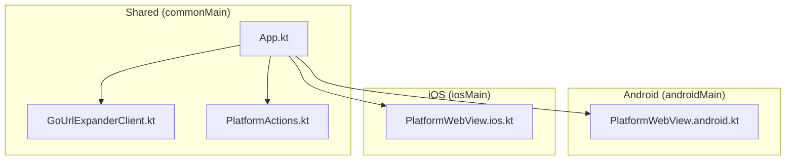
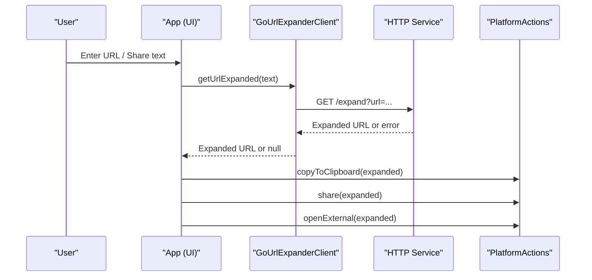
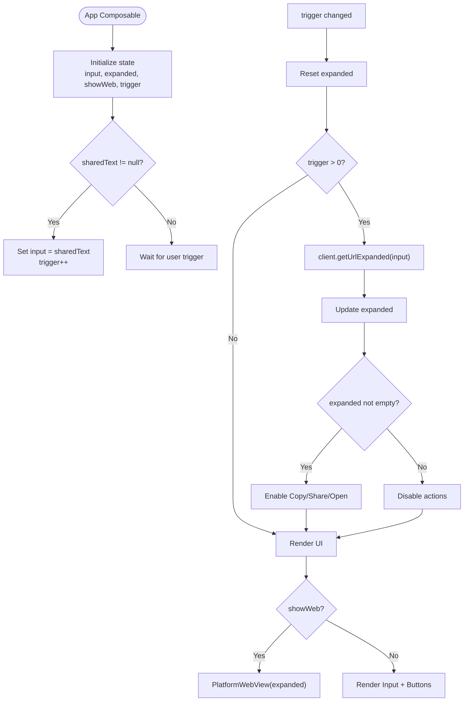
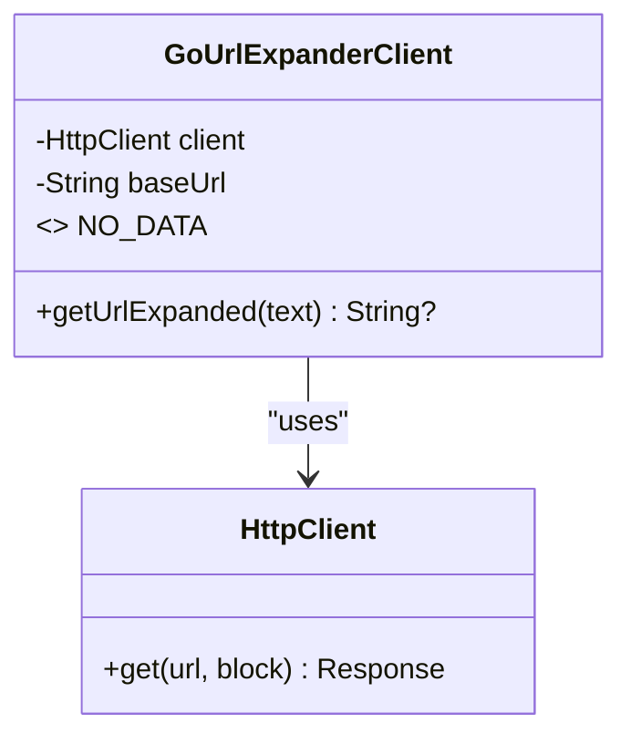
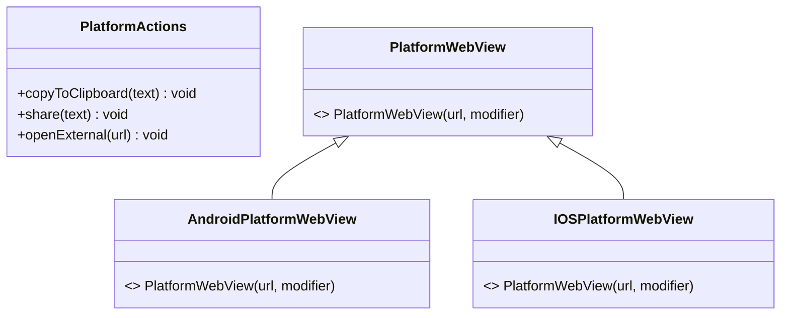
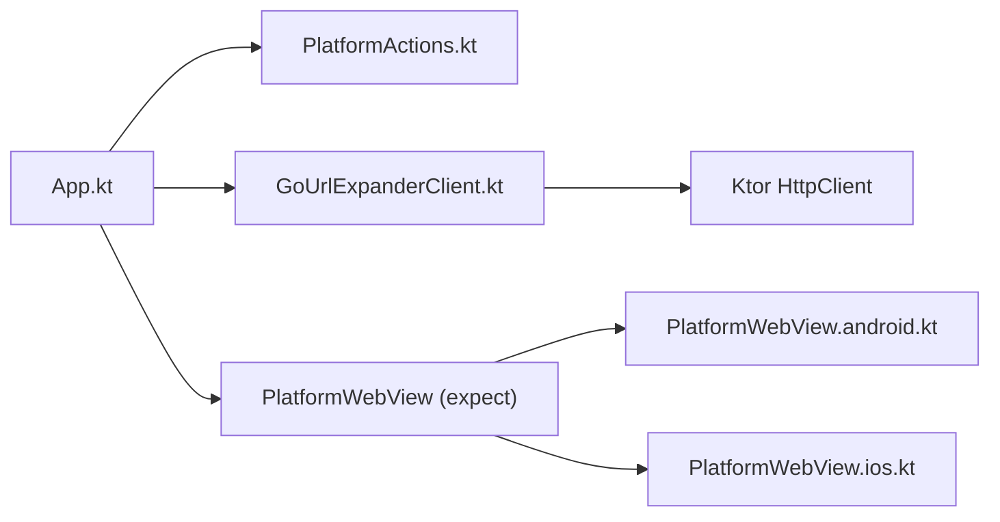

# Component Interactions and Dependencies

<cite>
**Referenced Files in This Document**
- [App.kt](file://composeApp/src/commonMain/kotlin/com/brunoshiroma/url_expander/App.kt)
- [GoUrlExpanderClient.kt](file://composeApp/src/commonMain/kotlin/com/brunoshiroma/url_expander/GoUrlExpanderClient.kt)
- [PlatformActions.kt](file://composeApp/src/commonMain/kotlin/com/brunoshiroma/url_expander/PlatformActions.kt)
- [PlatformWebView.android.kt](file://composeApp/src/androidMain/kotlin/com/brunoshiroma/url_expander/PlatformWebView.android.kt)
- [PlatformWebView.ios.kt](file://composeApp/src/iosMain/kotlin/com/brunoshiroma/url_expander/PlatformWebView.ios.kt)
- [GoUrlExpanderClientTest.kt](file://composeApp/src/commonTest/kotlin/com/brunoshiroma/url_expander/GoUrlExpanderClientTest.kt)
- [README.md](file://README.md)
</cite>

## Table of Contents
1. [Introduction](#introduction)
2. [Project Structure](#project-structure)
3. [Core Components](#core-components)
4. [Architecture Overview](#architecture-overview)
5. [Detailed Component Analysis](#detailed-component-analysis)
6. [Dependency Analysis](#dependency-analysis)
7. [Performance Considerations](#performance-considerations)
8. [Troubleshooting Guide](#troubleshooting-guide)
9. [Conclusion](#conclusion)

## Introduction
This document explains how the application’s UI orchestrates HTTP operations and native platform features through clear abstractions and dependency injection. The App component composes a URL expander client for network calls and a PlatformActions abstraction for clipboard, sharing, and external navigation. It also renders a platform-specific WebView to display expanded URLs. The architecture separates concerns across UI, business logic, and platform integration layers, enabling isolated testing and maintainable code.

## Project Structure
The project is a Kotlin Multiplatform Compose app with shared UI and networking in commonMain, and platform-specific implementations for Android and iOS:
- Shared layer (commonMain): UI composition, URL expansion client, and platform action interfaces.
- Android layer (androidMain): Activity entry point and WebView implementation.
- iOS layer (iosMain): ViewController host and WKWebView implementation.

**Diagram sources**
- [App.kt:36-126](file://composeApp/src/commonMain/kotlin/com/brunoshiroma/url_expander/App.kt#L36-L126)
- [GoUrlExpanderClient.kt:13-23](file://composeApp/src/commonMain/kotlin/com/brunoshiroma/url_expander/GoUrlExpanderClient.kt#L13-L23)
- [PlatformActions.kt:7-14](file://composeApp/src/commonMain/kotlin/com/brunoshiroma/url_expander/PlatformActions.kt#L7-L14)
- [PlatformWebView.android.kt:11-20](file://composeApp/src/androidMain/kotlin/com/brunoshiroma/url_expander/PlatformWebView.android.kt#L11-L20)
- [PlatformWebView.ios.kt:13-21](file://composeApp/src/iosMain/kotlin/com/brunoshiroma/url_expander/PlatformWebView.ios.kt#L13-L21)

**Section sources**
- [README.md:5-8](file://README.md#L5-L8)

## Core Components
- App: UI composition that coordinates user input, triggers URL expansion, and delegates platform actions.
- GoUrlExpanderClient: HTTP client wrapper that extracts URLs from text and calls an external service to expand them.
- PlatformActions: Abstraction for native operations like copy-to-clipboard, share, and opening external links.
- PlatformWebView: Platform-specific WebView composable declared as expect/actual to render URLs within the app.

Key responsibilities:
- App manages state, triggers expansion on user actions or incoming shared text, and invokes PlatformActions for side effects.
- GoUrlExpanderClient encapsulates HTTP requests using Ktor and returns expanded URLs or null on failure.
- PlatformActions hides platform differences behind a simple interface consumed by shared UI.
- PlatformWebView provides a consistent API to show web content on Android and iOS.

**Section sources**
- [App.kt:36-126](file://composeApp/src/commonMain/kotlin/com/brunoshiroma/url_expander/App.kt#L36-L126)
- [GoUrlExpanderClient.kt:9-27](file://composeApp/src/commonMain/kotlin/com/brunoshiroma/url_expander/GoUrlExpanderClient.kt#L9-L27)
- [PlatformActions.kt:7-14](file://composeApp/src/commonMain/kotlin/com/brunoshiroma/url_expander/PlatformActions.kt#L7-L14)

## Architecture Overview
The system follows a layered approach:
- UI Layer (App): Composes UI, holds state, and reacts to user interactions.
- Business Logic Layer (GoUrlExpanderClient): Performs URL extraction and HTTP expansion.
- Platform Integration Layer (PlatformActions + PlatformWebView): Encapsulates OS-specific capabilities.

**Diagram sources**
- [App.kt:56-61](file://composeApp/src/commonMain/kotlin/com/brunoshiroma/url_expander/App.kt#L56-L61)
- [GoUrlExpanderClient.kt:17-23](file://composeApp/src/commonMain/kotlin/com/brunoshiroma/url_expander/GoUrlExpanderClient.kt#L17-L23)
- [PlatformActions.kt:7-11](file://composeApp/src/commonMain/kotlin/com/brunoshiroma/url_expander/PlatformActions.kt#L7-L11)

## Detailed Component Analysis

### App Component
Responsibilities:
- Holds UI state for input, expanded result, and WebView visibility.
- Reacts to incoming shared text and manual triggers to expand URLs.
- Delegates platform operations via PlatformActions.
- Renders either the main form or the platform WebView based on state.

Dependency injection patterns:
- PlatformActions is injected as a constructor parameter, allowing test doubles or platform implementations to be provided at runtime.
- GoUrlExpanderClient is created with default parameters but can be replaced by injecting a custom instance when needed.

Communication flow:
- On trigger changes, App calls client.getUrlExpanded(input).
- On success, App enables actions and allows copying, sharing, or opening the URL.
- When showing the WebView, App passes the expanded URL to PlatformWebView.

**Diagram sources**
- [App.kt:36-126](file://composeApp/src/commonMain/kotlin/com/brunoshiroma/url_expander/App.kt#L36-L126)

**Section sources**
- [App.kt:36-126](file://composeApp/src/commonMain/kotlin/com/brunoshiroma/url_expander/App.kt#L36-L126)

### GoUrlExpanderClient
Responsibilities:
- Extracts URLs from arbitrary text using a regex helper.
- Calls the remote expand endpoint with the extracted URL.
- Returns the expanded URL string on success; returns null otherwise.

Constructor parameters and defaults:
- HttpClient: Injected for testability; defaults to a new instance.
- baseUrl: Configurable base URL; defaults to the production service.

Processing logic:
- If input equals a sentinel value, return null immediately.
- Extract URL; if none found, return null.
- Perform HTTP GET with url parameter; return body if status indicates success, else null.

**Diagram sources**
- [GoUrlExpanderClient.kt:13-27](file://composeApp/src/commonMain/kotlin/com/brunoshiroma/url_expander/GoUrlExpanderClient.kt#L13-L27)

**Section sources**
- [GoUrlExpanderClient.kt:9-27](file://composeApp/src/commonMain/kotlin/com/brunoshiroma/url_expander/GoUrlExpanderClient.kt#L9-L27)

### PlatformActions and PlatformWebView
Abstractions:
- PlatformActions defines methods for clipboard, sharing, and external navigation.
- PlatformWebView is declared as an expect function to provide platform-specific WebView implementations.

Platform implementations:
- Android: Uses Android WebView with JavaScript enabled.
- iOS: Uses WKWebView via UIKitView interop.

**Diagram sources**
- [PlatformActions.kt:7-14](file://composeApp/src/commonMain/kotlin/com/brunoshiroma/url_expander/PlatformActions.kt#L7-L14)
- [PlatformWebView.android.kt:11-20](file://composeApp/src/androidMain/kotlin/com/brunoshiroma/url_expander/PlatformWebView.android.kt#L11-L20)
- [PlatformWebView.ios.kt:13-21](file://composeApp/src/iosMain/kotlin/com/brunoshiroma/url_expander/PlatformWebView.ios.kt#L13-L21)

**Section sources**
- [PlatformActions.kt:7-14](file://composeApp/src/commonMain/kotlin/com/brunoshiroma/url_expander/PlatformActions.kt#L7-L14)
- [PlatformWebView.android.kt:11-20](file://composeApp/src/androidMain/kotlin/com/brunoshiroma/url_expander/PlatformWebView.android.kt#L11-L20)
- [PlatformWebView.ios.kt:13-21](file://composeApp/src/iosMain/kotlin/com/brunoshiroma/url_expander/PlatformWebView.ios.kt#L13-L21)

## Dependency Analysis
Coupling and cohesion:
- App depends on PlatformActions and GoUrlExpanderClient via constructor parameters, promoting loose coupling and testability.
- GoUrlExpanderClient depends on Ktor’s HttpClient, which is injected to allow mocking in tests.
- PlatformWebView is decoupled from App through the expect/actual mechanism, keeping shared UI independent of platform details.

Direct dependencies:
- App -> PlatformActions (interface)
- App -> GoUrlExpanderClient (class)
- GoUrlExpanderClient -> HttpClient (external library)
- App -> PlatformWebView (expect/actual)

Potential circular dependencies:
- None observed; dependencies are one-directional from UI to services and platform abstractions.

External integrations:
- Ktor HTTP client for network requests.
- Android WebView and iOS WKWebView for in-app browsing.

**Diagram sources**
- [App.kt:36-126](file://composeApp/src/commonMain/kotlin/com/brunoshiroma/url_expander/App.kt#L36-L126)
- [GoUrlExpanderClient.kt:13-23](file://composeApp/src/commonMain/kotlin/com/brunoshiroma/url_expander/GoUrlExpanderClient.kt#L13-L23)
- [PlatformActions.kt:7-14](file://composeApp/src/commonMain/kotlin/com/brunoshiroma/url_expander/PlatformActions.kt#L7-L14)
- [PlatformWebView.android.kt:11-20](file://composeApp/src/androidMain/kotlin/com/brunoshiroma/url_expander/PlatformWebView.android.kt#L11-L20)
- [PlatformWebView.ios.kt:13-21](file://composeApp/src/iosMain/kotlin/com/brunoshiroma/url_expander/PlatformWebView.ios.kt#L13-L21)

**Section sources**
- [App.kt:36-126](file://composeApp/src/commonMain/kotlin/com/brunoshiroma/url_expander/App.kt#L36-L126)
- [GoUrlExpanderClient.kt:13-23](file://composeApp/src/commonMain/kotlin/com/brunoshiroma/url_expander/GoUrlExpanderClient.kt#L13-L23)
- [PlatformActions.kt:7-14](file://composeApp/src/commonMain/kotlin/com/brunoshiroma/url_expander/PlatformActions.kt#L7-L14)

## Performance Considerations
- Network latency: Expansion relies on an external HTTP service; consider caching expanded results per URL to reduce redundant calls.
- State updates: Avoid unnecessary recompositions by minimizing trigger increments and ensuring state changes are minimal.
- WebView rendering: Large or complex pages may impact performance; consider lazy loading or limiting WebView lifecycle scope.
- Error handling: Fail fast on invalid inputs to prevent unnecessary network requests.

[No sources needed since this section provides general guidance]

## Troubleshooting Guide
Common issues and resolutions:
- No data sentinel: Passing the sentinel value to the client returns null; ensure input validation before calling the client.
- Non-success HTTP responses: The client returns null on non-success status codes; verify server availability and response format.
- URL extraction failures: If no URL is found in the input, the client returns null; validate user input and provide feedback.
- Platform actions not available: Ensure PlatformActions is properly implemented on each platform and passed into App.

Testing strategies:
- Use MockEngine to simulate HTTP responses and assert request encoding and behavior under different statuses.
- Validate URL extraction logic with various inputs to ensure robustness.
- Provide mock PlatformActions implementations in tests to verify UI interactions without invoking real platform APIs.

**Section sources**
- [GoUrlExpanderClientTest.kt:12-43](file://composeApp/src/commonTest/kotlin/com/brunoshiroma/url_expander/GoUrlExpanderClientTest.kt#L12-L43)
- [GoUrlExpanderClient.kt:17-23](file://composeApp/src/commonMain/kotlin/com/brunoshiroma/url_expander/GoUrlExpanderClient.kt#L17-L23)

## Conclusion
The application cleanly separates UI, business logic, and platform integration. App orchestrates URL expansion via GoUrlExpanderClient and delegates native operations through PlatformActions. Dependency injection and expect/actual patterns enable flexible testing and platform-specific implementations. This structure supports maintainability, scalability, and reliable isolated testing.

[No sources needed since this section summarizes without analyzing specific files]