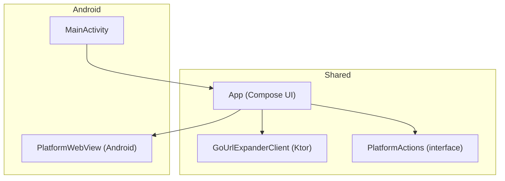
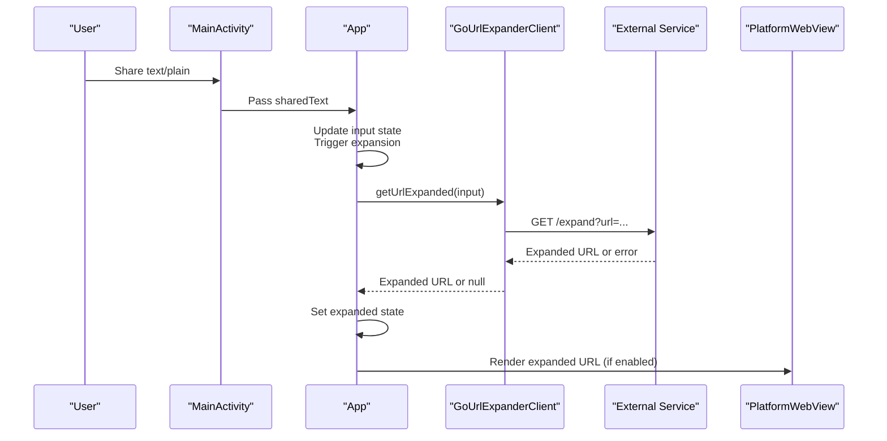
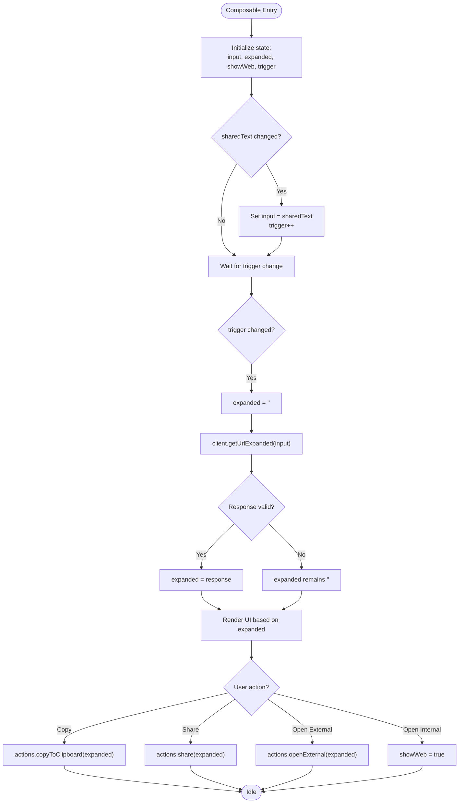
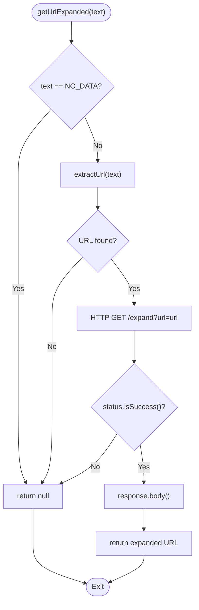
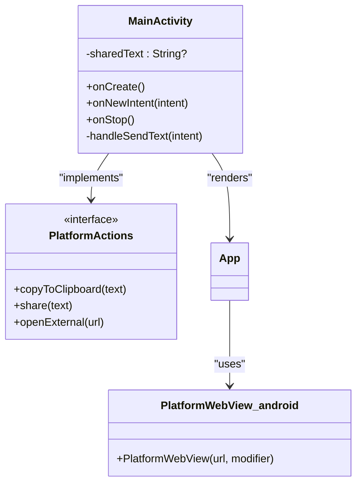
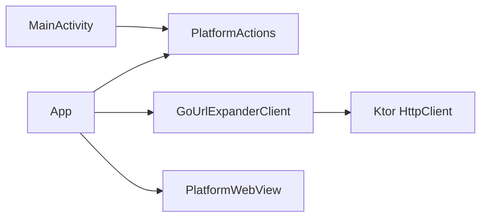

# Data Flow and State Management

<cite>
**Referenced Files in This Document**
- [App.kt](file://composeApp/src/commonMain/kotlin/com/brunoshiroma/url_expander/App.kt)
- [GoUrlExpanderClient.kt](file://composeApp/src/commonMain/kotlin/com/brunoshiroma/url_expander/GoUrlExpanderClient.kt)
- [PlatformActions.kt](file://composeApp/src/commonMain/kotlin/com/brunoshiroma/url_expander/PlatformActions.kt)
- [MainActivity.kt](file://composeApp/src/androidMain/kotlin/com/brunoshiroma/url_expander/MainActivity.kt)
- [PlatformWebView.android.kt](file://composeApp/src/androidMain/kotlin/com/brunoshiroma/url_expander/PlatformWebView.android.kt)
</cite>

## Table of Contents
1. [Introduction](#introduction)
2. [Project Structure](#project-structure)
3. [Core Components](#core-components)
4. [Architecture Overview](#architecture-overview)
5. [Detailed Component Analysis](#detailed-component-analysis)
6. [Dependency Analysis](#dependency-analysis)
7. [Performance Considerations](#performance-considerations)
8. [Troubleshooting Guide](#troubleshooting-guide)
9. [Conclusion](#conclusion)

## Introduction
This document explains how user input flows through the application from text entry to URL expansion results, focusing on Compose state management with remember and mutableStateOf, coroutine-based asynchronous operations using LaunchedEffect, and error handling patterns. It also details the data transformation pipeline that converts raw text into extracted URLs, performs HTTP requests to an external service, and processes responses for display or further actions.

## Project Structure
The app is a Kotlin Multiplatform + Compose Multiplatform project:
- Shared UI and client logic live under commonMain.
- Android-specific entry point and platform integrations live under androidMain.
- The shared UI composes the main App screen, which manages local state and triggers network requests via a Ktor-based client.

**Diagram sources**
- [MainActivity.kt:15-60](file://composeApp/src/androidMain/kotlin/com/brunoshiroma/url_expander/MainActivity.kt#L15-L60)
- [App.kt:34-126](file://composeApp/src/commonMain/kotlin/com/brunoshiroma/url_expander/App.kt#L34-L126)
- [GoUrlExpanderClient.kt:13-28](file://composeApp/src/commonMain/kotlin/com/brunoshiroma/url_expander/GoUrlExpanderClient.kt#L13-L28)
- [PlatformActions.kt:6-14](file://composeApp/src/commonMain/kotlin/com/brunoshiroma/url_expander/PlatformActions.kt#L6-L14)
- [PlatformWebView.android.kt:9-21](file://composeApp/src/androidMain/kotlin/com/brunoshiroma/url_expander/PlatformWebView.android.kt#L9-L21)

**Section sources**
- [MainActivity.kt:15-60](file://composeApp/src/androidMain/kotlin/com/brunoshiroma/url_expander/MainActivity.kt#L15-L60)
- [App.kt:34-126](file://composeApp/src/commonMain/kotlin/com/brunoshiroma/url_expander/App.kt#L34-L126)
- [GoUrlExpanderClient.kt:13-28](file://composeApp/src/commonMain/kotlin/com/brunoshiroma/url_expander/GoUrlExpanderClient.kt#L13-L28)
- [PlatformActions.kt:6-14](file://composeApp/src/commonMain/kotlin/com/brunoshiroma/url_expander/PlatformActions.kt#L6-L14)
- [PlatformWebView.android.kt:9-21](file://composeApp/src/androidMain/kotlin/com/brunoshiroma/url_expander/PlatformWebView.android.kt#L9-L21)

## Core Components
- App: The main Composable that owns UI state (input, expanded result, web view visibility), reacts to shared text, and triggers expansion.
- GoUrlExpanderClient: Extracts a URL from text and calls an external service using Ktor; returns the expanded URL string or null.
- PlatformActions: Interface abstracting clipboard, share, and open external actions.
- MainActivity: Android entry point that receives shared text and wires up PlatformActions.
- PlatformWebView (Android): Renders the expanded URL in a WebView.

Key responsibilities:
- State ownership and lifecycle in App.
- Text-to-URL extraction and HTTP request orchestration in GoUrlExpanderClient.
- Platform integration via PlatformActions and PlatformWebView.

**Section sources**
- [App.kt:34-126](file://composeApp/src/commonMain/kotlin/com/brunoshiroma/url_expander/App.kt#L34-L126)
- [GoUrlExpanderClient.kt:9-28](file://composeApp/src/commonMain/kotlin/com/brunoshiroma/url_expander/GoUrlExpanderClient.kt#L9-L28)
- [PlatformActions.kt:6-14](file://composeApp/src/commonMain/kotlin/com/brunoshiroma/url_expander/PlatformActions.kt#L6-L14)
- [MainActivity.kt:15-60](file://composeApp/src/androidMain/kotlin/com/brunoshiroma/url_expander/MainActivity.kt#L15-L60)
- [PlatformWebView.android.kt:9-21](file://composeApp/src/androidMain/kotlin/com/brunoshiroma/url_expander/PlatformWebView.android.kt#L9-L21)

## Architecture Overview
The system follows a unidirectional data flow:
- User input or shared text updates local state.
- A trigger variable drives a LaunchedEffect that resets and recomputes the expanded URL.
- The client extracts a URL and performs an HTTP GET to an external service.
- Success sets the expanded state; failure leaves it empty.
- UI reacts to state changes to enable/disable actions and render content.

**Diagram sources**
- [MainActivity.kt:56-60](file://composeApp/src/androidMain/kotlin/com/brunoshiroma/url_expander/MainActivity.kt#L56-L60)
- [App.kt:49-61](file://composeApp/src/commonMain/kotlin/com/brunoshiroma/url_expander/App.kt#L49-L61)
- [GoUrlExpanderClient.kt:17-23](file://composeApp/src/commonMain/kotlin/com/brunoshiroma/url_expander/GoUrlExpanderClient.kt#L17-L23)
- [PlatformWebView.android.kt:9-21](file://composeApp/src/androidMain/kotlin/com/brunoshiroma/url_expander/PlatformWebView.android.kt#L9-L21)

## Detailed Component Analysis

### App Composable: State and Reactive Updates
- Local state variables:
  - input: current text input value.
  - expanded: result of URL expansion.
  - showWeb: toggles between form and internal WebView.
  - trigger: integer used to drive recomputation via LaunchedEffect.
  - snackbar: host state for transient messages.
- Shared text handling:
  - When sharedText changes, input is set and trigger increments to start expansion.
- Expansion pipeline:
  - On trigger change, expanded is reset and then computed by calling client.getUrlExpanded(input).
  - Errors are swallowed via runCatching and getOrNull, resulting in an empty expanded state.
- UI reactions:
  - Button enabled depends on expanded being non-empty.
  - Copy, Share, Open external, and Open internal actions depend on expanded state.
  - Internal WebView shows when showWeb is true.

**Diagram sources**
- [App.kt:42-61](file://composeApp/src/commonMain/kotlin/com/brunoshiroma/url_expander/App.kt#L42-L61)
- [App.kt:63-121](file://composeApp/src/commonMain/kotlin/com/brunoshiroma/url_expander/App.kt#L63-L121)

**Section sources**
- [App.kt:42-61](file://composeApp/src/commonMain/kotlin/com/brunoshiroma/url_expander/App.kt#L42-L61)
- [App.kt:63-121](file://composeApp/src/commonMain/kotlin/com/brunoshiroma/url_expander/App.kt#L63-L121)

### GoUrlExpanderClient: Data Transformation and Networking
- Input validation:
  - If input equals NO_DATA, return null.
- URL extraction:
  - Uses a regex to find the first http/https URL substring.
- Network call:
  - Performs a GET request to baseUrl/expand with url parameter.
  - Returns body if status is success; otherwise returns null.

**Diagram sources**
- [GoUrlExpanderClient.kt:9-23](file://composeApp/src/commonMain/kotlin/com/brunoshiroma/url_expander/GoUrlExpanderClient.kt#L9-L23)

**Section sources**
- [GoUrlExpanderClient.kt:9-23](file://composeApp/src/commonMain/kotlin/com/brunoshiroma/url_expander/GoUrlExpanderClient.kt#L9-L23)

### MainActivity and Platform Integrations
- Receives shared text via Intent.ACTION_SEND and stores it in a mutableState.
- Wires PlatformActions implementations for clipboard, share, and opening external links.
- Launches the shared App with sharedText and actions.

**Diagram sources**
- [MainActivity.kt:15-60](file://composeApp/src/androidMain/kotlin/com/brunoshiroma/url_expander/MainActivity.kt#L15-L60)
- [PlatformActions.kt:6-14](file://composeApp/src/commonMain/kotlin/com/brunoshiroma/url_expander/PlatformActions.kt#L6-L14)
- [PlatformWebView.android.kt:9-21](file://composeApp/src/androidMain/kotlin/com/brunoshiroma/url_expander/PlatformWebView.android.kt#L9-L21)

**Section sources**
- [MainActivity.kt:15-60](file://composeApp/src/androidMain/kotlin/com/brunoshiroma/url_expander/MainActivity.kt#L15-L60)
- [PlatformActions.kt:6-14](file://composeApp/src/commonMain/kotlin/com/brunoshiroma/url_expander/PlatformActions.kt#L6-L14)
- [PlatformWebView.android.kt:9-21](file://composeApp/src/androidMain/kotlin/com/brunoshiroma/url_expander/PlatformWebView.android.kt#L9-L21)

## Dependency Analysis
- App depends on:
  - PlatformActions for platform operations.
  - GoUrlExpanderClient for URL expansion.
  - PlatformWebView for rendering expanded URLs internally.
- GoUrlExpanderClient depends on:
  - Ktor HttpClient for networking.
  - Regex for URL extraction.
- MainActivity depends on:
  - Android APIs for clipboard, sharing, and intents.
  - PlatformActions interface.

**Diagram sources**
- [App.kt:34-126](file://composeApp/src/commonMain/kotlin/com/brunoshiroma/url_expander/App.kt#L34-L126)
- [GoUrlExpanderClient.kt:3-23](file://composeApp/src/commonMain/kotlin/com/brunoshiroma/url_expander/GoUrlExpanderClient.kt#L3-L23)
- [PlatformActions.kt:6-14](file://composeApp/src/commonMain/kotlin/com/brunoshiroma/url_expander/PlatformActions.kt#L6-L14)
- [MainActivity.kt:15-60](file://composeApp/src/androidMain/kotlin/com/brunoshiroma/url_expander/MainActivity.kt#L15-L60)

**Section sources**
- [App.kt:34-126](file://composeApp/src/commonMain/kotlin/com/brunoshiroma/url_expander/App.kt#L34-L126)
- [GoUrlExpanderClient.kt:3-23](file://composeApp/src/commonMain/kotlin/com/brunoshiroma/url_expander/GoUrlExpanderClient.kt#L3-L23)
- [PlatformActions.kt:6-14](file://composeApp/src/commonMain/kotlin/com/brunoshiroma/url_expander/PlatformActions.kt#L6-L14)
- [MainActivity.kt:15-60](file://composeApp/src/androidMain/kotlin/com/brunoshiroma/url_expander/MainActivity.kt#L15-L60)

## Performance Considerations
- Avoid unnecessary recompositions:
  - Use remember for stable objects like SnackbarHostState and client instances.
  - Keep trigger increment minimal and only when needed.
- Network efficiency:
  - Ensure baseUrl is constant and reuse the same HttpClient instance.
  - Consider adding timeouts and cancellation via coroutine scope if needed.
- UI responsiveness:
  - Offload heavy work (e.g., parsing) to background coroutines if complexity increases.
  - Debounce rapid input changes if expanding on every keystroke becomes costly.

[No sources needed since this section provides general guidance]

## Troubleshooting Guide
Common issues and resolutions:
- Expanded result remains empty:
  - Verify input contains a valid http/https URL.
  - Check network connectivity and external service availability.
  - Inspect response status; non-successful responses yield null.
- Clipboard/share/open actions disabled:
  - These buttons are enabled only when expanded is non-empty.
  - Ensure successful expansion before attempting actions.
- Internal WebView not showing:
  - Confirm showWeb is set to true after successful expansion.
  - Validate that the expanded URL is well-formed.

Error handling patterns in code:
- App uses runCatching and getOrNull to convert exceptions into empty expanded state.
- Client returns null for invalid inputs or unsuccessful HTTP responses.

**Section sources**
- [App.kt:56-61](file://composeApp/src/commonMain/kotlin/com/brunoshiroma/url_expander/App.kt#L56-L61)
- [GoUrlExpanderClient.kt:17-23](file://composeApp/src/commonMain/kotlin/com/brunoshiroma/url_expander/GoUrlExpanderClient.kt#L17-L23)

## Conclusion
The application implements a clear, reactive data flow driven by Compose state and coroutines. User input or shared text updates local state, triggering a LaunchedEffect that computes the expanded URL via a Ktor client. Error handling ensures robust behavior by defaulting to empty states on failures. PlatformActions abstract platform-specific operations, while PlatformWebView renders the final URL internally. This design yields predictable state transitions and responsive UI updates across platforms.