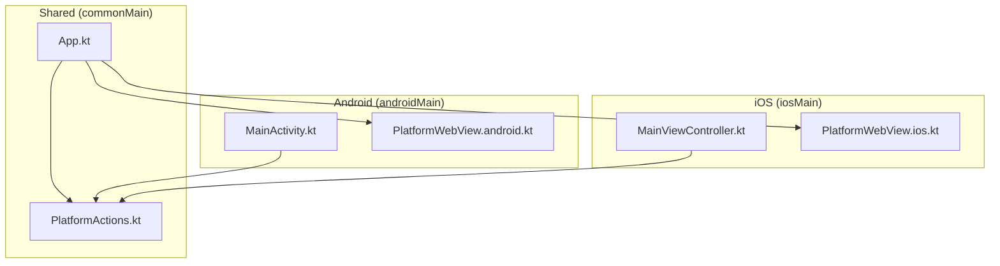
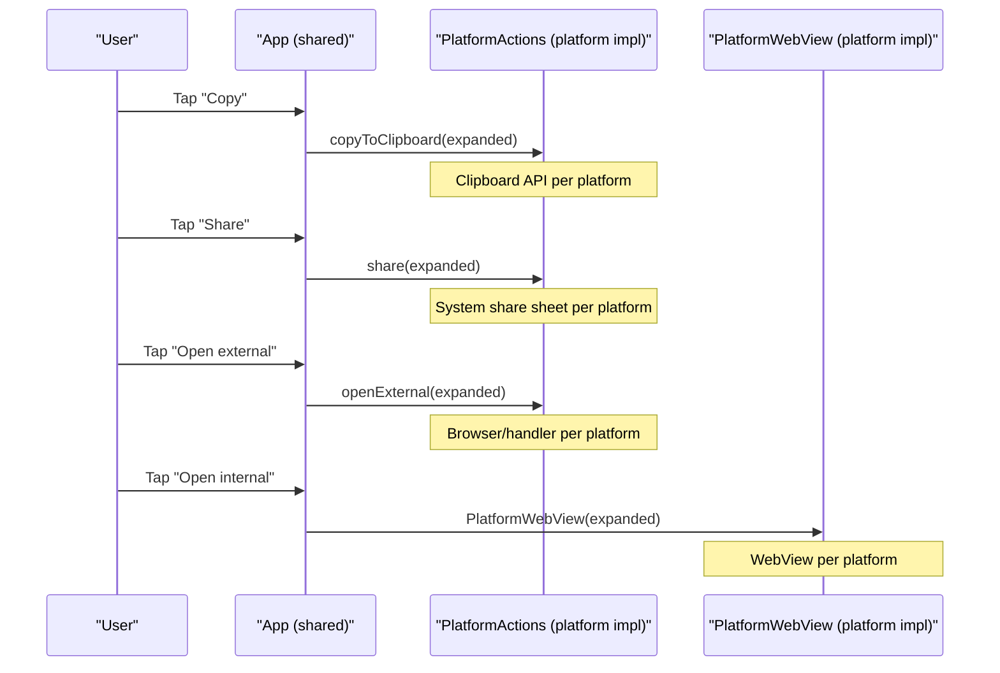
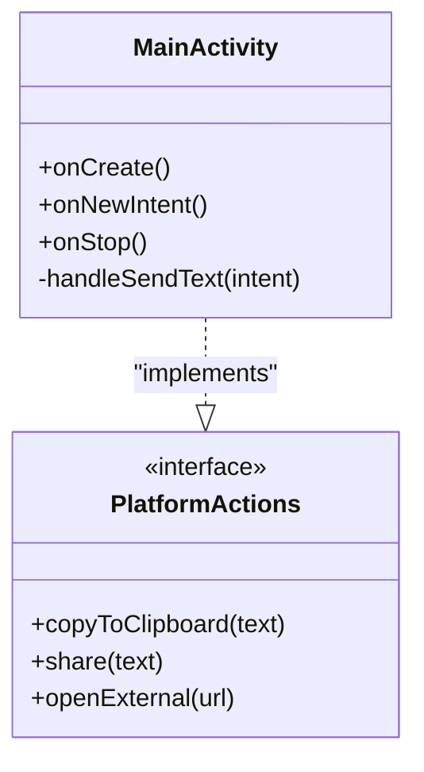
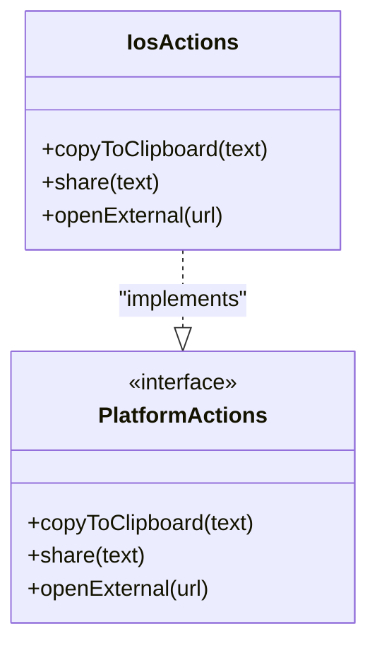
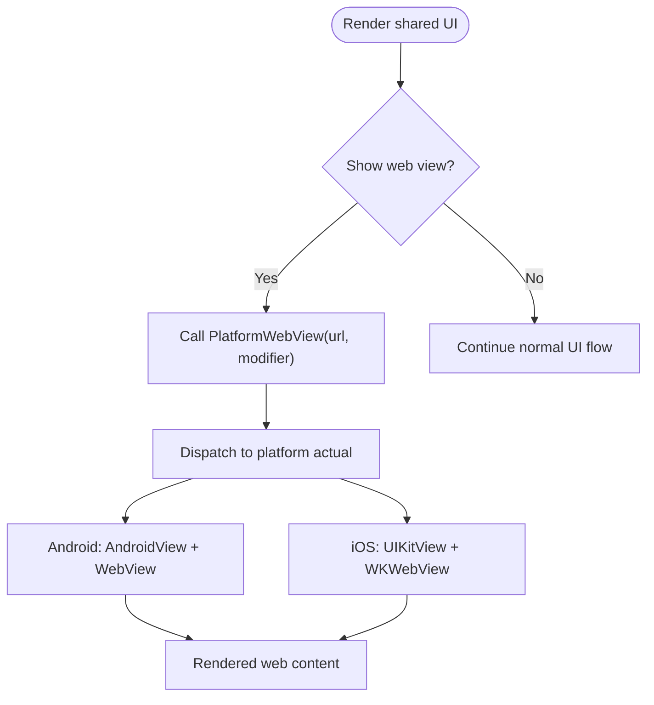
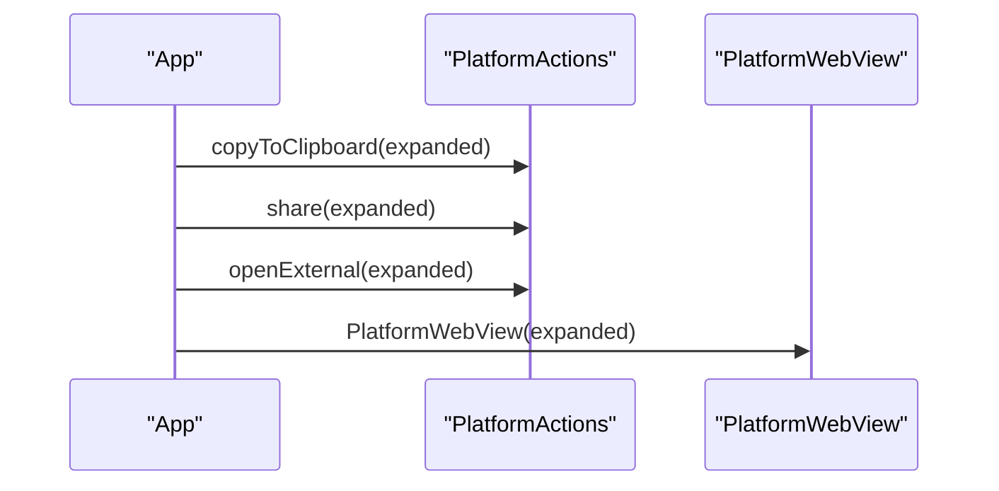
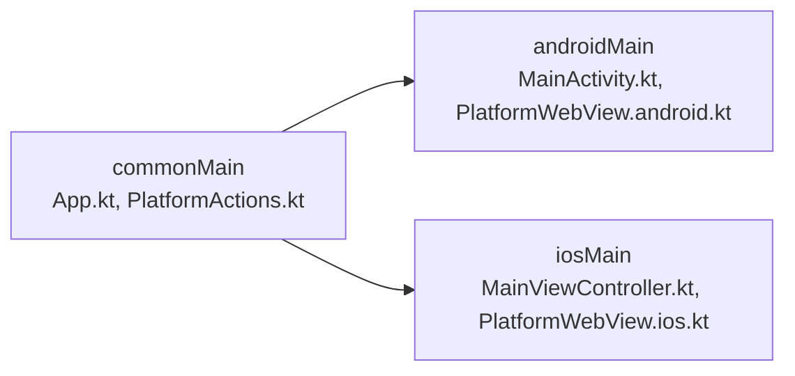

# Platform Abstraction Pattern

<cite>
**Referenced Files in This Document**
- [README.md](file://README.md)
- [PlatformActions.kt](file://composeApp/src/commonMain/kotlin/com/brunoshiroma/url_expander/PlatformActions.kt)
- [App.kt](file://composeApp/src/commonMain/kotlin/com/brunoshiroma/url_expander/App.kt)
- [MainActivity.kt](file://composeApp/src/androidMain/kotlin/com/brunoshiroma/url_expander/MainActivity.kt)
- [PlatformWebView.android.kt](file://composeApp/src/androidMain/kotlin/com/brunoshiroma/url_expander/PlatformWebView.android.kt)
- [MainViewController.kt](file://composeApp/src/iosMain/kotlin/com/brunoshiroma/url_expander/MainViewController.kt)
- [PlatformWebView.ios.kt](file://composeApp/src/iosMain/kotlin/com/brunoshiroma/url_expander/PlatformWebView.ios.kt)
</cite>

## Table of Contents
1. [Introduction](#introduction)
2. [Project Structure](#project-structure)
3. [Core Components](#core-components)
4. [Architecture Overview](#architecture-overview)
5. [Detailed Component Analysis](#detailed-component-analysis)
6. [Dependency Analysis](#dependency-analysis)
7. [Performance Considerations](#performance-considerations)
8. [Troubleshooting Guide](#troubleshooting-guide)
9. [Conclusion](#conclusion)
10. [Appendices](#appendices)

## Introduction
This document explains the platform abstraction pattern used in a Kotlin Multiplatform + Compose Multiplatform application that expands URLs and provides platform-specific actions such as clipboard operations, sharing, external URL opening, and web viewing. The shared UI lives in common code and delegates platform-specific behavior to an interface and expect/actual declarations. Android and iOS each provide concrete implementations for these abstractions while keeping business logic centralized.

## Project Structure
The project is organized by source sets:
- commonMain: Shared UI (Compose), client, and platform abstraction definitions.
- androidMain: Android Activity hosting the app, platform action implementations, and WebView using Android WebView.
- iosMain: iOS view controller hosting the app, platform action implementations, and WebView using WKWebView.

**Diagram sources**
- [App.kt:36-126](file://composeApp/src/commonMain/kotlin/com/brunoshiroma/url_expander/App.kt#L36-L126)
- [PlatformActions.kt:6-14](file://composeApp/src/commonMain/kotlin/com/brunoshiroma/url_expander/PlatformActions.kt#L6-L14)
- [MainActivity.kt:15-42](file://composeApp/src/androidMain/kotlin/com/brunoshiroma/url_expander/MainActivity.kt#L15-L42)
- [PlatformWebView.android.kt:9-21](file://composeApp/src/androidMain/kotlin/com/brunoshiroma/url_expander/PlatformWebView.android.kt#L9-L21)
- [MainViewController.kt:9-25](file://composeApp/src/iosMain/kotlin/com/brunoshiroma/url_expander/MainViewController.kt#L9-L25)
- [PlatformWebView.ios.kt:11-22](file://composeApp/src/iosMain/kotlin/com/brunoshiroma/url_expander/PlatformWebView.ios.kt#L11-L22)

**Section sources**
- [README.md:1-18](file://README.md#L1-L18)

## Core Components
- PlatformActions: An interface defining platform-specific operations used by shared UI:
  - copyToClipboard(text): Copy text to system clipboard.
  - share(text): Share text via system share sheet.
  - openExternal(url): Open a URL in the default browser or handler.
- expect/actual PlatformWebView: A composable declared with expect in common code and implemented with actual on each platform to render a web view.

These abstractions allow the shared UI to remain platform-agnostic while delegating OS-specific behaviors to platform modules.

**Section sources**
- [PlatformActions.kt:6-14](file://composeApp/src/commonMain/kotlin/com/brunoshiroma/url_expander/PlatformActions.kt#L6-L14)

## Architecture Overview
The shared App composable receives a PlatformActions instance and uses it to perform clipboard, share, and external URL operations. It also conditionally renders a PlatformWebView based on user interaction. Each platform supplies its own implementation of PlatformActions and PlatformWebView.

**Diagram sources**
- [App.kt:103-120](file://composeApp/src/commonMain/kotlin/com/brunoshiroma/url_expander/App.kt#L103-L120)
- [PlatformActions.kt:6-14](file://composeApp/src/commonMain/kotlin/com/brunoshiroma/url_expander/PlatformActions.kt#L6-L14)
- [PlatformWebView.android.kt:9-21](file://composeApp/src/androidMain/kotlin/com/brunoshiroma/url_expander/PlatformWebView.android.kt#L9-L21)
- [PlatformWebView.ios.kt:11-22](file://composeApp/src/iosMain/kotlin/com/brunoshiroma/url_expander/PlatformWebView.ios.kt#L11-L22)

## Detailed Component Analysis

### PlatformActions Interface Design
The PlatformActions interface centralizes all platform-dependent interactions required by the shared UI. This design:
- Keeps shared UI free from platform APIs.
- Enables easy addition of new platform features by extending the interface and implementing them per platform.
- Encourages consistent behavior across platforms through explicit contracts.

Key responsibilities:
- Clipboard access: copyToClipboard
- Sharing: share
- External navigation: openExternal

Best practices:
- Keep methods simple and focused on one capability.
- Return void or minimal results; handle errors within the platform implementation and surface user feedback via UI if needed.

**Section sources**
- [PlatformActions.kt:6-11](file://composeApp/src/commonMain/kotlin/com/brunoshiroma/url_expander/PlatformActions.kt#L6-L11)

### Android Implementation of PlatformActions
Android’s MainActivity implements PlatformActions using Android APIs:
- ClipboardManager for copying text.
- Intent.ACTION_SEND for sharing via the system chooser.
- Intent.ACTION_VIEW for opening URLs externally.

It also hosts the shared App composable and injects the PlatformActions implementation.

**Diagram sources**
- [MainActivity.kt:15-42](file://composeApp/src/androidMain/kotlin/com/brunoshiroma/url_expander/MainActivity.kt#L15-L42)
- [PlatformActions.kt:6-11](file://composeApp/src/commonMain/kotlin/com/brunoshiroma/url_expander/PlatformActions.kt#L6-L11)

**Section sources**
- [MainActivity.kt:15-62](file://composeApp/src/androidMain/kotlin/com/brunoshiroma/url_expander/MainActivity.kt#L15-L62)

### iOS Implementation of PlatformActions
iOS’s MainViewController defines a private object implementing PlatformActions using UIKit and Foundation:
- UIPasteboard for clipboard.
- UIActivityViewController for sharing.
- UIApplication.openURL for external URL handling.

It exposes a function to create the ComposeUIViewController and injects the PlatformActions into the shared App.

**Diagram sources**
- [MainViewController.kt:9-25](file://composeApp/src/iosMain/kotlin/com/brunoshiroma/url_expander/MainViewController.kt#L9-L25)
- [PlatformActions.kt:6-11](file://composeApp/src/commonMain/kotlin/com/brunoshiroma/url_expander/PlatformActions.kt#L6-L11)

**Section sources**
- [MainViewController.kt:9-25](file://composeApp/src/iosMain/kotlin/com/brunoshiroma/url_expander/MainViewController.kt#L9-L25)

### expect/actual PlatformWebView
The shared UI declares an expect composable PlatformWebView(url, modifier). Each platform provides an actual implementation:
- Android: Uses AndroidView to host a native WebView, enabling JavaScript and loading the provided URL.
- iOS: Uses UIKitView to host a WKWebView and loads the URL via NSURLRequest.

**Diagram sources**
- [PlatformActions.kt:13-14](file://composeApp/src/commonMain/kotlin/com/brunoshiroma/url_expander/PlatformActions.kt#L13-L14)
- [PlatformWebView.android.kt:9-21](file://composeApp/src/androidMain/kotlin/com/brunoshiroma/url_expander/PlatformWebView.android.kt#L9-L21)
- [PlatformWebView.ios.kt:11-22](file://composeApp/src/iosMain/kotlin/com/brunoshiroma/url_expander/PlatformWebView.ios.kt#L11-L22)

**Section sources**
- [PlatformWebView.android.kt:9-21](file://composeApp/src/androidMain/kotlin/com/brunoshiroma/url_expander/PlatformWebView.android.kt#L9-L21)
- [PlatformWebView.ios.kt:11-22](file://composeApp/src/iosMain/kotlin/com/brunoshiroma/url_expander/PlatformWebView.ios.kt#L11-L22)

### Shared UI Integration
The shared App composable:
- Accepts a PlatformActions instance and uses it for clipboard, share, and external URL operations.
- Conditionally renders PlatformWebView when the user chooses to open the expanded URL internally.
- Manages state for input, expanded result, and web view visibility.

**Diagram sources**
- [App.kt:103-120](file://composeApp/src/commonMain/kotlin/com/brunoshiroma/url_expander/App.kt#L103-L120)
- [PlatformActions.kt:6-14](file://composeApp/src/commonMain/kotlin/com/brunoshiroma/url_expander/PlatformActions.kt#L6-L14)

**Section sources**
- [App.kt:36-126](file://composeApp/src/commonMain/kotlin/com/brunoshiroma/url_expander/App.kt#L36-L126)

## Dependency Analysis
The following diagram shows how shared components depend on platform abstractions and how platform modules implement them.

**Diagram sources**
- [App.kt:36-126](file://composeApp/src/commonMain/kotlin/com/brunoshiroma/url_expander/App.kt#L36-L126)
- [PlatformActions.kt:6-14](file://composeApp/src/commonMain/kotlin/com/brunoshiroma/url_expander/PlatformActions.kt#L6-L14)
- [MainActivity.kt:15-42](file://composeApp/src/androidMain/kotlin/com/brunoshiroma/url_expander/MainActivity.kt#L15-L42)
- [PlatformWebView.android.kt:9-21](file://composeApp/src/androidMain/kotlin/com/brunoshiroma/url_expander/PlatformWebView.android.kt#L9-L21)
- [MainViewController.kt:9-25](file://composeApp/src/iosMain/kotlin/com/brunoshiroma/url_expander/MainViewController.kt#L9-L25)
- [PlatformWebView.ios.kt:11-22](file://composeApp/src/iosMain/kotlin/com/brunoshiroma/url_expander/PlatformWebView.ios.kt#L11-L22)

**Section sources**
- [App.kt:36-126](file://composeApp/src/commonMain/kotlin/com/brunoshiroma/url_expander/App.kt#L36-L126)
- [PlatformActions.kt:6-14](file://composeApp/src/commonMain/kotlin/com/brunoshiroma/url_expander/PlatformActions.kt#L6-L14)
- [MainActivity.kt:15-62](file://composeApp/src/androidMain/kotlin/com/brunoshiroma/url_expander/MainActivity.kt#L15-L62)
- [PlatformWebView.android.kt:9-21](file://composeApp/src/androidMain/kotlin/com/brunoshiroma/url_expander/PlatformWebView.android.kt#L9-L21)
- [MainViewController.kt:9-25](file://composeApp/src/iosMain/kotlin/com/brunoshiroma/url_expander/MainViewController.kt#L9-L25)
- [PlatformWebView.ios.kt:11-22](file://composeApp/src/iosMain/kotlin/com/brunoshiroma/url_expander/PlatformWebView.ios.kt#L11-L22)

## Performance Considerations
- WebView initialization: Both Android and iOS initialize a native WebView component inside a Compose interop wrapper. Ensure you avoid unnecessary recompositions that recreate the WebView.
- JavaScript settings: On Android, JavaScript is enabled for the WebView. If not required, consider disabling it to reduce overhead.
- Memory usage: WebViews can be memory-intensive. Reuse instances where possible and avoid holding references longer than necessary.
- Network requests: Loading URLs triggers network calls; consider caching strategies at the WebView level or upstream client layer if applicable.

[No sources needed since this section provides general guidance]

## Troubleshooting Guide
Common issues and resolutions:
- Clipboard not working:
  - Android: Ensure ClipboardManager is accessed correctly and permissions are granted if required by your use case.
  - iOS: Verify UIPasteboard is set on the main thread and the app has appropriate entitlements.
- Share sheet not appearing:
  - Android: Confirm ACTION_SEND intent type and extras are set correctly.
  - iOS: Ensure UIActivityViewController is presented from a visible root view controller.
- External URL not opening:
  - Android: Validate URL scheme and ensure an app handles ACTION_VIEW for the scheme.
  - iOS: Validate URL string and ensure UIApplication.openURL succeeds.
- WebView blank or not loading:
  - Android: Check JavaScript settings and URL validity.
  - iOS: Ensure NSURL and NSURLRequest are constructed properly.

**Section sources**
- [MainActivity.kt:19-35](file://composeApp/src/androidMain/kotlin/com/brunoshiroma/url_expander/MainActivity.kt#L19-L35)
- [MainViewController.kt:9-22](file://composeApp/src/iosMain/kotlin/com/brunoshiroma/url_expander/MainViewController.kt#L9-L22)
- [PlatformWebView.android.kt:9-21](file://composeApp/src/androidMain/kotlin/com/brunoshiroma/url_expander/PlatformWebView.android.kt#L9-L21)
- [PlatformWebView.ios.kt:11-22](file://composeApp/src/iosMain/kotlin/com/brunoshiroma/url_expander/PlatformWebView.ios.kt#L11-L22)

## Conclusion
The platform abstraction pattern in this project cleanly separates shared business logic from platform-specific details. By defining PlatformActions and expect/actual PlatformWebView, the shared UI remains portable while leveraging native capabilities on Android and iOS. This approach simplifies maintenance, encourages consistent behavior, and makes adding new platform features straightforward.

[No sources needed since this section summarizes without analyzing specific files]

## Appendices

### Adding New Platform-Specific Features
Steps to add a new capability (for example, a “save to file” action):
1. Extend PlatformActions with a new method in commonMain.
2. Implement the method in Android’s MainActivity (or a dedicated platform module).
3. Implement the method in iOS’s MainViewController.
4. Update the shared UI to call the new method from PlatformActions.

Example reference points:
- Interface definition: [PlatformActions.kt:6-11](file://composeApp/src/commonMain/kotlin/com/brunoshiroma/url_expander/PlatformActions.kt#L6-L11)
- Android implementation: [MainActivity.kt:19-35](file://composeApp/src/androidMain/kotlin/com/brunoshiroma/url_expander/MainActivity.kt#L19-L35)
- iOS implementation: [MainViewController.kt:9-22](file://composeApp/src/iosMain/kotlin/com/brunoshiroma/url_expander/MainViewController.kt#L9-L22)

### Best Practices for Maintainable Cross-Platform Code
- Keep PlatformActions small and cohesive; one responsibility per method.
- Avoid leaking platform types into common code; pass only primitive data or well-defined models.
- Use expect/actual sparingly; prefer shared logic where possible.
- Test shared logic in commonTest and validate platform integrations in platform-specific tests.
- Document platform-specific constraints and behaviors near the actual implementations.

[No sources needed since this section provides general guidance]