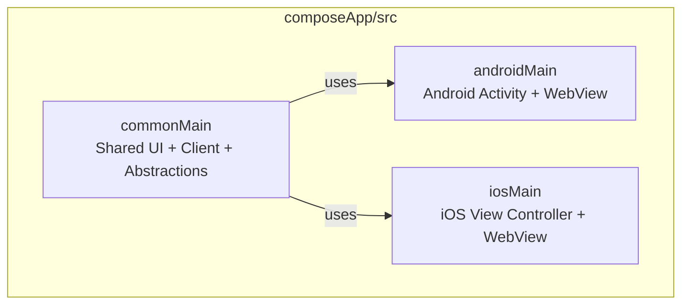
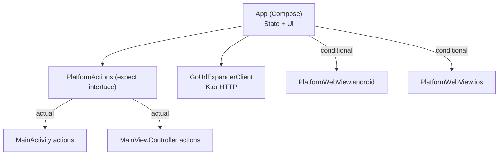
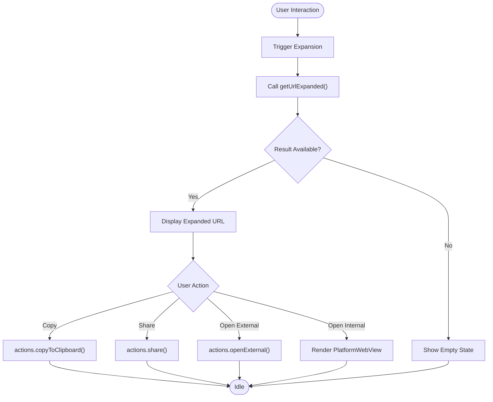
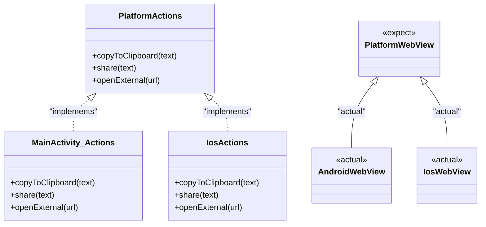
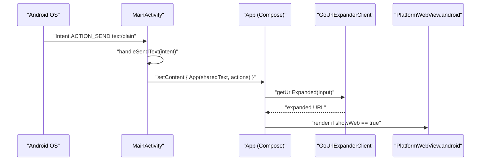
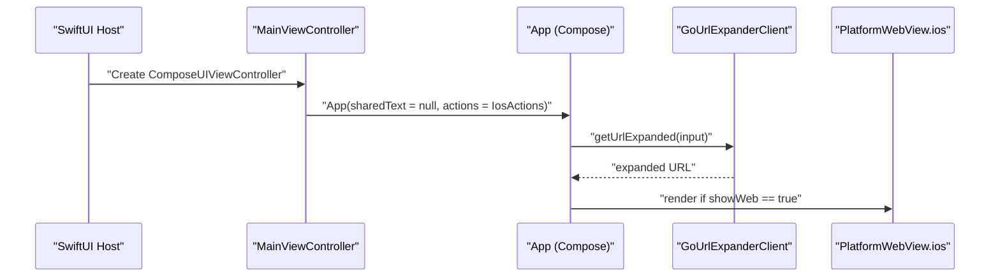
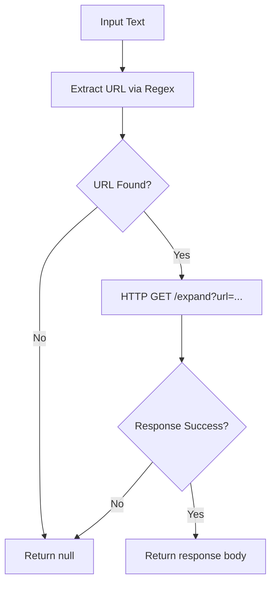
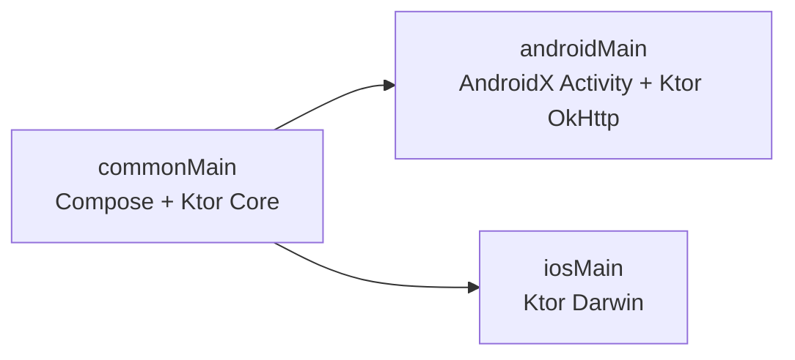

# Project Structure and Organization

<cite>
**Referenced Files in This Document**
- [README.md](file://README.md)
- [App.kt](file://composeApp/src/commonMain/kotlin/com/brunoshiroma/url_expander/App.kt)
- [PlatformActions.kt](file://composeApp/src/commonMain/kotlin/com/brunoshiroma/url_expander/PlatformActions.kt)
- [GoUrlExpanderClient.kt](file://composeApp/src/commonMain/kotlin/com/brunoshiroma/url_expander/GoUrlExpanderClient.kt)
- [MainActivity.kt](file://composeApp/src/androidMain/kotlin/com/brunoshiroma/url_expander/MainActivity.kt)
- [PlatformWebView.android.kt](file://composeApp/src/androidMain/kotlin/com/brunoshiroma/url_expander/PlatformWebView.android.kt)
- [MainViewController.kt](file://composeApp/src/iosMain/kotlin/com/brunoshiroma/url_expander/MainViewController.kt)
- [PlatformWebView.ios.kt](file://composeApp/src/iosMain/kotlin/com/brunoshiroma/url_expander/PlatformWebView.ios.kt)
- [build.gradle.kts](file://composeApp/build.gradle.kts)
</cite>

## Table of Contents
1. [Introduction](#introduction)
2. [Project Structure](#project-structure)
3. [Core Components](#core-components)
4. [Architecture Overview](#architecture-overview)
5. [Detailed Component Analysis](#detailed-component-analysis)
6. [Dependency Analysis](#dependency-analysis)
7. [Performance Considerations](#performance-considerations)
8. [Troubleshooting Guide](#troubleshooting-guide)
9. [Conclusion](#conclusion)

## Introduction
This document explains the project structure and organization for a Kotlin Multiplatform + Compose Multiplatform application that expands URLs via a remote service. The codebase is organized into:
- commonMain for shared UI, business logic, and platform abstractions
- androidMain for Android-specific entry points and integrations
- iosMain for iOS-specific entry points and integrations

The separation of concerns follows MVVM-like patterns where the shared UI composable holds state and orchestrates actions, while platform-specific implementations provide clipboard, sharing, external URL opening, and WebView capabilities through the expect/actual mechanism.

## Project Structure
The project uses a standard Kotlin Multiplatform layout under composeApp/src:
- commonMain contains shared Compose UI, network client, and platform abstraction interfaces
- androidMain contains the Android Activity, platform action implementation, and Android WebView
- iosMain contains the iOS view controller factory, platform action implementation, and iOS WKWebView

**Diagram sources**
- [App.kt:36-126](file://composeApp/src/commonMain/kotlin/com/brunoshiroma/url_expander/App.kt#L36-L126)
- [MainActivity.kt:15-60](file://composeApp/src/androidMain/kotlin/com/brunoshiroma/url_expander/MainActivity.kt#L15-L60)
- [MainViewController.kt:9-25](file://composeApp/src/iosMain/kotlin/com/brunoshiroma/url_expander/MainViewController.kt#L9-L25)

**Section sources**
- [README.md:5-8](file://README.md#L5-L8)
- [build.gradle.kts:10-48](file://composeApp/build.gradle.kts#L10-L48)

## Core Components
- Shared UI (App): Holds input/output state, triggers expansion, and delegates platform operations to PlatformActions. It also conditionally renders a platform WebView.
- Platform Abstraction (PlatformActions): Declares copyToClipboard, share, and openExternal as platform-agnostic operations.
- Network Client (GoUrlExpanderClient): Extracts URLs from text and calls the remote expand endpoint using Ktor.
- Android Integration (MainActivity, PlatformWebView.android): Implements PlatformActions on Android and embeds a WebView via AndroidView.
- iOS Integration (MainViewController, PlatformWebView.ios): Implements PlatformActions on iOS and embeds a WKWebView via UIKitView.

Key responsibilities:
- UI layer: State management and user interactions in App
- Business logic: URL extraction and HTTP request orchestration in GoUrlExpanderClient
- Platform integration: Clipboard, share sheet, external browser, and WebView per platform

**Section sources**
- [App.kt:36-126](file://composeApp/src/commonMain/kotlin/com/brunoshiroma/url_expander/App.kt#L36-L126)
- [PlatformActions.kt:6-14](file://composeApp/src/commonMain/kotlin/com/brunoshiroma/url_expander/PlatformActions.kt#L6-L14)
- [GoUrlExpanderClient.kt:9-28](file://composeApp/src/commonMain/kotlin/com/brunoshiroma/url_expander/GoUrlExpanderClient.kt#L9-L28)
- [MainActivity.kt:15-60](file://composeApp/src/androidMain/kotlin/com/brunoshiroma/url_expander/MainActivity.kt#L15-L60)
- [PlatformWebView.android.kt:9-21](file://composeApp/src/androidMain/kotlin/com/brunoshiroma/url_expander/PlatformWebView.android.kt#L9-L21)
- [MainViewController.kt:9-25](file://composeApp/src/iosMain/kotlin/com/brunoshiroma/url_expander/MainViewController.kt#L9-L25)
- [PlatformWebView.ios.kt:11-22](file://composeApp/src/iosMain/kotlin/com/brunoshiroma/url_expander/PlatformWebView.ios.kt#L11-L22)

## Architecture Overview
The app follows a layered approach:
- UI Layer (Compose): App composable manages state and invokes PlatformActions and the network client.
- Domain/Business Layer: GoUrlExpanderClient encapsulates URL extraction and remote API calls.
- Platform Layer: Android and iOS implement PlatformActions and PlatformWebView.

**Diagram sources**
- [App.kt:36-126](file://composeApp/src/commonMain/kotlin/com/brunoshiroma/url_expander/App.kt#L36-L126)
- [PlatformActions.kt:6-14](file://composeApp/src/commonMain/kotlin/com/brunoshiroma/url_expander/PlatformActions.kt#L6-L14)
- [MainActivity.kt:19-36](file://composeApp/src/androidMain/kotlin/com/brunoshiroma/url_expander/MainActivity.kt#L19-L36)
- [MainViewController.kt:9-23](file://composeApp/src/iosMain/kotlin/com/brunoshiroma/url_expander/MainViewController.kt#L9-L23)
- [PlatformWebView.android.kt:9-21](file://composeApp/src/androidMain/kotlin/com/brunoshiroma/url_expander/PlatformWebView.android.kt#L9-L21)
- [PlatformWebView.ios.kt:11-22](file://composeApp/src/iosMain/kotlin/com/brunoshiroma/url_expander/PlatformWebView.ios.kt#L11-L22)

## Detailed Component Analysis

### Shared UI and State Management (App)
- Manages input text, expanded result, and WebView visibility state.
- On receiving shared text or manual trigger, it calls the network client to expand the URL.
- Delegates clipboard, share, and external open to PlatformActions.
- Conditionally renders PlatformWebView when internal browsing is requested.

**Diagram sources**
- [App.kt:49-121](file://composeApp/src/commonMain/kotlin/com/brunoshiroma/url_expander/App.kt#L49-L121)

**Section sources**
- [App.kt:36-126](file://composeApp/src/commonMain/kotlin/com/brunoshiroma/url_expander/App.kt#L36-L126)

### Platform Abstractions and Expect/Actual Pattern
- PlatformActions defines the contract for clipboard, sharing, and external URL opening.
- PlatformWebView is declared with expect and implemented with actual on each platform.
- Android implements these via Android APIs; iOS implements them via UIKit/WebKit.

**Diagram sources**
- [PlatformActions.kt:6-14](file://composeApp/src/commonMain/kotlin/com/brunoshiroma/url_expander/PlatformActions.kt#L6-L14)
- [MainActivity.kt:19-36](file://composeApp/src/androidMain/kotlin/com/brunoshiroma/url_expander/MainActivity.kt#L19-L36)
- [MainViewController.kt:9-23](file://composeApp/src/iosMain/kotlin/com/brunoshiroma/url_expander/MainViewController.kt#L9-L23)
- [PlatformWebView.android.kt:9-21](file://composeApp/src/androidMain/kotlin/com/brunoshiroma/url_expander/PlatformWebView.android.kt#L9-L21)
- [PlatformWebView.ios.kt:11-22](file://composeApp/src/iosMain/kotlin/com/brunoshiroma/url_expander/PlatformWebView.ios.kt#L11-L22)

**Section sources**
- [PlatformActions.kt:6-14](file://composeApp/src/commonMain/kotlin/com/brunoshiroma/url_expander/PlatformActions.kt#L6-L14)
- [PlatformWebView.android.kt:9-21](file://composeApp/src/androidMain/kotlin/com/brunoshiroma/url_expander/PlatformWebView.android.kt#L9-L21)
- [PlatformWebView.ios.kt:11-22](file://composeApp/src/iosMain/kotlin/com/brunoshiroma/url_expander/PlatformWebView.ios.kt#L11-L22)

### Android Entry Point and Integrations
- MainActivity receives shared text intents, sets up PlatformActions, and composes App.
- Implements clipboard, share sheet, and external URL opening using Android APIs.
- Uses AndroidView to embed a WebView for internal browsing.

**Diagram sources**
- [MainActivity.kt:38-60](file://composeApp/src/androidMain/kotlin/com/brunoshiroma/url_expander/MainActivity.kt#L38-L60)
- [App.kt:49-121](file://composeApp/src/commonMain/kotlin/com/brunoshiroma/url_expander/App.kt#L49-L121)
- [PlatformWebView.android.kt:9-21](file://composeApp/src/androidMain/kotlin/com/brunoshiroma/url_expander/PlatformWebView.android.kt#L9-L21)

**Section sources**
- [MainActivity.kt:15-60](file://composeApp/src/androidMain/kotlin/com/brunoshiroma/url_expander/MainActivity.kt#L15-L60)
- [PlatformWebView.android.kt:9-21](file://composeApp/src/androidMain/kotlin/com/brunoshiroma/url_expander/PlatformWebView.android.kt#L9-L21)

### iOS Entry Point and Integrations
- MainViewController provides an iOS entry point and implements PlatformActions.
- Uses UIPasteboard, UIActivityViewController, and UIApplication for platform features.
- Renders WKWebView via UIKitView for internal browsing.

**Diagram sources**
- [MainViewController.kt:9-25](file://composeApp/src/iosMain/kotlin/com/brunoshiroma/url_expander/MainViewController.kt#L9-L25)
- [App.kt:49-121](file://composeApp/src/commonMain/kotlin/com/brunoshiroma/url_expander/App.kt#L49-L121)
- [PlatformWebView.ios.kt:11-22](file://composeApp/src/iosMain/kotlin/com/brunoshiroma/url_expander/PlatformWebView.ios.kt#L11-L22)

**Section sources**
- [MainViewController.kt:9-25](file://composeApp/src/iosMain/kotlin/com/brunoshiroma/url_expander/MainViewController.kt#L9-L25)
- [PlatformWebView.ios.kt:11-22](file://composeApp/src/iosMain/kotlin/com/brunoshiroma/url_expander/PlatformWebView.ios.kt#L11-L22)

### Business Logic: URL Extraction and Remote Expansion
- GoUrlExpanderClient extracts URLs from arbitrary text using a regex pattern.
- Calls a remote expand endpoint via Ktor and returns the expanded URL string or null.

**Diagram sources**
- [GoUrlExpanderClient.kt:9-23](file://composeApp/src/commonMain/kotlin/com/brunoshiroma/url_expander/GoUrlExpanderClient.kt#L9-L23)

**Section sources**
- [GoUrlExpanderClient.kt:9-28](file://composeApp/src/commonMain/kotlin/com/brunoshiroma/url_expander/GoUrlExpanderClient.kt#L9-L28)

## Dependency Analysis
- commonMain depends on Compose runtime/foundation/material/ui and Ktor client core.
- androidMain adds Android Activity Compose integration and Ktor OkHttp engine.
- iosMain adds Ktor Darwin engine for networking on iOS.

**Diagram sources**
- [build.gradle.kts:28-48](file://composeApp/build.gradle.kts#L28-L48)

**Section sources**
- [build.gradle.kts:28-48](file://composeApp/build.gradle.kts#L28-L48)

## Performance Considerations
- Network calls are asynchronous via suspend functions; ensure UI remains responsive by avoiding blocking operations on the main thread.
- WebView rendering can be heavy; consider lazy initialization and reuse strategies if expanding frequently.
- Avoid unnecessary recompositions by keeping state minimal and stable in the UI layer.

[No sources needed since this section provides general guidance]

## Troubleshooting Guide
- If shared text is not received on Android, verify Intent.ACTION_SEND handling and extra keys.
- If WebView does not load content, check URL validity and platform-specific WebView configuration.
- For network failures, inspect Ktor response status and handle null results gracefully in the UI.

**Section sources**
- [MainActivity.kt:56-60](file://composeApp/src/androidMain/kotlin/com/brunoshiroma/url_expander/MainActivity.kt#L56-L60)
- [PlatformWebView.android.kt:9-21](file://composeApp/src/androidMain/kotlin/com/brunoshiroma/url_expander/PlatformWebView.android.kt#L9-L21)
- [PlatformWebView.ios.kt:11-22](file://composeApp/src/iosMain/kotlin/com/brunoshiroma/url_expander/PlatformWebView.ios.kt#L11-L22)
- [GoUrlExpanderClient.kt:17-23](file://composeApp/src/commonMain/kotlin/com/brunoshiroma/url_expander/GoUrlExpanderClient.kt#L17-L23)

## Conclusion
The project cleanly separates shared UI and business logic from platform-specific integrations using Kotlin Multiplatform’s source sets and the expect/actual pattern. The MVVM-like structure keeps state and UI in the shared layer while delegating platform features to concrete implementations on Android and iOS. This organization promotes code reuse, testability, and maintainability across platforms.

[No sources needed since this section summarizes without analyzing specific files]