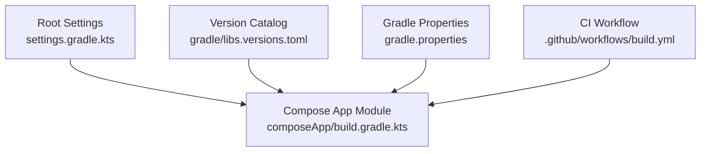
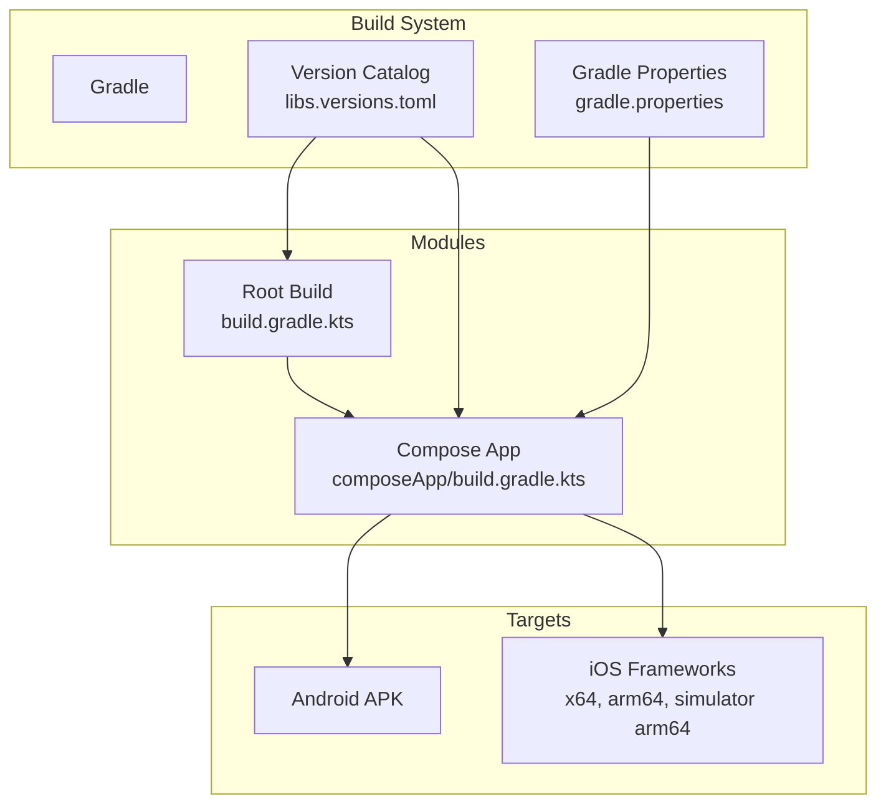
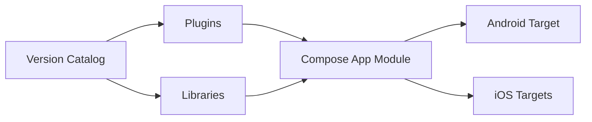

# Build and Configuration

<cite>
**Referenced Files in This Document**
- [build.gradle.kts](file://build.gradle.kts)
- [settings.gradle.kts](file://settings.gradle.kts)
- [composeApp/build.gradle.kts](file://composeApp/build.gradle.kts)
- [gradle/libs.versions.toml](file://gradle/libs.versions.toml)
- [gradle.properties](file://gradle.properties)
- [.sdkmanrc](file://.sdkmanrc)
- [build.yml](file://.github/workflows/build.yml)
- [README.md](file://README.md)
</cite>

## Table of Contents
1. [Introduction](#introduction)
2. [Project Structure](#project-structure)
3. [Core Components](#core-components)
4. [Architecture Overview](#architecture-overview)
5. [Detailed Component Analysis](#detailed-component-analysis)
6. [Dependency Analysis](#dependency-analysis)
7. [Performance Considerations](#performance-considerations)
8. [Troubleshooting Guide](#troubleshooting-guide)
9. [Conclusion](#conclusion)
10. [Appendices](#appendices)

## Introduction
This document explains how the Kotlin URL Expander project is built and configured. It covers the Gradle build script structure, dependency management via version catalogs, Kotlin Multiplatform configuration for Android and iOS, signing setup, CI/CD integration, and guidance for customization and optimization.

## Project Structure
The project uses a multi-module Gradle setup with one application module:
- Root settings define repositories, plugin management, and include the composeApp module.
- The root build script declares plugins centrally using aliases from the version catalog.
- The composeApp module configures Kotlin Multiplatform targets (Android and iOS), Compose dependencies, platform-specific Ktor clients, and Android app packaging.

**Diagram sources**
- [settings.gradle.kts:1-22](file://settings.gradle.kts#L1-L22)
- [composeApp/build.gradle.kts:1-73](file://composeApp/build.gradle.kts#L1-L73)
- [gradle/libs.versions.toml:1-23](file://gradle/libs.versions.toml#L1-L23)
- [gradle.properties:1-6](file://gradle.properties#L1-L6)
- [build.yml:1-31](file://.github/workflows/build.yml#L1-L31)

**Section sources**
- [settings.gradle.kts:1-22](file://settings.gradle.kts#L1-L22)
- [build.gradle.kts:1-7](file://build.gradle.kts#L1-L7)
- [composeApp/build.gradle.kts:1-73](file://composeApp/build.gradle.kts#L1-L73)

## Core Components
- Version Catalog: Centralizes versions and library/plugin aliases to ensure consistency across modules.
- Root Build Script: Declares plugins globally without applying them, enabling centralized control.
- Compose App Module: Configures Kotlin Multiplatform targets, Compose UI, and platform-specific networking clients.
- Android Configuration: Defines namespace, SDK levels, compile options, and release signing behavior.
- CI Workflow: Builds Android artifacts and iOS frameworks on GitHub Actions.

Key responsibilities:
- Dependency alignment through the version catalog.
- Multiplatform target definitions for Android and iOS.
- Platform-specific source sets and dependencies.
- Android packaging and signing.
- Automated builds in CI.

**Section sources**
- [gradle/libs.versions.toml:1-23](file://gradle/libs.versions.toml#L1-L23)
- [build.gradle.kts:1-7](file://build.gradle.kts#L1-L7)
- [composeApp/build.gradle.kts:1-73](file://composeApp/build.gradle.kts#L1-L73)
- [build.yml:1-31](file://.github/workflows/build.yml#L1-L31)

## Architecture Overview
The build architecture centers around Gradle with Kotlin Multiplatform and Compose Multiplatform. The composeApp module compiles shared code and produces:
- An Android APK via the Android Application plugin.
- Static iOS frameworks for multiple architectures.

**Diagram sources**
- [gradle/libs.versions.toml:1-23](file://gradle/libs.versions.toml#L1-L23)
- [gradle.properties:1-6](file://gradle.properties#L1-L6)
- [build.gradle.kts:1-7](file://build.gradle.kts#L1-L7)
- [composeApp/build.gradle.kts:1-73](file://composeApp/build.gradle.kts#L1-L73)

## Detailed Component Analysis

### Gradle Version Catalog
The version catalog defines:
- Versions for AGP, Kotlin, Compose Multiplatform, AndroidX Activity, Ktor, and Coroutines.
- Library coordinates with version references.
- Plugin aliases for Android Application, Compose Multiplatform, Compose Compiler, and Kotlin Multiplatform.

Benefits:
- Single source of truth for versions.
- Consistent plugin versions across modules.
- Simplified dependency updates.

Customization tips:
- Add new libraries under [libraries] and reference them via libs.<alias>.
- Update versions in [versions] to align upgrades.

**Section sources**
- [gradle/libs.versions.toml:1-23](file://gradle/libs.versions.toml#L1-L23)

### Root Build Script
Declares plugins centrally using aliases and applies them as not applied at the root level. This keeps plugin versions aligned and avoids duplication.

Best practices:
- Keep plugin declarations here; apply only where needed in modules.
- Use alias(libs.plugins.*) to leverage the version catalog.

**Section sources**
- [build.gradle.kts:1-7](file://build.gradle.kts#L1-L7)

### Settings and Repositories
Settings configure:
- Repository sources for plugins and dependencies.
- Toolchain resolution via foojay resolver.
- Inclusion of the composeApp module.

Notes:
- Google and Maven Central are used for both plugin and dependency resolution.
- The foojay toolchain resolver ensures consistent JDK provisioning.

**Section sources**
- [settings.gradle.kts:1-22](file://settings.gradle.kts#L1-L22)

### Compose App Module: Kotlin Multiplatform Targets
The composeApp module configures:
- Android target with JVM 17.
- iOS targets: x64, arm64, and simulator arm64.
- Static iOS frameworks named ComposeApp.
- Source sets for common, androidMain, iosMain, and commonTest.

Implications:
- Shared logic resides in commonMain.
- Platform-specific implementations go in androidMain or iosMain.
- Tests can be written in commonTest and run on JVM.

**Section sources**
- [composeApp/build.gradle.kts:10-48](file://composeApp/build.gradle.kts#L10-L48)

### Compose App Module: Dependencies
Shared dependencies:
- Compose runtime, foundation, material3, ui.
- Ktor client core.

Platform-specific dependencies:
- Android: Activity Compose and Ktor OkHttp client.
- iOS: Ktor Darwin client.

Testing dependencies:
- Kotlin Test, Ktor Client Mock, Coroutines Test.

Guidance:
- Prefer adding shared functionality in commonMain.
- Use platform-specific dependencies only when necessary.

**Section sources**
- [composeApp/build.gradle.kts:28-48](file://composeApp/build.gradle.kts#L28-L48)
- [gradle/libs.versions.toml:9-17](file://gradle/libs.versions.toml#L9-L17)

### Android Configuration
Android block defines:
- Namespace and compile SDK.
- Default config including applicationId, minSdk, targetSdk, versionCode, versionName.
- Java compatibility set to 17.
- Release build type signed with debug key until a real release key is configured.

Signing:
- Currently uses the debug signing configuration for release builds.
- To sign releases properly, define a dedicated signingConfig with release keystore details and apply it to the release buildType.

Packaging:
- Produces an APK suitable for installation and distribution once signed correctly.

**Section sources**
- [composeApp/build.gradle.kts:51-72](file://composeApp/build.gradle.kts#L51-L72)

### iOS Framework Configuration
Kotlin Multiplatform configures static frameworks for:
- iosX64
- iosArm64
- iosSimulatorArm64

Each framework is named ComposeApp and marked static. This enables embedding into Xcode projects.

Integration notes:
- Use the provided Gradle task to embed and sign the Apple framework for Xcode.
- Link ComposeApp.framework in your Xcode project.

**Section sources**
- [composeApp/build.gradle.kts:17-26](file://composeApp/build.gradle.kts#L17-L26)
- [README.md:16-18](file://README.md#L16-L18)

### CI/CD Integration
GitHub Actions workflow includes:
- Android job: Sets up JDK 17, runs unit tests, and assembles the debug APK.
- iOS job: Runs simulator tests and links the iOS simulator framework.

Recommendations:
- Add caching for Gradle and local Maven caches.
- Introduce artifact uploads for APKs and frameworks.
- Add signing steps for release builds.

**Section sources**
- [build.yml:1-31](file://.github/workflows/build.yml#L1-L31)

### Gradle Properties and SDK Management
Gradle properties enable:
- Increased JVM heap size.
- Gradle build cache.
- AndroidX usage and non-transitive R class.

SDKMAN configuration pins the JDK version to GraalCE 17, ensuring consistent toolchains locally.

Optimization tips:
- Enable parallel execution and configuration cache if appropriate.
- Tune JVM args based on CI runner capacity.

**Section sources**
- [gradle.properties:1-6](file://gradle.properties#L1-L6)
- [.sdkmanrc:1-4](file://.sdkmanrc#L1-L4)

## Dependency Analysis
The build relies on:
- Android Gradle Plugin for Android packaging.
- Kotlin Multiplatform for cross-platform compilation.
- Compose Multiplatform for shared UI.
- Ktor Client for HTTP requests with platform-specific backends.

**Diagram sources**
- [gradle/libs.versions.toml:1-23](file://gradle/libs.versions.toml#L1-L23)
- [composeApp/build.gradle.kts:1-73](file://composeApp/build.gradle.kts#L1-L73)

**Section sources**
- [gradle/libs.versions.toml:1-23](file://gradle/libs.versions.toml#L1-L23)
- [composeApp/build.gradle.kts:1-73](file://composeApp/build.gradle.kts#L1-L73)

## Performance Considerations
- Build Cache: Enabled via gradle.properties to speed up repeated builds.
- JVM Heap: Increased to 2GB to accommodate larger builds.
- Parallel Execution: Consider enabling org.gradle.parallel=true for faster multi-module builds.
- Configuration Cache: Consider enabling org.gradle.configuration-cache=true for faster configuration phases.
- Incremental Compilation: Kotlin Multiplatform benefits from incremental builds; keep source sets clean and avoid unnecessary recompilation.
- Dependency Updates: Align versions carefully to reduce transitive conflicts and rebuild overhead.

[No sources needed since this section provides general guidance]

## Troubleshooting Guide
Common issues and resolutions:
- JDK Mismatch: Ensure JDK 17 is installed and selected by SDKMAN or CI. The .sdkmanrc file pins GraalCE 17.
- Android SDK/API Levels: Verify that compileSdk and targetSdk are available and compatible with the Android Gradle Plugin version.
- iOS Toolchain: macOS environment required for iOS targets; ensure Xcode command line tools are installed.
- Signing Errors: Replace debug signing with a proper release keystore for production builds.
- Network Clients: Confirm platform-specific Ktor clients are included for each target (OkHttp for Android, Darwin for iOS).
- CI Failures: Check that the correct tasks are executed in CI jobs and that the environment has required tools (JDK, Android SDK, Xcode).

**Section sources**
- [.sdkmanrc:1-4](file://.sdkmanrc#L1-L4)
- [composeApp/build.gradle.kts:51-72](file://composeApp/build.gradle.kts#L51-L72)
- [build.yml:1-31](file://.github/workflows/build.yml#L1-L31)

## Conclusion
The project’s build system is centered on Gradle with a robust version catalog, Kotlin Multiplatform targets for Android and iOS, and Compose Multiplatform for shared UI. Android packaging and iOS framework generation are straightforward, while CI automates testing and linking. For production readiness, configure proper signing, optimize build performance, and extend dependencies via the version catalog.

[No sources needed since this section summarizes without analyzing specific files]

## Appendices

### Build Commands Reference
- Assemble Android APK:
  - gradle :composeApp:assembleDebug
- Run shared tests:
  - gradle :composeApp:testDebugUnitTest
- Build iOS framework (macOS):
  - gradle :composeApp:linkDebugFrameworkIosSimulatorArm64
- Embed and sign Apple framework for Xcode:
  - gradle :composeApp:embedAndSignAppleFrameworkForXcode

**Section sources**
- [README.md:10-18](file://README.md#L10-L18)