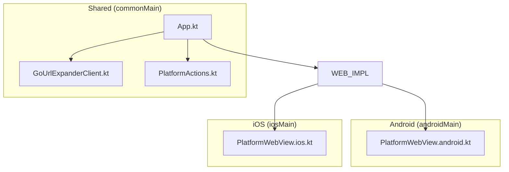
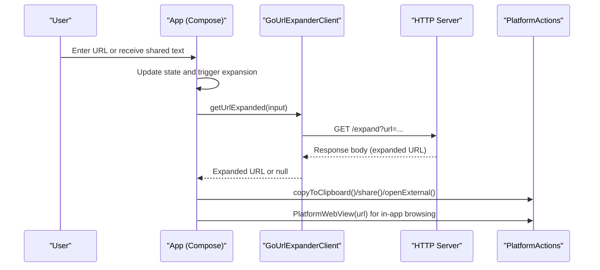
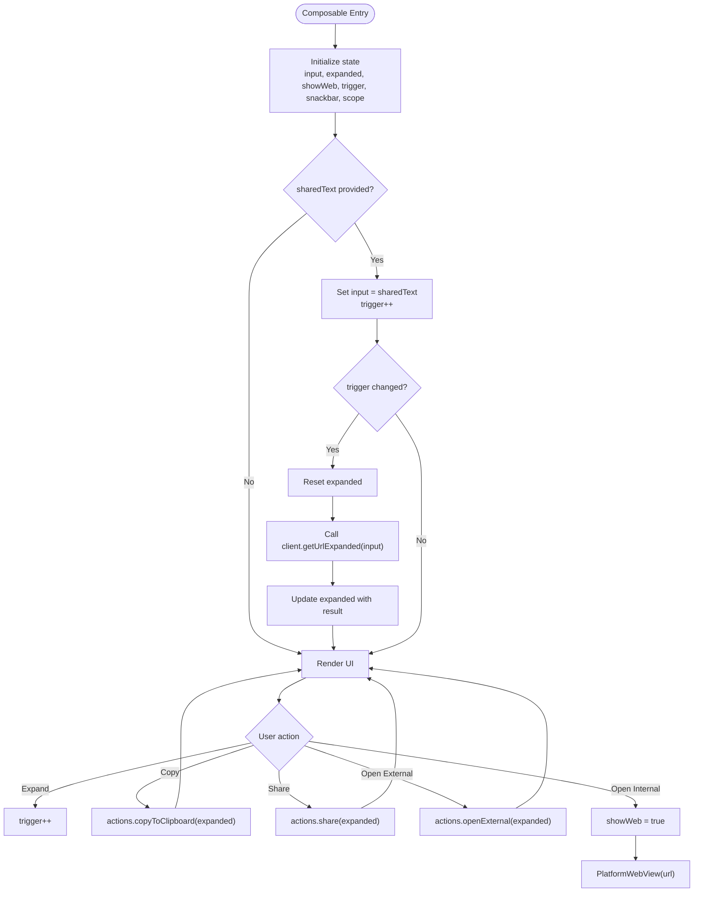
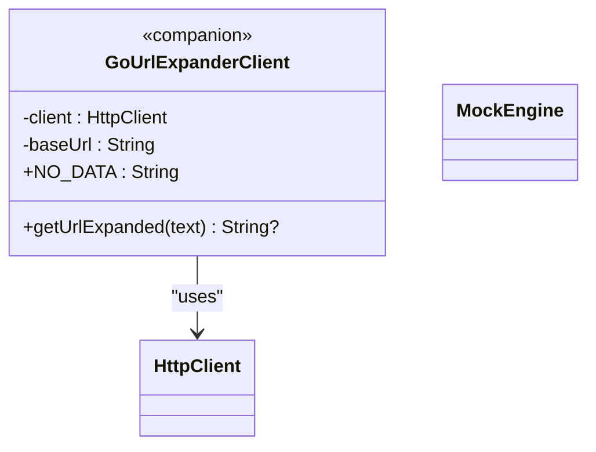
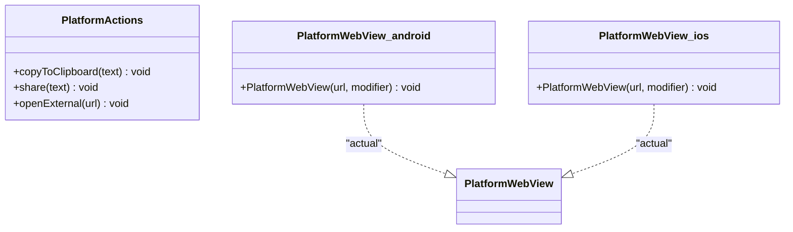
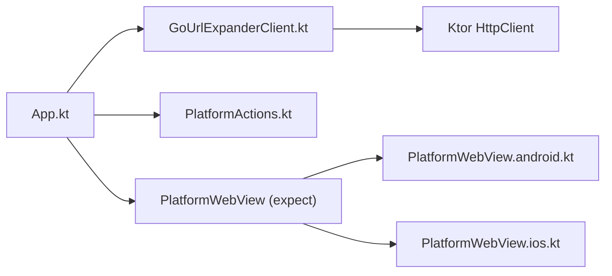

# Core Components

<cite>
**Referenced Files in This Document**
- [App.kt](file://composeApp/src/commonMain/kotlin/com/brunoshiroma/url_expander/App.kt)
- [GoUrlExpanderClient.kt](file://composeApp/src/commonMain/kotlin/com/brunoshiroma/url_expander/GoUrlExpanderClient.kt)
- [PlatformActions.kt](file://composeApp/src/commonMain/kotlin/com/brunoshiroma/url_expander/PlatformActions.kt)
- [PlatformWebView.android.kt](file://composeApp/src/androidMain/kotlin/com/brunoshiroma/url_expander/PlatformWebView.android.kt)
- [PlatformWebView.ios.kt](file://composeApp/src/iosMain/kotlin/com/brunoshiroma/url_expander/PlatformWebView.ios.kt)
- [GoUrlExpanderClientTest.kt](file://composeApp/src/commonTest/kotlin/com/brunoshiroma/url_expander/GoUrlExpanderClientTest.kt)
</cite>

## Table of Contents
1. [Introduction](#introduction)
2. [Project Structure](#project-structure)
3. [Core Components](#core-components)
4. [Architecture Overview](#architecture-overview)
5. [Detailed Component Analysis](#detailed-component-analysis)
6. [Dependency Analysis](#dependency-analysis)
7. [Performance Considerations](#performance-considerations)
8. [Troubleshooting Guide](#troubleshooting-guide)
9. [Conclusion](#conclusion)

## Introduction
This document explains the core components of the Kotlin URL Expander application:
- App: UI composition and state management using Compose Multiplatform.
- GoUrlExpanderClient: HTTP communication with a remote URL expansion service via Ktor.
- PlatformActions: A platform abstraction for clipboard, sharing, and external navigation.

It also covers how these components interact, their public interfaces, method signatures, usage patterns, and guidance for extending or customizing them.

## Project Structure
The relevant source files are organized as follows:
- Shared (commonMain): App, GoUrlExpanderClient, PlatformActions
- Android-specific: PlatformWebView implementation
- iOS-specific: PlatformWebView implementation
- Tests: Unit tests for URL extraction and client behavior

**Diagram sources**
- [App.kt:36-126](file://composeApp/src/commonMain/kotlin/com/brunoshiroma/url_expander/App.kt#L36-L126)
- [GoUrlExpanderClient.kt:13-28](file://composeApp/src/commonMain/kotlin/com/brunoshiroma/url_expander/GoUrlExpanderClient.kt#L13-L28)
- [PlatformActions.kt:7-14](file://composeApp/src/commonMain/kotlin/com/brunoshiroma/url_expander/PlatformActions.kt#L7-L14)
- [PlatformWebView.android.kt:11-21](file://composeApp/src/androidMain/kotlin/com/brunoshiroma/url_expander/PlatformWebView.android.kt#L11-L21)
- [PlatformWebView.ios.kt:13-22](file://composeApp/src/iosMain/kotlin/com/brunoshiroma/url_expander/PlatformWebView.ios.kt#L13-L22)

**Section sources**
- [README.md:1-18](file://README.md#L1-L18)

## Core Components
This section introduces the three core components and their responsibilities.

- App
  - Purpose: Composes the UI, manages local state (input, expanded URL, web view visibility), triggers URL expansion, and delegates platform actions to PlatformActions.
  - Key behaviors:
    - Accepts shared text from the host app and auto-expands it.
    - Renders an input field, expand button, result display, and action buttons (Copy, Share, Open external, Open internal).
    - Uses LaunchedEffect to react to shared text and trigger expansion.
    - Integrates with PlatformWebView for in-app browsing.

- GoUrlExpanderClient
  - Purpose: Encapsulates HTTP calls to a remote URL expansion endpoint using Ktor.
  - Key behaviors:
    - Extracts URLs from arbitrary text using a regex helper.
    - Sends GET requests to /expand with a url parameter.
    - Returns the response body on success; returns null otherwise.
    - Provides a sentinel constant for empty/no data.

- PlatformActions
  - Purpose: Defines platform-specific operations used by the shared UI.
  - Methods:
    - copyToClipboard(text)
    - share(text)
    - openExternal(url)
  - Also declares expect PlatformWebView(url, modifier) for platform implementations.

**Section sources**
- [App.kt:36-126](file://composeApp/src/commonMain/kotlin/com/brunoshiroma/url_expander/App.kt#L36-L126)
- [GoUrlExpanderClient.kt:9-28](file://composeApp/src/commonMain/kotlin/com/brunoshiroma/url_expander/GoUrlExpanderClient.kt#L9-L28)
- [PlatformActions.kt:7-14](file://composeApp/src/commonMain/kotlin/com/brunoshiroma/url_expander/PlatformActions.kt#L7-L14)

## Architecture Overview
The application follows a layered approach:
- UI layer (Compose) in App orchestrates user interactions and state.
- Client layer (GoUrlExpanderClient) handles network I/O.
- Platform abstraction (PlatformActions + expect/actual WebView) isolates platform differences.

**Diagram sources**
- [App.kt:50-61](file://composeApp/src/commonMain/kotlin/com/brunoshiroma/url_expander/App.kt#L50-L61)
- [App.kt:103-120](file://composeApp/src/commonMain/kotlin/com/brunoshiroma/url_expander/App.kt#L103-L120)
- [GoUrlExpanderClient.kt:17-23](file://composeApp/src/commonMain/kotlin/com/brunoshiroma/url_expander/GoUrlExpanderClient.kt#L17-L23)
- [PlatformActions.kt:7-14](file://composeApp/src/commonMain/kotlin/com/brunoshiroma/url_expander/PlatformActions.kt#L7-L14)

## Detailed Component Analysis

### App Component
Responsibilities:
- State management: input, expanded URL, showWeb flag, trigger counter, snackbar state, coroutine scope.
- Side effects:
  - On receiving sharedText, set input and increment trigger to start expansion.
  - On trigger change, reset expanded and call client.getUrlExpanded.
- UI rendering:
  - TopAppBar with optional Back button when viewing web content.
  - Input field and Expand button.
  - Display expanded URL with selection support.
  - Action buttons delegating to PlatformActions.
  - Toggle between main screen and PlatformWebView.

Key interactions:
- Calls PlatformActions.copyToClipboard, share, openExternal.
- Invokes PlatformWebView for in-app browsing.

Usage pattern:
- Inject PlatformActions implementation from the host platform.
- Optionally inject a custom GoUrlExpanderClient for testing or alternate endpoints.

**Diagram sources**
- [App.kt:42-61](file://composeApp/src/commonMain/kotlin/com/brunoshiroma/url_expander/App.kt#L42-L61)
- [App.kt:65-124](file://composeApp/src/commonMain/kotlin/com/brunoshiroma/url_expander/App.kt#L65-L124)

**Section sources**
- [App.kt:36-126](file://composeApp/src/commonMain/kotlin/com/brunoshiroma/url_expander/App.kt#L36-L126)

### GoUrlExpanderClient
Responsibilities:
- Extract URLs from free-form text using a regex helper function.
- Perform HTTP GET to the base URL’s /expand endpoint with a url query parameter.
- Return the response body string on success; return null otherwise.
- Provide a NO_DATA sentinel value to short-circuit processing.

Public interface:
- Constructor parameters:
  - client: HttpClient (default creates a new instance)
  - baseUrl: String (default points to the production service)
- Methods:
  - suspend fun getUrlExpanded(text: String): String?
- Companion object:
  - const val NO_DATA: String

Helper function:
- extractUrl(text: String): String?

Behavioral notes:
- If text equals NO_DATA, returns null immediately.
- If no URL is found in text, returns null.
- If HTTP status is not successful, returns null.

Testing highlights:
- Verifies URL extraction from mixed text.
- Confirms NO_DATA handling.
- Validates request encoding and response mapping.
- Ensures non-success responses yield null.

**Diagram sources**
- [GoUrlExpanderClient.kt:13-28](file://composeApp/src/commonMain/kotlin/com/brunoshiroma/url_expander/GoUrlExpanderClient.kt#L13-L28)

**Section sources**
- [GoUrlExpanderClient.kt:9-28](file://composeApp/src/commonMain/kotlin/com/brunoshiroma/url_expander/GoUrlExpanderClient.kt#L9-L28)
- [GoUrlExpanderClientTest.kt:12-43](file://composeApp/src/commonTest/kotlin/com/brunoshiroma/url_expander/GoUrlExpanderClientTest.kt#L12-L43)

### PlatformActions and PlatformWebView
PlatformActions defines the contract for platform-specific operations:
- copyToClipboard(text: String)
- share(text: String)
- openExternal(url: String)

PlatformWebView is declared as an expect composable that must be implemented per platform:
- Android: Wraps Android WebView via AndroidView.
- iOS: Wraps WKWebView via UIKitView.

**Diagram sources**
- [PlatformActions.kt:7-14](file://composeApp/src/commonMain/kotlin/com/brunoshiroma/url_expander/PlatformActions.kt#L7-L14)
- [PlatformWebView.android.kt:11-21](file://composeApp/src/androidMain/kotlin/com/brunoshiroma/url_expander/PlatformWebView.android.kt#L11-L21)
- [PlatformWebView.ios.kt:13-22](file://composeApp/src/iosMain/kotlin/com/brunoshiroma/url_expander/PlatformWebView.ios.kt#L13-L22)

**Section sources**
- [PlatformActions.kt:7-14](file://composeApp/src/commonMain/kotlin/com/brunoshiroma/url_expander/PlatformActions.kt#L7-L14)
- [PlatformWebView.android.kt:11-21](file://composeApp/src/androidMain/kotlin/com/brunoshiroma/url_expander/PlatformWebView.android.kt#L11-L21)
- [PlatformWebView.ios.kt:13-22](file://composeApp/src/iosMain/kotlin/com/brunoshiroma/url_expander/PlatformWebView.ios.kt#L13-L22)

## Dependency Analysis
High-level dependencies:
- App depends on:
  - GoUrlExpanderClient for URL expansion
  - PlatformActions for platform operations
  - PlatformWebView for in-app browsing
- GoUrlExpanderClient depends on:
  - Ktor HttpClient for networking
- PlatformWebView implementations depend on:
  - Android WebView (androidMain)
  - iOS WKWebView (iosMain)

**Diagram sources**
- [App.kt:36-126](file://composeApp/src/commonMain/kotlin/com/brunoshiroma/url_expander/App.kt#L36-L126)
- [GoUrlExpanderClient.kt:3-23](file://composeApp/src/commonMain/kotlin/com/brunoshiroma/url_expander/GoUrlExpanderClient.kt#L3-L23)
- [PlatformActions.kt:7-14](file://composeApp/src/commonMain/kotlin/com/brunoshiroma/url_expander/PlatformActions.kt#L7-L14)
- [PlatformWebView.android.kt:11-21](file://composeApp/src/androidMain/kotlin/com/brunoshiroma/url_expander/PlatformWebView.android.kt#L11-L21)
- [PlatformWebView.ios.kt:13-22](file://composeApp/src/iosMain/kotlin/com/brunoshiroma/url_expander/PlatformWebView.ios.kt#L13-L22)

**Section sources**
- [App.kt:36-126](file://composeApp/src/commonMain/kotlin/com/brunoshiroma/url_expander/App.kt#L36-L126)
- [GoUrlExpanderClient.kt:3-23](file://composeApp/src/commonMain/kotlin/com/brunoshiroma/url_expander/GoUrlExpanderClient.kt#L3-L23)
- [PlatformActions.kt:7-14](file://composeApp/src/commonMain/kotlin/com/brunoshiroma/url_expander/PlatformActions.kt#L7-L14)

## Performance Considerations
- Network calls:
  - getUrlExpanded is a suspend function; ensure it runs off the UI thread (already handled by coroutines in Compose).
  - Consider adding timeouts and retries at the HttpClient level if needed.
- UI responsiveness:
  - Avoid heavy work inside composables; keep side effects in LaunchedEffect or ViewModel-like state holders.
- WebView lifecycle:
  - PlatformWebView instances should be disposed appropriately to prevent memory leaks on Android/iOS.

[No sources needed since this section provides general guidance]

## Troubleshooting Guide
Common issues and resolutions:
- No URL found in input:
  - The client returns null if no URL matches the regex. Ensure the input contains a valid http(s) URL.
- Empty or invalid input:
  - Passing NO_DATA or empty strings results in null; validate inputs before calling getUrlExpanded.
- Non-success HTTP responses:
  - Any non-success status yields null; check server availability and endpoint correctness.
- Clipboard/share/openExternal failures:
  - Verify platform permissions and capabilities; handle errors gracefully in your PlatformActions implementation.

Relevant references:
- URL extraction logic and client behavior are validated by unit tests.

**Section sources**
- [GoUrlExpanderClient.kt:9-23](file://composeApp/src/commonMain/kotlin/com/brunoshiroma/url_expander/GoUrlExpanderClient.kt#L9-L23)
- [GoUrlExpanderClientTest.kt:15-42](file://composeApp/src/commonTest/kotlin/com/brunoshiroma/url_expander/GoUrlExpanderClientTest.kt#L15-L42)

## Conclusion
The core components form a clean separation of concerns:
- App coordinates UI and state while delegating platform specifics.
- GoUrlExpanderClient encapsulates network logic and URL parsing.
- PlatformActions abstracts platform operations, enabling consistent behavior across Android and iOS.

To extend or customize:
- Implement PlatformActions for additional platform features.
- Replace GoUrlExpanderClient with a mock or alternative endpoint for testing.
- Customize PlatformWebView to add authentication headers, cookies, or navigation policies.

[No sources needed since this section summarizes without analyzing specific files]