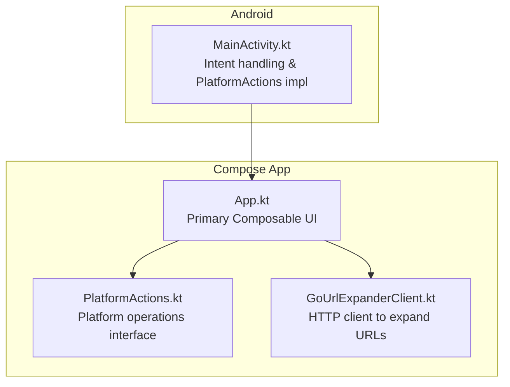
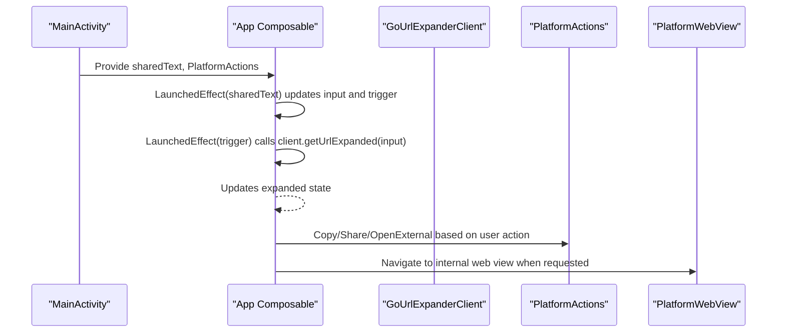
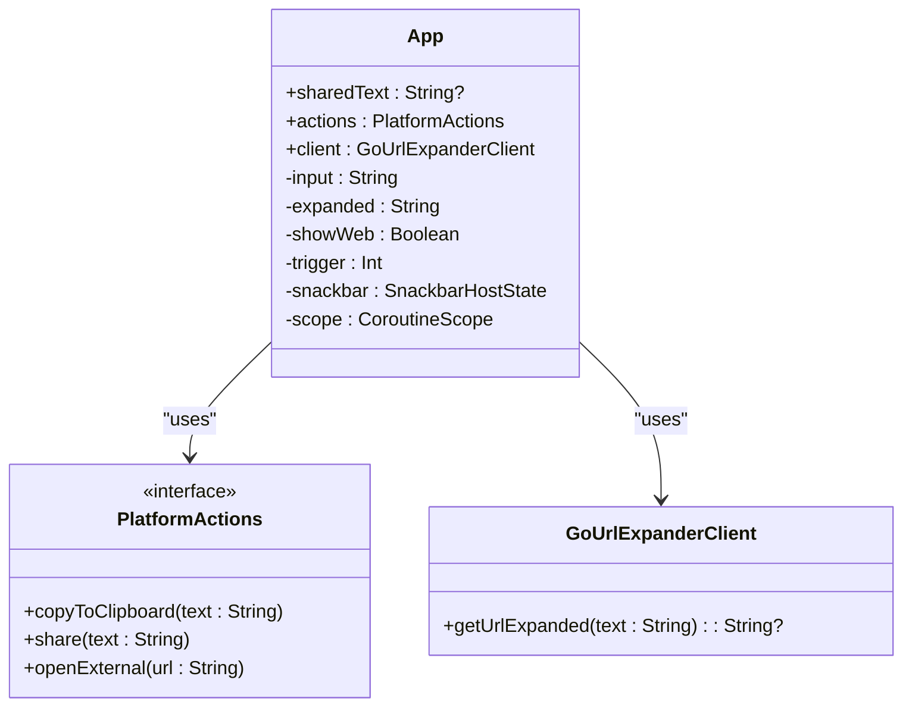
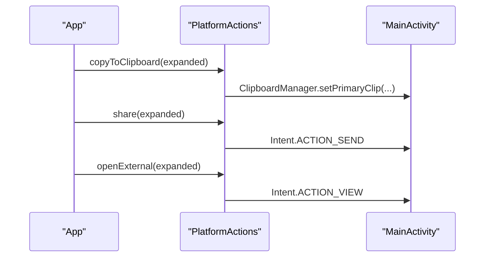
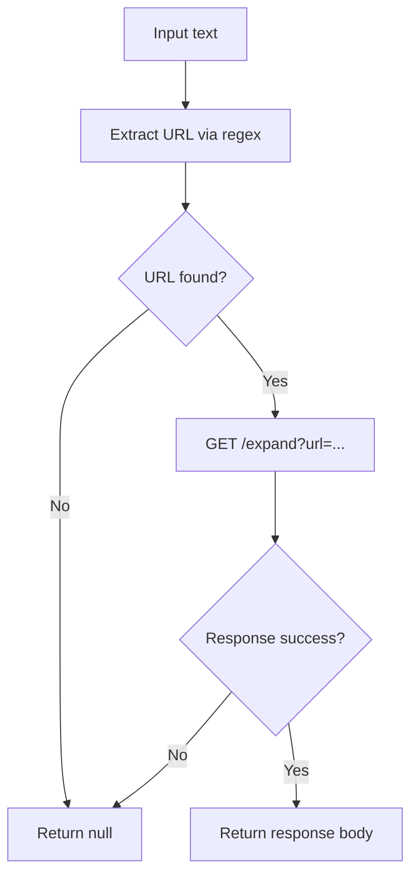
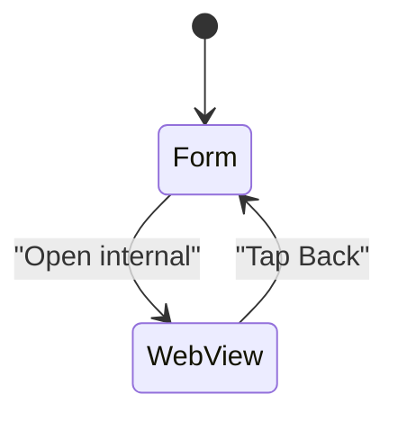
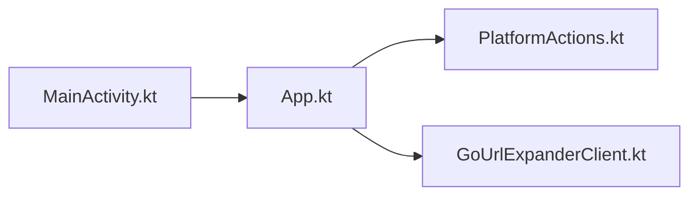

# Main Application (App.kt)

<cite>
**Referenced Files in This Document**
- [App.kt](file://composeApp/src/commonMain/kotlin/com/brunoshiroma/url_expander/App.kt)
- [PlatformActions.kt](file://composeApp/src/commonMain/kotlin/com/brunoshiroma/url_expander/PlatformActions.kt)
- [GoUrlExpanderClient.kt](file://composeApp/src/commonMain/kotlin/com/brunoshiroma/url_expander/GoUrlExpanderClient.kt)
- [MainActivity.kt](file://composeApp/src/androidMain/kotlin/com/brunoshiroma/url_expander/MainActivity.kt)
</cite>

## Table of Contents
1. [Introduction](#introduction)
2. [Project Structure](#project-structure)
3. [Core Components](#core-components)
4. [Architecture Overview](#architecture-overview)
5. [Detailed Component Analysis](#detailed-component-analysis)
6. [Dependency Analysis](#dependency-analysis)
7. [Performance Considerations](#performance-considerations)
8. [Troubleshooting Guide](#troubleshooting-guide)
9. [Conclusion](#conclusion)

## Introduction
This document explains the main App component that serves as the primary UI entry point for the Kotlin URL Expander application. It covers how the Composable function orchestrates state, handles user interactions, integrates with a Go-based URL expansion service, and composes Material3 UI elements. It also documents shared text handling from Android intents, dependency injection of platform actions, and navigation between internal and external web views.

## Project Structure
The relevant code for this documentation is organized under composeApp:
- Common UI logic and contracts live in commonMain.
- Platform-specific behavior (Android) lives in androidMain.

**Diagram sources**
- [App.kt:34-126](file://composeApp/src/commonMain/kotlin/com/brunoshiroma/url_expander/App.kt#L34-L126)
- [PlatformActions.kt:6-14](file://composeApp/src/commonMain/kotlin/com/brunoshiroma/url_expander/PlatformActions.kt#L6-L14)
- [GoUrlExpanderClient.kt:13-28](file://composeApp/src/commonMain/kotlin/com/brunoshiroma/url_expander/GoUrlExpanderClient.kt#L13-L28)
- [MainActivity.kt:15-42](file://composeApp/src/androidMain/kotlin/com/brunoshiroma/url_expander/MainActivity.kt#L15-L42)

**Section sources**
- [App.kt:34-126](file://composeApp/src/commonMain/kotlin/com/brunoshiroma/url_expander/App.kt#L34-L126)
- [PlatformActions.kt:6-14](file://composeApp/src/commonMain/kotlin/com/brunoshiroma/url_expander/PlatformActions.kt#L6-L14)
- [GoUrlExpanderClient.kt:13-28](file://composeApp/src/commonMain/kotlin/com/brunoshiroma/url_expander/GoUrlExpanderClient.kt#L13-L28)
- [MainActivity.kt:15-42](file://composeApp/src/androidMain/kotlin/com/brunoshiroma/url_expander/MainActivity.kt#L15-L42)

## Core Components
- App Composable: The top-level UI that manages input, expanded result, web view mode, and Snackbar feedback. It uses Material3 Scaffold, TopAppBar, OutlinedTextField, Buttons, and Text.
- PlatformActions: An interface abstracting clipboard copy, share, and opening an external browser.
- GoUrlExpanderClient: A suspendable HTTP client that extracts a URL from input and calls a remote endpoint to expand it.
- MainActivity (Android): Wires up intent handling, provides PlatformActions implementation, and sets content with App.

Key responsibilities:
- State management via remember and mutableStateOf.
- Triggering URL expansion on manual input or when sharedText arrives.
- Displaying results and enabling actions only when a valid expanded URL exists.
- Navigating between the main form and a platform-specific WebView.

**Section sources**
- [App.kt:34-126](file://composeApp/src/commonMain/kotlin/com/brunoshiroma/url_expander/App.kt#L34-L126)
- [PlatformActions.kt:6-14](file://composeApp/src/commonMain/kotlin/com/brunoshiroma/url_expander/PlatformActions.kt#L6-L14)
- [GoUrlExpanderClient.kt:13-28](file://composeApp/src/commonMain/kotlin/com/brunoshiroma/url_expander/GoUrlExpanderClient.kt#L13-L28)
- [MainActivity.kt:15-42](file://composeApp/src/androidMain/kotlin/com/brunoshiroma/url_expander/MainActivity.kt#L15-L42)

## Architecture Overview
The App Composable composes the UI and coordinates state transitions. It depends on PlatformActions for platform operations and GoUrlExpanderClient for network requests. On Android, MainActivity injects PlatformActions and passes sharedText from intents into App.

**Diagram sources**
- [MainActivity.kt:38-42](file://composeApp/src/androidMain/kotlin/com/brunoshiroma/url_expander/MainActivity.kt#L38-L42)
- [App.kt:49-61](file://composeApp/src/commonMain/kotlin/com/brunoshiroma/url_expander/App.kt#L49-L61)
- [App.kt:103-120](file://composeApp/src/commonMain/kotlin/com/brunoshiroma/url_expander/App.kt#L103-L120)
- [GoUrlExpanderClient.kt:17-23](file://composeApp/src/commonMain/kotlin/com/brunoshiroma/url_expander/GoUrlExpanderClient.kt#L17-L23)

## Detailed Component Analysis

### App Composable: Role, Parameters, and State
- Role: Primary UI entry point; renders the input form, displays the expanded URL, and provides actions (copy, share, open).
- Parameters:
  - sharedText: Optional string passed from Android intent to prefill the input and auto-expand.
  - actions: Dependency-injected PlatformActions for clipboard, sharing, and external navigation.
  - client: Optional GoUrlExpanderClient instance; defaults to a new instance created with remember.
- State variables:
  - input: Current text field value.
  - expanded: Result of URL expansion.
  - showWeb: Boolean flag to switch between form and internal web view.
  - trigger: Numeric counter used to re-run expansion logic.
  - snackbar: SnackbarHostState for user feedback.
  - scope: CoroutineScope for launching snackbar messages.

State flow:
- When sharedText changes, input is set and trigger increments.
- When trigger changes, expanded is reset and then updated by calling client.getUrlExpanded(input).
- Actions are enabled only when expanded is non-empty.

UI composition:
- Material3 Scaffold with TopAppBar and SnackbarHost.
- Form includes OutlinedTextField, Expand button, and a selectable Text showing the expanded URL.
- Action rows provide Copy, Share, Open external, and Open internal buttons.

Navigation:
- Internal web view is shown when showWeb is true, using PlatformWebView(expanded).
- Back button in TopAppBar resets showWeb to false.

Snackbar feedback:
- After copying, a Snackbar shows “Copied” using scope.launch { snackbar.showSnackbar(...) }.

Error handling:
- Expansion uses runCatching to avoid crashes; if the call fails, expanded becomes empty.
- Button enablement prevents invalid actions when no expanded URL is available.

Responsive layout:
- Uses safeDrawingPadding to respect system insets.
- Fills max width/height and centers content horizontally.

**Section sources**
- [App.kt:34-126](file://composeApp/src/commonMain/kotlin/com/brunoshiroma/url_expander/App.kt#L34-L126)

#### Class and Interaction Diagram

**Diagram sources**
- [App.kt:34-126](file://composeApp/src/commonMain/kotlin/com/brunoshiroma/url_expander/App.kt#L34-L126)
- [PlatformActions.kt:6-14](file://composeApp/src/commonMain/kotlin/com/brunoshiroma/url_expander/PlatformActions.kt#L6-L14)
- [GoUrlExpanderClient.kt:13-28](file://composeApp/src/commonMain/kotlin/com/brunoshiroma/url_expander/GoUrlExpanderClient.kt#L13-L28)

### User Workflows

#### Manual URL Entry
- User types a URL into the OutlinedTextField.
- Tapping Expand triggers incrementing trigger, which causes getUrlExpanded to be called.
- Expanded URL appears below the input and enables action buttons.

#### Sharing Integration
- Android MainActivity intercepts ACTION_SEND with text/plain and forwards EXTRA_TEXT as sharedText to App.
- App sets input to sharedText and increments trigger, automatically expanding the URL without further user interaction.

#### Result Actions
- Copy: Calls actions.copyToClipboard(expanded) and shows a Snackbar confirmation.
- Share: Calls actions.share(expanded) to present system share sheet.
- Open external: Calls actions.openExternal(expanded) to launch the default browser.
- Open internal: Sets showWeb = true to render PlatformWebView with the expanded URL.

```mermaid
flowchart TD
Start(["User Input"]) --> Type["Type URL in TextField"]
Type --> Expand["Tap Expand"]
Expand --> Trigger["Increment trigger"]
Trigger --> Fetch["Call getUrlExpanded(input)"]
Fetch --> HasResult{"Expanded URL?"}
HasResult --> |Yes| EnableActions["Enable action buttons"]
HasResult --> |No| ShowEmpty["Show empty result"]
EnableActions --> Copy["Copy to Clipboard"]
EnableActions --> Share["Share via System Sheet"]
EnableActions --> OpenExt["Open External Browser"]
EnableActions --> OpenInt["Open Internal WebView"]
Copy --> Feedback["Show Snackbar 'Copied'"]
OpenInt --> Web["Render PlatformWebView"]
Web --> Back["Tap Back to return"]
```

**Diagram sources**
- [App.kt:85-120](file://composeApp/src/commonMain/kotlin/com/brunoshiroma/url_expander/App.kt#L85-L120)
- [App.kt:49-61](file://composeApp/src/commonMain/kotlin/com/brunoshiroma/url_expander/App.kt#L49-L61)
- [GoUrlExpanderClient.kt:17-23](file://composeApp/src/commonMain/kotlin/com/brunoshiroma/url_expander/GoUrlExpanderClient.kt#L17-L23)

**Section sources**
- [App.kt:85-120](file://composeApp/src/commonMain/kotlin/com/brunoshiroma/url_expander/App.kt#L85-L120)
- [MainActivity.kt:56-60](file://composeApp/src/androidMain/kotlin/com/brunoshiroma/url_expander/MainActivity.kt#L56-L60)

### PlatformActions and Dependency Injection
- PlatformActions defines three operations: copyToClipboard, share, and openExternal.
- MainActivity implements these using Android APIs (ClipboardManager, Intent.ACTION_SEND, Intent.ACTION_VIEW).
- App receives PlatformActions as a parameter, decoupling UI from platform specifics.

**Diagram sources**
- [App.kt:103-116](file://composeApp/src/commonMain/kotlin/com/brunoshiroma/url_expander/App.kt#L103-L116)
- [MainActivity.kt:19-36](file://composeApp/src/androidMain/kotlin/com/brunoshiroma/url_expander/MainActivity.kt#L19-L36)

**Section sources**
- [PlatformActions.kt:6-14](file://composeApp/src/commonMain/kotlin/com/brunoshiroma/url_expander/PlatformActions.kt#L6-L14)
- [MainActivity.kt:19-36](file://composeApp/src/androidMain/kotlin/com/brunoshiroma/url_expander/MainActivity.kt#L19-L36)

### GoUrlExpanderClient Integration
- Extracts a URL from arbitrary text using a regex pattern.
- Sends an HTTP GET request to a base URL’s /expand endpoint with the extracted URL as a query parameter.
- Returns the response body if successful; otherwise returns null.
- App uses runCatching to handle failures gracefully and sets expanded to an empty string on error.

**Diagram sources**
- [GoUrlExpanderClient.kt:9-23](file://composeApp/src/commonMain/kotlin/com/brunoshiroma/url_expander/GoUrlExpanderClient.kt#L9-L23)

**Section sources**
- [GoUrlExpanderClient.kt:9-23](file://composeApp/src/commonMain/kotlin/com/brunoshiroma/url_expander/GoUrlExpanderClient.kt#L9-L23)

### Navigation Between Web View Modes
- Internal web view: When the user taps “Open internal,” showWeb becomes true and PlatformWebView renders with the expanded URL.
- Back navigation: The TopAppBar shows a “Back” button when in web view mode; tapping it resets showWeb to false.

**Diagram sources**
- [App.kt:68-79](file://composeApp/src/commonMain/kotlin/com/brunoshiroma/url_expander/App.kt#L68-L79)
- [App.kt:118-120](file://composeApp/src/commonMain/kotlin/com/brunoshiroma/url_expander/App.kt#L118-L120)

**Section sources**
- [App.kt:68-79](file://composeApp/src/commonMain/kotlin/com/brunoshiroma/url_expander/App.kt#L68-L79)
- [App.kt:118-120](file://composeApp/src/commonMain/kotlin/com/brunoshiroma/url_expander/App.kt#L118-L120)

## Dependency Analysis
- App depends on:
  - PlatformActions for platform operations.
  - GoUrlExpanderClient for network expansion.
  - Material3 components for UI.
- MainActivity depends on:
  - Android APIs to implement PlatformActions.
  - Passes sharedText and PlatformActions to App.

**Diagram sources**
- [MainActivity.kt:38-42](file://composeApp/src/androidMain/kotlin/com/brunoshiroma/url_expander/MainActivity.kt#L38-L42)
- [App.kt:34-126](file://composeApp/src/commonMain/kotlin/com/brunoshiroma/url_expander/App.kt#L34-L126)
- [PlatformActions.kt:6-14](file://composeApp/src/commonMain/kotlin/com/brunoshiroma/url_expander/PlatformActions.kt#L6-L14)
- [GoUrlExpanderClient.kt:13-28](file://composeApp/src/commonMain/kotlin/com/brunoshiroma/url_expander/GoUrlExpanderClient.kt#L13-L28)

**Section sources**
- [App.kt:34-126](file://composeApp/src/commonMain/kotlin/com/brunoshiroma/url_expander/App.kt#L34-L126)
- [MainActivity.kt:38-42](file://composeApp/src/androidMain/kotlin/com/brunoshiroma/url_expander/MainActivity.kt#L38-L42)

## Performance Considerations
- Avoid unnecessary recompositions by keeping state minimal and scoped appropriately.
- Use remember for stable instances of client and snackbar host.
- Debounce rapid repeated expansions if needed to reduce network load.
- Consider caching expanded results per input to prevent redundant network calls.

[No sources needed since this section provides general guidance]

## Troubleshooting Guide
- No expanded result:
  - Ensure the input contains a valid URL; extraction relies on a regex pattern.
  - Check network connectivity and server availability.
- Copy not working:
  - Verify PlatformActions.copyToClipboard is implemented correctly on the target platform.
- Share not appearing:
  - Confirm the platform supports ACTION_SEND for text/plain.
- Opening external link fails:
  - Validate that the URL scheme is supported by the device’s handlers.
- Internal web view issues:
  - Ensure PlatformWebView is implemented for the current platform and receives a valid URL.

**Section sources**
- [GoUrlExpanderClient.kt:9-23](file://composeApp/src/commonMain/kotlin/com/brunoshiroma/url_expander/GoUrlExpanderClient.kt#L9-L23)
- [MainActivity.kt:19-36](file://composeApp/src/androidMain/kotlin/com/brunoshiroma/url_expander/MainActivity.kt#L19-L36)

## Conclusion
The App Composable acts as the central orchestrator for the URL Expander UI, managing state, coordinating user interactions, and integrating with platform capabilities and a remote expansion service. Its design cleanly separates concerns through PlatformActions and GoUrlExpanderClient, while providing a responsive Material3 interface with clear feedback and robust error handling.

[No sources needed since this section summarizes without analyzing specific files]