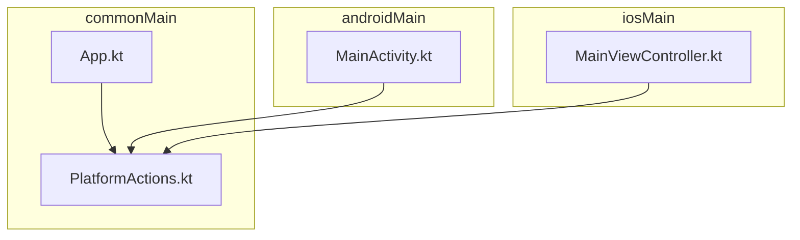
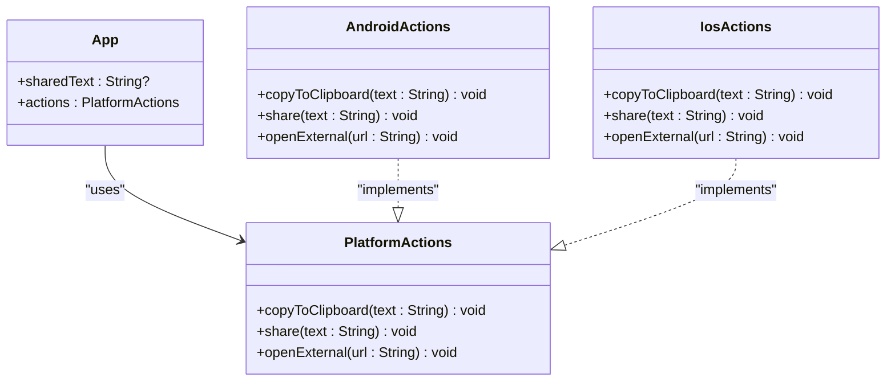
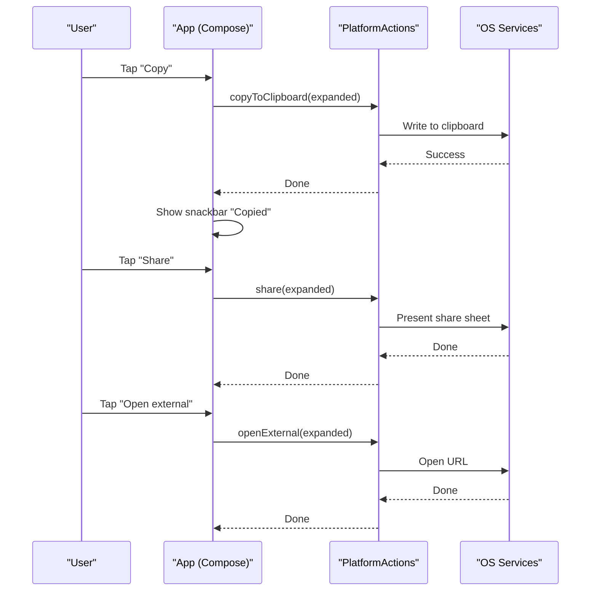
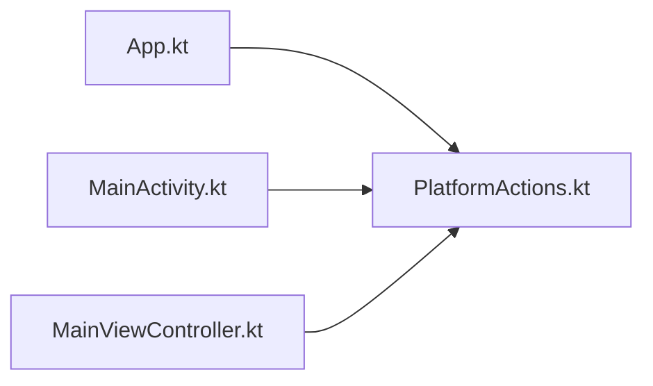

# Platform Actions Interface (PlatformActions.kt)

<cite>
**Referenced Files in This Document**
- [PlatformActions.kt](file://composeApp/src/commonMain/kotlin/com/brunoshiroma/url_expander/PlatformActions.kt)
- [App.kt](file://composeApp/src/commonMain/kotlin/com/brunoshiroma/url_expander/App.kt)
- [MainActivity.kt](file://composeApp/src/androidMain/kotlin/com/brunoshiroma/url_expander/MainActivity.kt)
- [MainViewController.kt](file://composeApp/src/iosMain/kotlin/com/brunoshiroma/url_expander/MainViewController.kt)
</cite>

## Table of Contents
1. [Introduction](#introduction)
2. [Project Structure](#project-structure)
3. [Core Components](#core-components)
4. [Architecture Overview](#architecture-overview)
5. [Detailed Component Analysis](#detailed-component-analysis)
6. [Dependency Analysis](#dependency-analysis)
7. [Performance Considerations](#performance-considerations)
8. [Troubleshooting Guide](#troubleshooting-guide)
9. [Conclusion](#conclusion)

## Introduction
This document explains the PlatformActions interface and its role in enabling cross-platform functionality through Kotlin Multiplatform’s expect/actual pattern. It covers method signatures, expected behaviors on Android and iOS, how shared UI code uses the interface, and best practices for implementing platform-specific actions while keeping concerns cleanly separated.

## Project Structure
The relevant parts of the project are organized by platform:
- commonMain defines the shared contract via PlatformActions and the UI that consumes it.
- androidMain provides an actual implementation of PlatformActions for Android.
- iosMain provides an actual implementation of PlatformActions for iOS.

**Diagram sources**
- [PlatformActions.kt:1-15](file://composeApp/src/commonMain/kotlin/com/brunoshiroma/url_expander/PlatformActions.kt#L1-L15)
- [App.kt:36-120](file://composeApp/src/commonMain/kotlin/com/brunoshiroma/url_expander/App.kt#L36-L120)
- [MainActivity.kt:15-42](file://composeApp/src/androidMain/kotlin/com/brunoshiroma/url_expander/MainActivity.kt#L15-L42)
- [MainViewController.kt:9-25](file://composeApp/src/iosMain/kotlin/com/brunoshiroma/url_expander/MainViewController.kt#L9-L25)

**Section sources**
- [PlatformActions.kt:1-15](file://composeApp/src/commonMain/kotlin/com/brunoshiroma/url_expander/PlatformActions.kt#L1-L15)
- [App.kt:36-120](file://composeApp/src/commonMain/kotlin/com/brunoshiroma/url_expander/App.kt#L36-L120)
- [MainActivity.kt:15-42](file://composeApp/src/androidMain/kotlin/com/brunoshiroma/url_expander/MainActivity.kt#L15-L42)
- [MainViewController.kt:9-25](file://composeApp/src/iosMain/kotlin/com/brunoshiroma/url_expander/MainViewController.kt#L9-L25)

## Core Components
- PlatformActions: A shared interface defining three platform operations:
  - copyToClipboard(text: String): Copies text to the system clipboard.
  - share(text: String): Shares the provided text using the platform’s native sharing mechanism.
  - openExternal(url: String): Opens a URL in the default external handler (browser or app).
- App: The shared Compose UI that invokes PlatformActions methods from user interactions.
- Android implementation: MainActivity creates an anonymous object implementing PlatformActions using Android APIs.
- iOS implementation: MainViewController defines IosActions implementing PlatformActions using iOS APIs.

Key responsibilities:
- Shared code remains platform-agnostic by depending only on PlatformActions.
- Each platform supplies concrete behavior without leaking platform details into shared code.

**Section sources**
- [PlatformActions.kt:6-11](file://composeApp/src/commonMain/kotlin/com/brunoshiroma/url_expander/PlatformActions.kt#L6-L11)
- [App.kt:103-116](file://composeApp/src/commonMain/kotlin/com/brunoshiroma/url_expander/App.kt#L103-L116)
- [MainActivity.kt:19-36](file://composeApp/src/androidMain/kotlin/com/brunoshiroma/url_expander/MainActivity.kt#L19-L36)
- [MainViewController.kt:9-23](file://composeApp/src/iosMain/kotlin/com/brunoshiroma/url_expander/MainViewController.kt#L9-L23)

## Architecture Overview
The design leverages Kotlin Multiplatform’s expect/actual pattern to decouple shared UI from platform-specific capabilities.

**Diagram sources**
- [PlatformActions.kt:6-11](file://composeApp/src/commonMain/kotlin/com/brunoshiroma/url_expander/PlatformActions.kt#L6-L11)
- [App.kt:36-40](file://composeApp/src/commonMain/kotlin/com/brunoshiroma/url_expander/App.kt#L36-L40)
- [MainActivity.kt:19-36](file://composeApp/src/androidMain/kotlin/com/brunoshiroma/url_expander/MainActivity.kt#L19-L36)
- [MainViewController.kt:9-23](file://composeApp/src/iosMain/kotlin/com/brunoshiroma/url_expander/MainViewController.kt#L9-L23)

## Detailed Component Analysis

### PlatformActions Interface
Purpose:
- Defines a stable contract for platform-specific operations used by shared UI.
- Ensures consistent method signatures across platforms.

Method contracts:
- copyToClipboard(text: String)
  - Behavior: Writes the given text to the system clipboard.
  - Parameters: text to be copied.
  - Return: None (void).
  - Errors: No explicit exceptions; failures should be handled internally by the platform implementation.
- share(text: String)
  - Behavior: Presents the platform’s native share sheet with the provided text.
  - Parameters: text to share.
  - Return: None (void).
  - Errors: No explicit exceptions; platform may ignore invalid inputs gracefully.
- openExternal(url: String)
  - Behavior: Opens the URL in the default external handler (e.g., browser).
  - Parameters: url string.
  - Return: None (void).
  - Errors: No explicit exceptions; invalid URLs may be ignored or handled by the OS.

Design principles:
- Abstraction over platform APIs enables shared UI to remain clean and portable.
- Thin, focused methods reduce coupling and improve testability.
- Void returns simplify error handling at call sites; errors are encapsulated within implementations.

**Section sources**
- [PlatformActions.kt:6-11](file://composeApp/src/commonMain/kotlin/com/brunoshiroma/url_expander/PlatformActions.kt#L6-L11)

### Android Implementation (MainActivity)
Responsibilities:
- Implements PlatformActions using Android APIs:
  - ClipboardManager for copying text.
  - Intent.ACTION_SEND for sharing text.
  - Intent.ACTION_VIEW for opening URLs externally.
- Provides the PlatformActions instance to the shared App composable.

Behavior highlights:
- copyToClipboard: Uses system clipboard service to set primary clip.
- share: Creates a chooser intent for text/plain content.
- openExternal: Launches a view intent with the parsed URL.

Integration:
- MainActivity constructs an anonymous object implementing PlatformActions and passes it to App during setContent.

**Section sources**
- [MainActivity.kt:19-36](file://composeApp/src/androidMain/kotlin/com/brunoshiroma/url_expander/MainActivity.kt#L19-L36)
- [MainActivity.kt:38-42](file://composeApp/src/androidMain/kotlin/com/brunoshiroma/url_expander/MainActivity.kt#L38-L42)

### iOS Implementation (MainViewController)
Responsibilities:
- Implements PlatformActions using iOS APIs:
  - UIPasteboard for copying text.
  - UIActivityViewController for sharing text.
  - UIApplication.openURL for opening URLs externally.
- Exposes a Compose entry point that injects IosActions into App.

Behavior highlights:
- copyToClipboard: Sets UIPasteboard.generalPasteboard.string.
- share: Presents UIActivityViewController with the text.
- openExternal: Converts string to NSURL and opens via UIApplication.

Integration:
- MainViewController returns a ComposeUIViewController that initializes App with IosActions.

**Section sources**
- [MainViewController.kt:9-23](file://composeApp/src/iosMain/kotlin/com/brunoshiroma/url_expander/MainViewController.kt#L9-L23)
- [MainViewController.kt:25-25](file://composeApp/src/iosMain/kotlin/com/brunoshiroma/url_expander/MainViewController.kt#L25-L25)

### Usage in Shared UI (App)
How App uses PlatformActions:
- Receives actions: PlatformActions as a parameter.
- Invokes methods from user-triggered events:
  - Copy button calls actions.copyToClipboard(expanded).
  - Share button calls actions.share(expanded).
  - Open external button calls actions.openExternal(expanded).

Error handling expectations:
- App does not catch exceptions from PlatformActions; implementations should handle invalid inputs or OS-level failures internally.
- UI feedback (e.g., snackbar) is shown after successful copy invocation.

**Diagram sources**
- [App.kt:103-116](file://composeApp/src/commonMain/kotlin/com/brunoshiroma/url_expander/App.kt#L103-L116)
- [MainActivity.kt:19-36](file://composeApp/src/androidMain/kotlin/com/brunoshiroma/url_expander/MainActivity.kt#L19-L36)
- [MainViewController.kt:9-23](file://composeApp/src/iosMain/kotlin/com/brunoshiroma/url_expander/MainViewController.kt#L9-L23)

**Section sources**
- [App.kt:103-116](file://composeApp/src/commonMain/kotlin/com/brunoshiroma/url_expander/App.kt#L103-L116)

## Dependency Analysis
- App depends on PlatformActions abstraction, not on platform-specific classes.
- Android and iOS modules depend on PlatformActions to provide concrete implementations.
- This separation ensures:
  - Low coupling between shared UI and platform layers.
  - High cohesion within each platform’s implementation.
  - Easy extension to additional platforms without modifying shared code.

**Diagram sources**
- [App.kt:36-40](file://composeApp/src/commonMain/kotlin/com/brunoshiroma/url_expander/App.kt#L36-L40)
- [PlatformActions.kt:6-11](file://composeApp/src/commonMain/kotlin/com/brunoshiroma/url_expander/PlatformActions.kt#L6-L11)
- [MainActivity.kt:19-36](file://composeApp/src/androidMain/kotlin/com/brunoshiroma/url_expander/MainActivity.kt#L19-L36)
- [MainViewController.kt:9-23](file://composeApp/src/iosMain/kotlin/com/brunoshiroma/url_expander/MainViewController.kt#L9-L23)

**Section sources**
- [App.kt:36-40](file://composeApp/src/commonMain/kotlin/com/brunoshiroma/url_expander/App.kt#L36-L40)
- [PlatformActions.kt:6-11](file://composeApp/src/commonMain/kotlin/com/brunoshiroma/url_expander/PlatformActions.kt#L6-L11)

## Performance Considerations
- All PlatformActions methods are synchronous and return void, minimizing overhead in the UI thread.
- Clipboard and sharing operations are typically fast; avoid heavy work inside these methods.
- Prefer delegating long-running tasks to background scopes where appropriate; keep PlatformActions focused on thin platform calls.

[No sources needed since this section provides general guidance]

## Troubleshooting Guide
Common issues and resolutions:
- Clipboard write fails silently:
  - Ensure the text is non-null and non-empty before calling copyToClipboard.
  - On Android, verify clipboard permissions are not restricted by the OS.
- Share sheet does not appear:
  - Validate that the text is valid and supported by the target apps.
  - On iOS, ensure the activity controller is presented from a visible root view controller.
- External URL does not open:
  - Confirm the URL string is well-formed.
  - On iOS, check that the URL scheme is allowed and handled by installed apps.

Best practices:
- Keep PlatformActions methods simple and side-effect focused.
- Handle invalid inputs gracefully within platform implementations.
- Avoid throwing exceptions from PlatformActions; instead, log or ignore invalid cases.

**Section sources**
- [MainActivity.kt:19-36](file://composeApp/src/androidMain/kotlin/com/brunoshiroma/url_expander/MainActivity.kt#L19-L36)
- [MainViewController.kt:9-23](file://composeApp/src/iosMain/kotlin/com/brunoshiroma/url_expander/MainViewController.kt#L9-L23)

## Conclusion
PlatformActions provides a clean, minimal abstraction for platform-specific operations, enabling shared UI code to remain portable and maintainable. By adhering to the defined contracts and following the outlined best practices, you can implement new platform features with confidence while preserving a clear separation of concerns.

[No sources needed since this section summarizes without analyzing specific files]