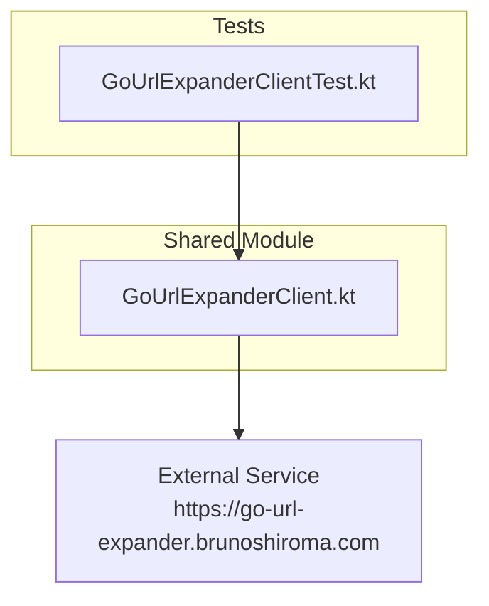
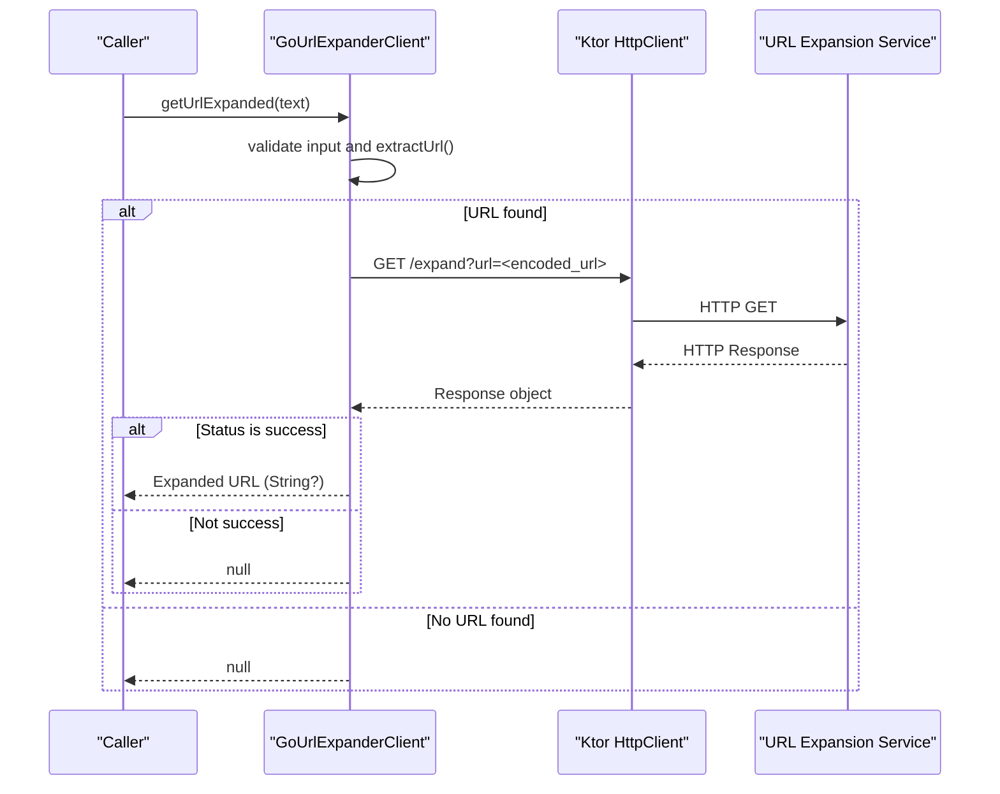
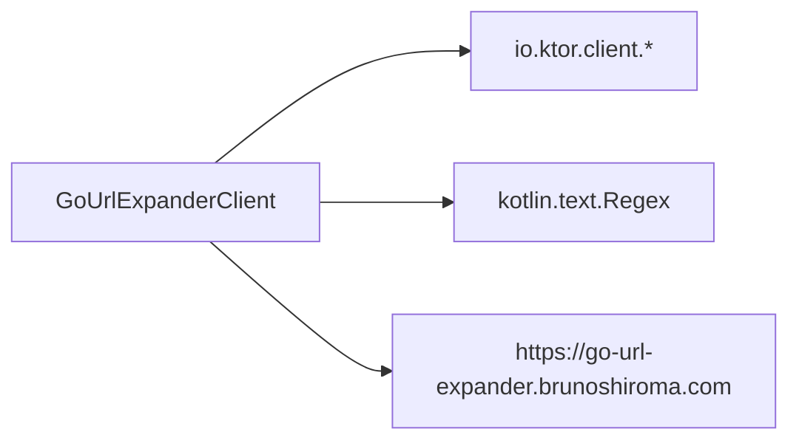

# URL Expansion Client (GoUrlExpanderClient.kt)

<cite>
**Referenced Files in This Document**
- [GoUrlExpanderClient.kt](file://composeApp/src/commonMain/kotlin/com/brunoshiroma/url_expander/GoUrlExpanderClient.kt)
- [GoUrlExpanderClientTest.kt](file://composeApp/src/commonTest/kotlin/com/brunoshiroma/url_expander/GoUrlExpanderClientTest.kt)
- [README.md](file://README.md)
</cite>

## Table of Contents
1. [Introduction](#introduction)
2. [Project Structure](#project-structure)
3. [Core Components](#core-components)
4. [Architecture Overview](#architecture-overview)
5. [Detailed Component Analysis](#detailed-component-analysis)
6. [Dependency Analysis](#dependency-analysis)
7. [Performance Considerations](#performance-considerations)
8. [Troubleshooting Guide](#troubleshooting-guide)
9. [Conclusion](#conclusion)

## Introduction
This document explains the GoUrlExpanderClient component responsible for HTTP communication and URL processing within a Kotlin Multiplatform project. It covers how the client extracts URLs from text, makes network requests to an external URL expansion service using Ktor, and handles responses. The goal is to provide clear guidance on the public API, error handling strategies, configuration options, and integration points with the remote endpoint.

## Project Structure
The URL expansion client resides in the shared module and uses Ktor for networking:
- Shared code: composeApp/src/commonMain
- Tests: composeApp/src/commonTest
- Android/iOS platform-specific UI and integrations are outside the scope of this document.

**Diagram sources**
- [GoUrlExpanderClient.kt:13-23](file://composeApp/src/commonMain/kotlin/com/brunoshiroma/url_expander/GoUrlExpanderClient.kt#L13-L23)
- [GoUrlExpanderClientTest.kt:20-42](file://composeApp/src/commonTest/kotlin/com/brunoshiroma/url_expander/GoUrlExpanderClientTest.kt#L20-L42)

**Section sources**
- [README.md:1-8](file://README.md#L1-L8)

## Core Components
- GoUrlExpanderClient: A suspend-capable client that:
  - Extracts a URL from input text using a regex pattern.
  - Sends a GET request to the expansion endpoint with the extracted URL as a query parameter.
  - Returns the expanded URL string when the response status indicates success; otherwise returns null.
- extractUrl(text): A top-level function that finds the first URL-like substring in the provided text.

Key behaviors:
- Input validation: If the input equals a sentinel value indicating no data, the method returns null immediately.
- URL extraction: Uses a regular expression to locate http or https URLs embedded in arbitrary text.
- Network call: Uses Ktor’s HttpClient to perform a GET request to /expand with url parameter.
- Response handling: Only successful HTTP statuses result in returning the body; all other cases return null.

Public API:
- getUrlExpanded(text: String): String?
  - Validates input against a sentinel constant.
  - Extracts URL via extractUrl().
  - Performs HTTP GET to baseUrl + "/expand?url=...".
  - Returns response body if status is successful; otherwise null.

Configuration:
- baseUrl: Defaults to the production service URL but can be overridden for testing or custom deployments.
- client: Accepts a preconfigured Ktor HttpClient instance; defaults to a new instance.

Error handling:
- Non-successful HTTP responses yield null rather than throwing exceptions.
- Missing or invalid URLs in input yield null.
- Sentinel input yields null without making a network request.

Timeouts and connection pooling:
- No explicit timeout or connection pool settings are configured in the client. Behavior depends on the default Ktor engine configuration.

Retry mechanisms:
- No built-in retry logic is implemented.

**Section sources**
- [GoUrlExpanderClient.kt:9-27](file://composeApp/src/commonMain/kotlin/com/brunoshiroma/url_expander/GoUrlExpanderClient.kt#L9-L27)

## Architecture Overview
The client follows a simple request-response flow:
1. Validate input and extract URL.
2. Build a GET request to the expansion endpoint with the URL encoded as a query parameter.
3. Receive the response and return the body only if the status is successful.

**Diagram sources**
- [GoUrlExpanderClient.kt:17-23](file://composeApp/src/commonMain/kotlin/com/brunoshiroma/url_expander/GoUrlExpanderClient.kt#L17-L23)

## Detailed Component Analysis

### URL Extraction Logic
- Pattern: Matches http or https URLs followed by non-whitespace characters.
- Behavior:
  - Returns the first match group if present.
  - Returns null when no match is found.

Examples of matching behavior (described conceptually):
- Input containing a URL embedded in text returns the URL portion.
- Input without any URL returns null.

**Section sources**
- [GoUrlExpanderClient.kt:9-11](file://composeApp/src/commonMain/kotlin/com/brunoshiroma/url_expander/GoUrlExpanderClient.kt#L9-L11)
- [GoUrlExpanderClientTest.kt:14-18](file://composeApp/src/commonTest/kotlin/com/brunoshiroma/url_expander/GoUrlExpanderClientTest.kt#L14-L18)

### HTTP Communication
- Endpoint: GET /expand with query parameter url.
- Base URL: Configurable; defaults to the production service.
- Request building: Uses Ktor’s get() and parameter() helpers.
- Response handling: Checks status.isSuccess() and returns body<String>() on success; otherwise returns null.

Request/response models:
- Request: GET with query parameter url (automatically encoded).
- Response: Plain text body representing the expanded URL.

Integration notes:
- The client assumes the remote service responds with a plain text URL upon success.
- Non-successful responses are treated as failures and return null.

**Section sources**
- [GoUrlExpanderClient.kt:13-23](file://composeApp/src/commonMain/kotlin/com/brunoshiroma/url_expander/GoUrlExpanderClient.kt#L13-L23)
- [GoUrlExpanderClientTest.kt:26-36](file://composeApp/src/commonTest/kotlin/com/brunoshiroma/url_expander/GoUrlExpanderClientTest.kt#L26-L36)

### Public API Methods
- getUrlExpanded(text: String): String?
  - Validates against a sentinel constant for “no data” and returns null early.
  - Extracts URL; if none, returns null.
  - Performs network request and returns expanded URL on success; otherwise null.

Parameter validation:
- Explicit check for sentinel value.
- Implicit validation via URL extraction; missing URL leads to null.

Error handling strategy:
- Silent failure model: errors and non-successful responses map to null instead of throwing.

Timeout configuration:
- Not explicitly set; relies on default Ktor engine configuration.

Connection pooling and lifecycle:
- Default HttpClient is created per instance unless injected.
- No explicit lifecycle management or reuse strategy is implemented here.

Retry mechanisms:
- None implemented.

**Section sources**
- [GoUrlExpanderClient.kt:13-27](file://composeApp/src/commonMain/kotlin/com/brunoshiroma/url_expander/GoUrlExpanderClient.kt#L13-L27)
- [GoUrlExpanderClientTest.kt:20-42](file://composeApp/src/commonTest/kotlin/com/brunoshiroma/url_expander/GoUrlExpanderClientTest.kt#L20-L42)

### Test Coverage Highlights
- extractUrlFindsUrlInsideText: Verifies URL extraction from mixed content and null when absent.
- noDataReturnsNull: Confirms sentinel input returns null without network calls.
- returnsBodyOnSuccessAndEncodesUrl: Validates successful response and correct URL encoding in the request.
- nonSuccessReturnsNull: Ensures non-success HTTP status results in null.

**Section sources**
- [GoUrlExpanderClientTest.kt:14-42](file://composeApp/src/commonTest/kotlin/com/brunoshiroma/url_expander/GoUrlExpanderClientTest.kt#L14-L42)

## Dependency Analysis
The client depends on:
- Ktor Client APIs for HTTP operations.
- Standard Kotlin Regex for URL extraction.
- External URL expansion service over HTTPS.

**Diagram sources**
- [GoUrlExpanderClient.kt:3-7](file://composeApp/src/commonMain/kotlin/com/brunoshiroma/url_expander/GoUrlExpanderClient.kt#L3-L7)
- [GoUrlExpanderClient.kt:9-23](file://composeApp/src/commonMain/kotlin/com/brunoshiroma/url_expander/GoUrlExpanderClient.kt#L9-L23)

**Section sources**
- [GoUrlExpanderClient.kt:3-23](file://composeApp/src/commonMain/kotlin/com/brunoshiroma/url_expander/GoUrlExpanderClient.kt#L3-L23)

## Performance Considerations
- URL extraction is O(n) with respect to input length due to regex scanning.
- Network latency dominates overall performance; consider:
  - Reusing a single HttpClient instance across the app to leverage connection pooling.
  - Configuring timeouts appropriate for your environment.
  - Adding caching for repeated expansions if applicable.
- Avoid unnecessary allocations by reusing the client and avoiding per-call HttpClient construction.

[No sources needed since this section provides general guidance]

## Troubleshooting Guide
Common issues and resolutions:
- Null returned unexpectedly:
  - Input equals the sentinel value; ensure callers pass meaningful text.
  - No URL found in input; verify input contains a valid http/https URL.
  - Non-successful HTTP response; inspect server status codes and logs.
- Network errors:
  - Ensure connectivity and DNS resolution.
  - Verify the base URL is reachable and the /expand endpoint exists.
- Encoding issues:
  - The client encodes the url parameter automatically; confirm the remote service expects standard URL encoding.

Operational checks:
- Use mock engines in tests to simulate various HTTP statuses and payloads.
- Log the constructed request URL during development to verify parameter encoding.

**Section sources**
- [GoUrlExpanderClientTest.kt:20-42](file://composeApp/src/commonTest/kotlin/com/brunoshiroma/url_expander/GoUrlExpanderClientTest.kt#L20-L42)

## Conclusion
GoUrlExpanderClient provides a minimal, robust interface for extracting URLs from text and expanding them via a remote service. Its design emphasizes simplicity and predictable null-based error signaling. For production use, consider injecting a shared HttpClient with tuned timeouts and connection pooling, and extend error handling to surface actionable diagnostics while preserving the current contract where appropriate.

[No sources needed since this section summarizes without analyzing specific files]