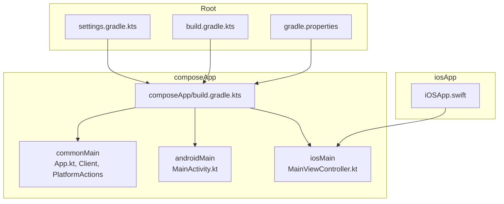

# Getting Started

<cite>
**Referenced Files in This Document**
- [README.md](file://README.md)
- [build.gradle.kts](file://build.gradle.kts)
- [settings.gradle.kts](file://settings.gradle.kts)
- [gradle.properties](file://gradle.properties)
- [composeApp/build.gradle.kts](file://composeApp/build.gradle.kts)
- [App.kt](file://composeApp/src/commonMain/kotlin/com/brunoshiroma/url_expander/App.kt)
- [MainActivity.kt](file://composeApp/src/androidMain/kotlin/com/brunoshiroma/url_expander/MainActivity.kt)
- [MainViewController.kt](file://composeApp/src/iosMain/kotlin/com/brunoshiroma/url_expander/MainViewController.kt)
- [iOSApp.swift](file://iosApp/iosApp/iOSApp.swift)
- [.sdkmanrc](file://.sdkmanrc)
</cite>

## Table of Contents
1. [Introduction](#introduction)
2. [Prerequisites](#prerequisites)
3. [Installation and Setup](#installation-and-setup)
4. [Project Structure](#project-structure)
5. [Build Commands](#build-commands)
6. [Run the Application](#run-the-application)
7. [Troubleshooting](#troubleshooting)
8. [Conclusion](#conclusion)

## Introduction
This project is a Kotlin Multiplatform + Compose Multiplatform client for go-url-expander. It shares UI and networking logic across Android and iOS, with platform-specific implementations for clipboard, sharing, and web view behavior. The repository includes an Android app module and an iOS host app that embeds the shared framework.

## Prerequisites
Before you begin, ensure your development environment meets the following requirements:

- Android Studio (latest stable recommended)
  - Android SDK installed
  - Android Emulator or physical device configured
- Xcode (latest stable recommended)
  - macOS required for iOS builds
- JDK 17
  - The project configures Gradle to use JVM 17 for Android compilation
- Gradle
  - Use the Gradle Wrapper included in the repository
- Kotlin Multiplatform and Compose Multiplatform tooling
  - Provided via Gradle plugins defined in the project

Environment configuration hints:
- The project sets Gradle JVM arguments and enables caching.
- A .sdkmanrc file specifies Java 17 Graal CE as the preferred JDK.

**Section sources**
- [README.md:10-17](file://README.md#L10-L17)
- [composeApp/build.gradle.kts:10-15](file://composeApp/build.gradle.kts#L10-L15)
- [gradle.properties:1-5](file://gradle.properties#L1-L5)
- [.sdkmanrc:1-4](file://.sdkmanrc#L1-L4)

## Installation and Setup
Follow these steps to set up both Android and iOS environments.

### Android setup
1. Install Android Studio and open this project.
2. Allow Gradle to sync dependencies.
3. Ensure the Android SDK and emulator/device are configured.
4. Verify the Android module compiles by running the Android debug build command below.

### iOS setup
1. Install Xcode on macOS.
2. Open the iOS host app at iosApp/iosApp in Xcode.
3. Add a Run Script build phase in the Xcode project that invokes the Gradle task to embed and sign the Apple framework.
4. Link the generated ComposeApp.framework in the Xcode project.

Notes:
- The README provides the exact Gradle tasks for building the Android APK and iOS framework.
- For iOS integration into Xcode, the README includes the Run Script command and linking instructions.

**Section sources**
- [README.md:10-17](file://README.md#L10-L17)

## Project Structure
The project uses a multi-module layout with shared code and platform-specific modules:

- Root Gradle settings define repositories and include the composeApp module.
- Root build.gradle.kts applies plugin aliases without enabling them globally.
- composeApp/build.gradle.kts configures:
  - Kotlin Multiplatform targets (Android and iOS variants)
  - Compose Multiplatform dependencies
  - Ktor client dependencies per platform
  - Android application configuration (namespace, compileSdk, minSdk, targetSdk, versioning)
- Shared code lives under composeApp/src/commonMain:
  - App UI composable
  - URL expander client
  - PlatformActions interface
- Android-specific code under composeApp/src/androidMain:
  - MainActivity handling share intents and platform actions
- iOS-specific code under composeApp/src/iosMain:
  - MainViewController bridging to SwiftUI
  - PlatformWebView implementation for iOS
- iOS host app under iosApp/iosApp:
  - SwiftUI entry point

**Diagram sources**
- [settings.gradle.kts:1-22](file://settings.gradle.kts#L1-L22)
- [build.gradle.kts:1-7](file://build.gradle.kts#L1-L7)
- [gradle.properties:1-5](file://gradle.properties#L1-L5)
- [composeApp/build.gradle.kts:1-73](file://composeApp/build.gradle.kts#L1-L73)
- [App.kt:1-127](file://composeApp/src/commonMain/kotlin/com/brunoshiroma/url_expander/App.kt#L1-L127)
- [MainActivity.kt:1-62](file://composeApp/src/androidMain/kotlin/com/brunoshiroma/url_expander/MainActivity.kt#L1-L62)
- [MainViewController.kt:1-26](file://composeApp/src/iosMain/kotlin/com/brunoshiroma/url_expander/MainViewController.kt#L1-L26)
- [iOSApp.swift:1-11](file://iosApp/iosApp/iOSApp.swift#L1-L11)

**Section sources**
- [settings.gradle.kts:1-22](file://settings.gradle.kts#L1-L22)
- [build.gradle.kts:1-7](file://build.gradle.kts#L1-L7)
- [composeApp/build.gradle.kts:1-73](file://composeApp/build.gradle.kts#L1-L73)
- [App.kt:1-127](file://composeApp/src/commonMain/kotlin/com/brunoshiroma/url_expander/App.kt#L1-L127)
- [MainActivity.kt:1-62](file://composeApp/src/androidMain/kotlin/com/brunoshiroma/url_expander/MainActivity.kt#L1-L62)
- [MainViewController.kt:1-26](file://composeApp/src/iosMain/kotlin/com/brunoshiroma/url_expander/MainViewController.kt#L1-L26)
- [iOSApp.swift:1-11](file://iosApp/iosApp/iOSApp.swift#L1-L11)

## Build Commands
Use the Gradle Wrapper from the repository root to build artifacts.

- Generate Android APK (debug):
  - gradle :composeApp:assembleDebug
- Run shared tests (JVM):
  - gradle :composeApp:testDebugUnitTest
- Generate iOS framework (macOS):
  - gradle :composeApp:linkDebugFrameworkIosSimulatorArm64

For iOS integration into Xcode:
- Add a Run Script build phase in the Xcode project:
  - cd "$SRCROOT/.." && gradle :composeApp:embedAndSignAppleFrameworkForXcode
- Link ComposeApp.framework in the Xcode project.

**Section sources**
- [README.md:10-17](file://README.md#L10-L17)

## Run the Application
### Android
- Build the debug APK using the command above.
- Install and run the APK on an emulator or connected device.
- The Android app handles text/plain share intents and displays the expanded URL with options to copy, share, open externally, or open internally.

Key behaviors:
- MainActivity receives shared text and passes it to the shared UI.
- PlatformActions implement clipboard, share, and external URL opening on Android.

**Section sources**
- [MainActivity.kt:15-60](file://composeApp/src/androidMain/kotlin/com/brunoshiroma/url_expander/MainActivity.kt#L15-L60)
- [App.kt:36-125](file://composeApp/src/commonMain/kotlin/com/brunoshiroma/url_expander/App.kt#L36-L125)

### iOS
- Open iosApp/iosApp in Xcode.
- Ensure the Run Script build phase is added and ComposeApp.framework is linked as described in the Build Commands section.
- Build and run the iOS app from Xcode.
- The iOS host app launches the shared Compose UI via MainViewController.
- PlatformActions implement clipboard, share, and external URL opening on iOS.

**Section sources**
- [iOSApp.swift:1-11](file://iosApp/iosApp/iOSApp.swift#L1-L11)
- [MainViewController.kt:9-25](file://composeApp/src/iosMain/kotlin/com/brunoshiroma/url_expander/MainViewController.kt#L9-L25)
- [App.kt:36-125](file://composeApp/src/commonMain/kotlin/com/brunoshiroma/url_expander/App.kt#L36-L125)

## Troubleshooting
Common setup issues and resolutions:

- Gradle JVM mismatch
  - Symptom: Compilation errors related to Java/Kotlin versions.
  - Resolution: Ensure JDK 17 is used. The project sets JVM target to 17 and defines Gradle JVM args. Consider using sdkman with the provided .sdkmanrc to auto-select Java 17 Graal CE.

- Android SDK or emulator not configured
  - Symptom: Build fails when targeting Android.
  - Resolution: Install Android SDK components and configure an emulator or device in Android Studio.

- iOS build fails due to missing framework or signing
  - Symptom: Xcode cannot find ComposeApp.framework or signing errors occur.
  - Resolution: Add the Run Script build phase to embed and sign the framework, then link ComposeApp.framework in the Xcode project.

- Dependency resolution failures
  - Symptom: Gradle cannot resolve plugins or libraries.
  - Resolution: Verify internet access and that repositories (Google, Maven Central) are reachable. The project configures these repositories in settings.gradle.kts.

- Slow builds
  - Symptom: Builds take too long.
  - Resolution: Gradle caching is enabled in gradle.properties. Ensure the Gradle daemon is running and consider increasing JVM heap if needed.

**Section sources**
- [composeApp/build.gradle.kts:10-15](file://composeApp/build.gradle.kts#L10-L15)
- [gradle.properties:1-5](file://gradle.properties#L1-L5)
- [.sdkmanrc:1-4](file://.sdkmanrc#L1-L4)
- [settings.gradle.kts:3-8](file://settings.gradle.kts#L3-L8)
- [README.md:10-17](file://README.md#L10-L17)

## Conclusion
You now have the prerequisites, installation steps, project structure overview, build commands, and guidance to run the Kotlin URL Expander on Android and iOS. If you encounter environment or build issues, refer to the troubleshooting section for common fixes.