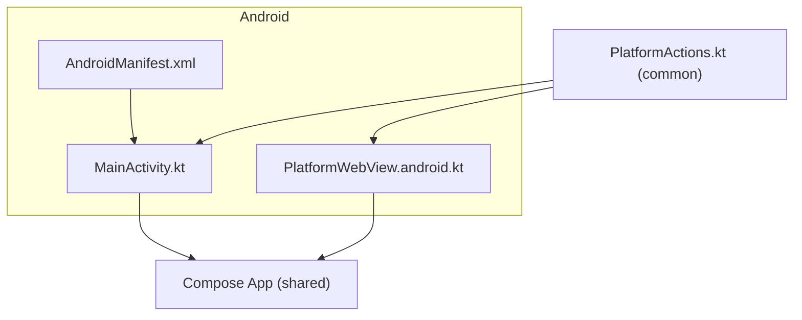
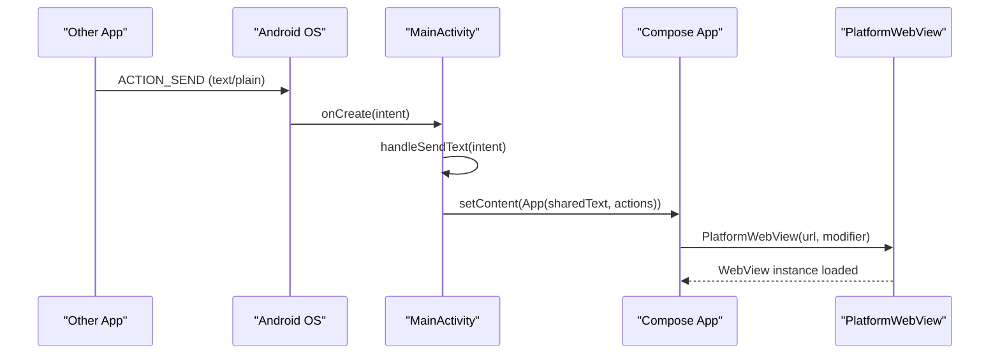
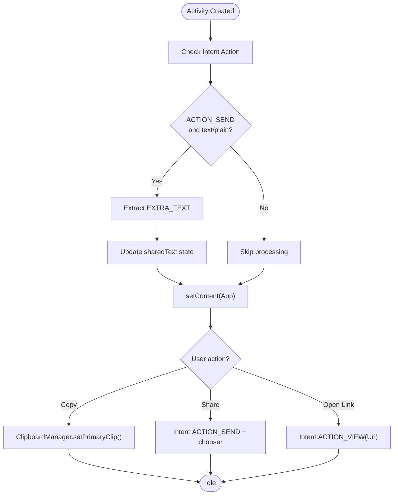
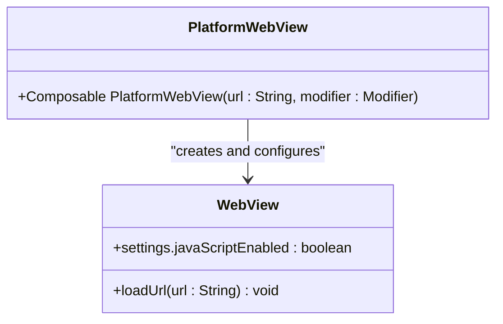
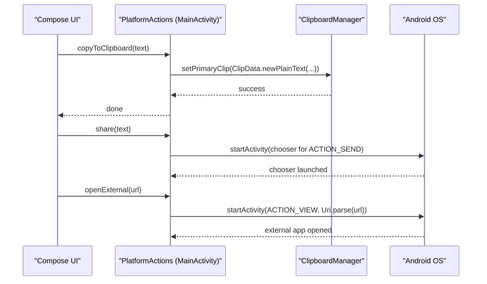
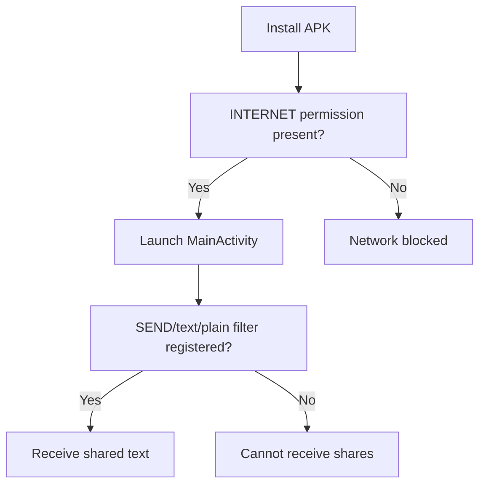
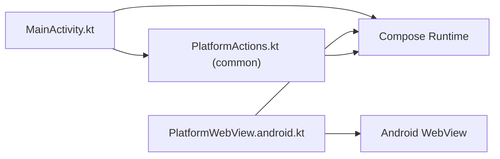

# Android Implementation

<cite>
**Referenced Files in This Document**
- [MainActivity.kt](file://composeApp/src/androidMain/kotlin/com/brunoshiroma/url_expander/MainActivity.kt)
- [PlatformWebView.android.kt](file://composeApp/src/androidMain/kotlin/com/brunoshiroma/url_expander/PlatformWebView.android.kt)
- [AndroidManifest.xml](file://composeApp/src/androidMain/AndroidManifest.xml)
- [PlatformActions.kt](file://composeApp/src/commonMain/kotlin/com/brunoshiroma/url_expander/PlatformActions.kt)
- [README.md](file://README.md)
</cite>

## Table of Contents
1. [Introduction](#introduction)
2. [Project Structure](#project-structure)
3. [Core Components](#core-components)
4. [Architecture Overview](#architecture-overview)
5. [Detailed Component Analysis](#detailed-component-analysis)
6. [Dependency Analysis](#dependency-analysis)
7. [Performance Considerations](#performance-considerations)
8. [Troubleshooting Guide](#troubleshooting-guide)
9. [Conclusion](#conclusion)

## Introduction
This document explains the Android implementation of the URL Expander application, focusing on:
- The Activity lifecycle and how it handles incoming text shares (ACTION_SEND).
- How URLs are processed from other apps via intents.
- The Android-specific WebView implementation, including configuration and navigation behavior.
- Platform actions for clipboard operations, system sharing, and opening external links.
- Android-specific considerations such as permissions, manifest configuration, and activity lifecycle management.

The app is a Kotlin Multiplatform Compose project where shared UI logic lives in commonMain and platform-specific implementations reside under androidMain.

**Section sources**
- [README.md:1-8](file://README.md#L1-L8)

## Project Structure
At a high level, the Android module provides:
- An Activity that receives shared text and hosts the Compose UI.
- A WebView wrapper to render web content.
- Manifest declarations for permissions, intent filters, and queries.

**Diagram sources**
- [MainActivity.kt:15-60](file://composeApp/src/androidMain/kotlin/com/brunoshiroma/url_expander/MainActivity.kt#L15-L60)
- [PlatformWebView.android.kt:9-21](file://composeApp/src/androidMain/kotlin/com/brunoshiroma/url_expander/PlatformWebView.android.kt#L9-L21)
- [AndroidManifest.xml:17-40](file://composeApp/src/androidMain/AndroidManifest.xml#L17-L40)
- [PlatformActions.kt:6-14](file://composeApp/src/commonMain/kotlin/com/brunoshiroma/url_expander/PlatformActions.kt#L6-L14)

**Section sources**
- [MainActivity.kt:15-60](file://composeApp/src/androidMain/kotlin/com/brunoshiroma/url_expander/MainActivity.kt#L15-L60)
- [PlatformWebView.android.kt:9-21](file://composeApp/src/androidMain/kotlin/com/brunoshiroma/url_expander/PlatformWebView.android.kt#L9-L21)
- [AndroidManifest.xml:17-40](file://composeApp/src/androidMain/AndroidManifest.xml#L17-L40)
- [PlatformActions.kt:6-14](file://composeApp/src/commonMain/kotlin/com/brunoshiroma/url_expander/PlatformActions.kt#L6-L14)

## Core Components
- MainActivity: Entry point that receives shared text, updates state, and renders the Compose UI with platform actions.
- PlatformWebView.android: Android-specific WebView composable that loads a URL.
- PlatformActions: Common interface defining clipboard, share, and external link operations; implemented by MainActivity.
- AndroidManifest.xml: Declares INTERNET permission, VIEW intent queries, and the SEND intent filter for text/plain.

Key responsibilities:
- Intent handling for ACTION_SEND with text/plain.
- Clipboard copy via ClipboardManager.
- System share via ACTION_SEND chooser.
- External link open via ACTION_VIEW.
- WebView setup with JavaScript enabled.

**Section sources**
- [MainActivity.kt:15-60](file://composeApp/src/androidMain/kotlin/com/brunoshiroma/url_expander/MainActivity.kt#L15-L60)
- [PlatformWebView.android.kt:9-21](file://composeApp/src/androidMain/kotlin/com/brunoshiroma/url_expander/PlatformWebView.android.kt#L9-L21)
- [PlatformActions.kt:6-14](file://composeApp/src/commonMain/kotlin/com/brunoshiroma/url_expander/PlatformActions.kt#L6-L14)
- [AndroidManifest.xml:4-15](file://composeApp/src/androidMain/AndroidManifest.xml#L4-L15)
- [AndroidManifest.xml:17-40](file://composeApp/src/androidMain/AndroidManifest.xml#L17-L40)

## Architecture Overview
The Android runtime delivers an Intent to MainActivity when another app shares text. MainActivity extracts the text, stores it in Compose state, and passes platform actions to the shared UI. The UI uses these actions to copy to clipboard, share, or open external links. For rendering web pages, the UI composes PlatformWebView which wraps a native WebView.

**Diagram sources**
- [MainActivity.kt:38-48](file://composeApp/src/androidMain/kotlin/com/brunoshiroma/url_expander/MainActivity.kt#L38-L48)
- [MainActivity.kt:56-60](file://composeApp/src/androidMain/kotlin/com/brunoshiroma/url_expander/MainActivity.kt#L56-L60)
- [PlatformWebView.android.kt:9-21](file://composeApp/src/androidMain/kotlin/com/brunoshiroma/url_expander/PlatformWebView.android.kt#L9-L21)

## Detailed Component Analysis

### MainActivity Lifecycle and Intent Handling
- Lifecycle:
  - onCreate: Initializes UI and processes the initial intent.
  - onNewIntent: Handles subsequent shares while the Activity is already running.
  - onStop: Finishes the task when the user navigates away, making the app transient.
- Intent handling:
  - Recognizes ACTION_SEND with mimeType text/plain.
  - Extracts EXTRA_TEXT and stores it in Compose state.
- Platform actions:
  - Copy to clipboard using ClipboardManager.
  - Share via ACTION_SEND with a chooser.
  - Open external links via ACTION_VIEW with a parsed Uri.

**Diagram sources**
- [MainActivity.kt:38-48](file://composeApp/src/androidMain/kotlin/com/brunoshiroma/url_expander/MainActivity.kt#L38-L48)
- [MainActivity.kt:56-60](file://composeApp/src/androidMain/kotlin/com/brunoshiroma/url_expander/MainActivity.kt#L56-L60)
- [MainActivity.kt:19-36](file://composeApp/src/androidMain/kotlin/com/brunoshiroma/url_expander/MainActivity.kt#L19-L36)

**Section sources**
- [MainActivity.kt:15-60](file://composeApp/src/androidMain/kotlin/com/brunoshiroma/url_expander/MainActivity.kt#L15-L60)

### PlatformWebView.android Implementation
- Wraps a native WebView inside a Composable using AndroidView.
- Enables JavaScript.
- Loads the provided URL immediately upon creation.

Security and configuration notes:
- JavaScript is enabled.
- No explicit security settings (e.g., mixed content, file access) are configured here.
- Navigation is handled by the WebView’s default behavior.

**Diagram sources**
- [PlatformWebView.android.kt:9-21](file://composeApp/src/androidMain/kotlin/com/brunoshiroma/url_expander/PlatformWebView.android.kt#L9-L21)

**Section sources**
- [PlatformWebView.android.kt:9-21](file://composeApp/src/androidMain/kotlin/com/brunoshiroma/url_expander/PlatformWebView.android.kt#L9-L21)

### Android-Specific Platform Actions
- Clipboard: Uses ClipboardManager to set primary clip with plain text.
- Sharing: Creates an ACTION_SEND intent with type text/plain and launches a chooser.
- External Links: Opens ACTION_VIEW with a Uri parsed from the provided URL string.

These actions implement the common PlatformActions interface so the shared UI can call them without knowing platform details.

**Diagram sources**
- [MainActivity.kt:19-36](file://composeApp/src/androidMain/kotlin/com/brunoshiroma/url_expander/MainActivity.kt#L19-L36)
- [PlatformActions.kt:6-14](file://composeApp/src/commonMain/kotlin/com/brunoshiroma/url_expander/PlatformActions.kt#L6-L14)

**Section sources**
- [MainActivity.kt:19-36](file://composeApp/src/androidMain/kotlin/com/brunoshiroma/url_expander/MainActivity.kt#L19-L36)
- [PlatformActions.kt:6-14](file://composeApp/src/commonMain/kotlin/com/brunoshiroma/url_expander/PlatformActions.kt#L6-L14)

### Manifest Configuration and Permissions
- Permission:
  - INTERNET is declared to allow network access.
- Queries:
  - Declares support for viewing HTTP and HTTPS schemes to satisfy Android visibility requirements for ACTION_VIEW.
- Activity:
  - MainActivity is exported and set as singleInstance.
  - Excludes from recents and clears task on launch.
  - Configures orientation and input changes.
  - Registers MAIN/LAUNCHER and SEND/text/plain intent filters.

**Diagram sources**
- [AndroidManifest.xml:4-15](file://composeApp/src/androidMain/AndroidManifest.xml#L4-L15)
- [AndroidManifest.xml:17-40](file://composeApp/src/androidMain/AndroidManifest.xml#L17-L40)

**Section sources**
- [AndroidManifest.xml:4-15](file://composeApp/src/androidMain/AndroidManifest.xml#L4-L15)
- [AndroidManifest.xml:17-40](file://composeApp/src/androidMain/AndroidManifest.xml#L17-L40)

## Dependency Analysis
- MainActivity depends on:
  - Android framework APIs (Intent, ClipboardManager, Context).
  - Compose runtime for state and UI composition.
  - PlatformActions interface defined in common.
- PlatformWebView.android depends on:
  - Android WebView.
  - Compose interop (AndroidView).
- Shared code depends on:
  - PlatformActions interface for cross-platform abstractions.

**Diagram sources**
- [MainActivity.kt:15-60](file://composeApp/src/androidMain/kotlin/com/brunoshiroma/url_expander/MainActivity.kt#L15-L60)
- [PlatformWebView.android.kt:9-21](file://composeApp/src/androidMain/kotlin/com/brunoshiroma/url_expander/PlatformWebView.android.kt#L9-L21)
- [PlatformActions.kt:6-14](file://composeApp/src/commonMain/kotlin/com/brunoshiroma/url_expander/PlatformActions.kt#L6-L14)

**Section sources**
- [MainActivity.kt:15-60](file://composeApp/src/androidMain/kotlin/com/brunoshiroma/url_expander/MainActivity.kt#L15-L60)
- [PlatformWebView.android.kt:9-21](file://composeApp/src/androidMain/kotlin/com/brunoshiroma/url_expander/PlatformWebView.android.kt#L9-L21)
- [PlatformActions.kt:6-14](file://composeApp/src/commonMain/kotlin/com/brunoshiroma/url_expander/PlatformActions.kt#L6-L14)

## Performance Considerations
- WebView initialization:
  - Creating a WebView inside AndroidView factory ensures it is created once per composition.
  - JavaScript is enabled; consider enabling only what is needed and disabling unnecessary features for performance and security.
- Activity lifecycle:
  - The Activity finishes itself on stop to keep the app transient, reducing memory footprint.
- Intent handling:
  - Minimal parsing of incoming intents keeps overhead low.

[No sources needed since this section provides general guidance]

## Troubleshooting Guide
- Shares not received:
  - Ensure the SEND/text/plain intent filter is present in the manifest.
  - Verify the target app targets a version requiring <queries> for ACTION_VIEW and that http/https schemes are included.
- Network errors in WebView:
  - Confirm INTERNET permission is declared.
  - Validate that the URL scheme is supported and reachable.
- Clipboard not working:
  - Ensure the app has the necessary runtime context and that the device supports clipboard operations.
- External links not opening:
  - Verify that at least one app can handle ACTION_VIEW for the given scheme.
  - Confirm <queries> entries include the required schemes.

**Section sources**
- [AndroidManifest.xml:4-15](file://composeApp/src/androidMain/AndroidManifest.xml#L4-L15)
- [AndroidManifest.xml:17-40](file://composeApp/src/androidMain/AndroidManifest.xml#L17-L40)
- [MainActivity.kt:56-60](file://composeApp/src/androidMain/kotlin/com/brunoshiroma/url_expander/MainActivity.kt#L56-L60)

## Conclusion
The Android implementation centers around a lightweight Activity that receives shared text, exposes platform actions through a common interface, and renders web content via a simple WebView wrapper. The manifest declares the necessary permissions and intent filters to support sharing and external link handling. For production hardening, consider strengthening WebView security settings and refining Material3 UI components within the shared Compose layer.

[No sources needed since this section summarizes without analyzing specific files]