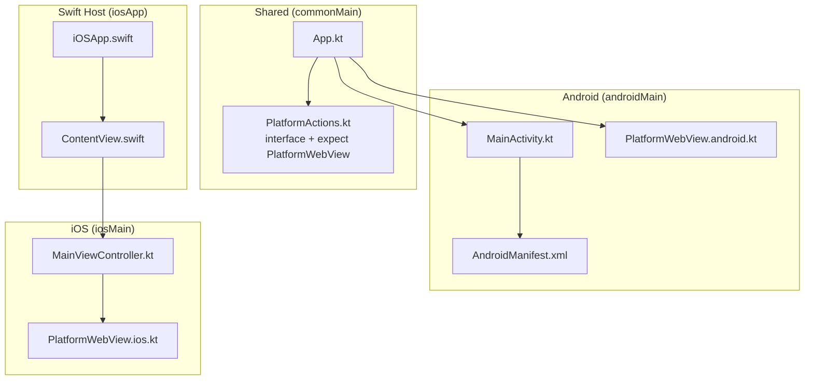
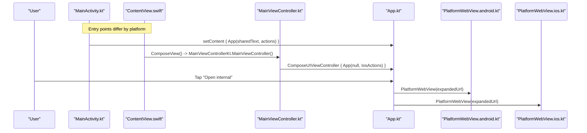
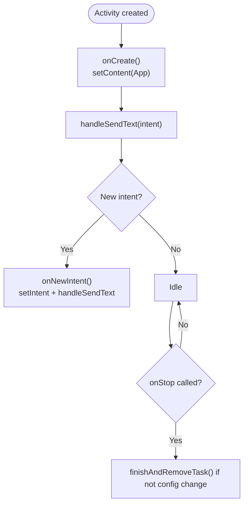
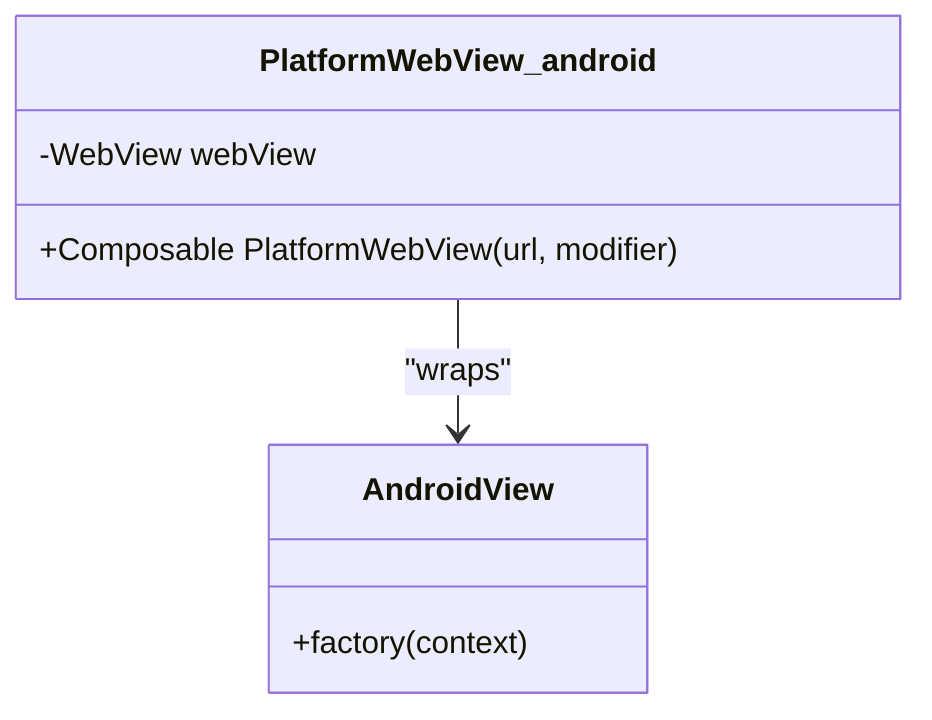
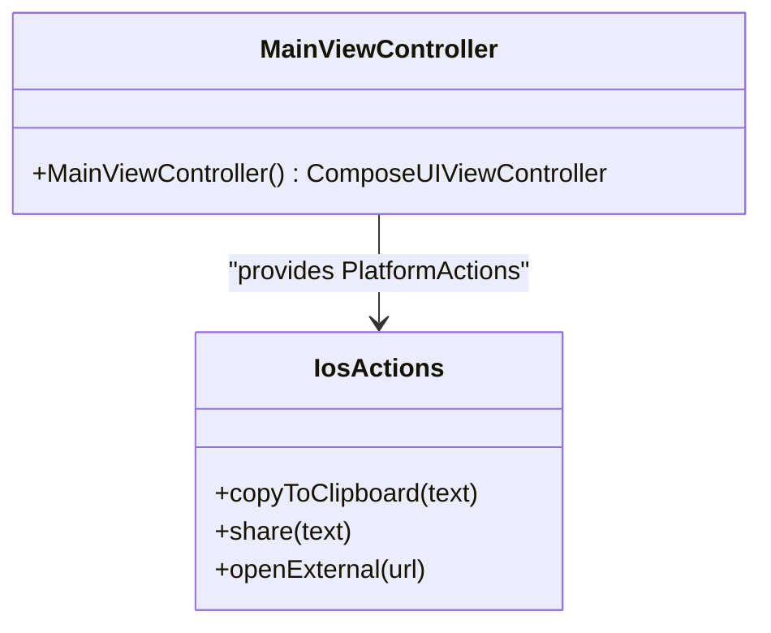
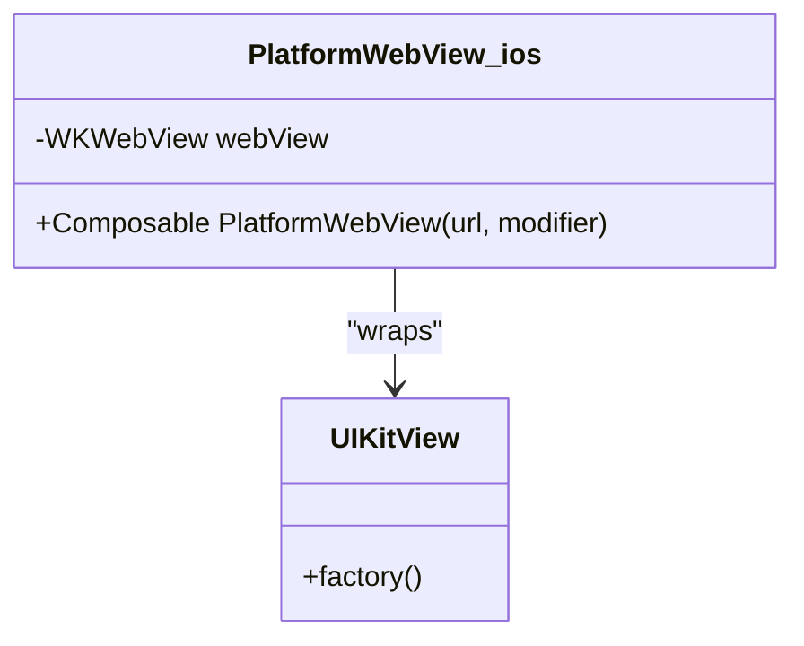
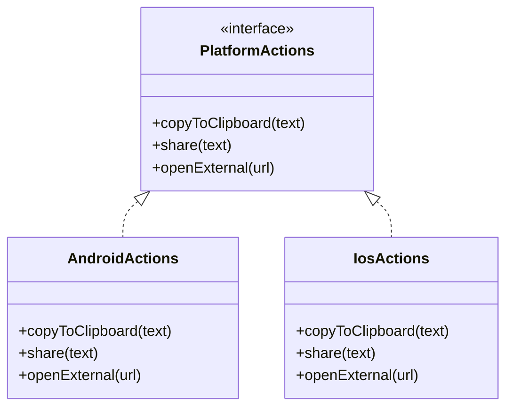
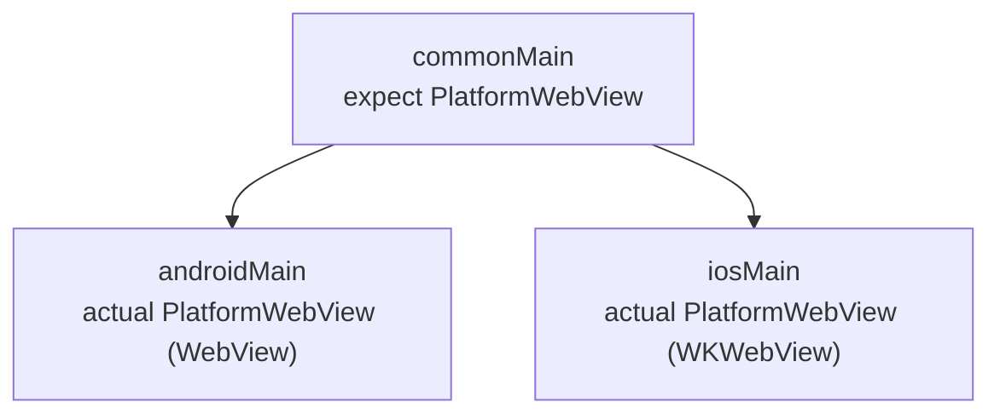
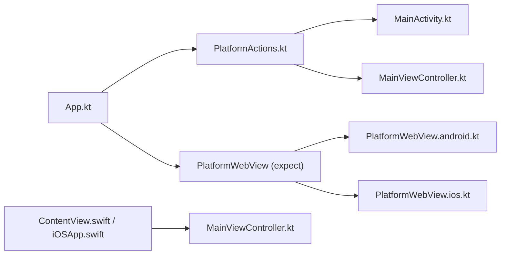

# Platform Implementations

<cite>
**Referenced Files in This Document**
- [MainActivity.kt](file://composeApp/src/androidMain/kotlin/com/brunoshiroma/url_expander/MainActivity.kt)
- [PlatformWebView.android.kt](file://composeApp/src/androidMain/kotlin/com/brunoshiroma/url_expander/PlatformWebView.android.kt)
- [AndroidManifest.xml](file://composeApp/src/androidMain/AndroidManifest.xml)
- [MainViewController.kt](file://composeApp/src/iosMain/kotlin/com/brunoshiroma/url_expander/MainViewController.kt)
- [PlatformWebView.ios.kt](file://composeApp/src/iosMain/kotlin/com/brunoshiroma/url_expander/PlatformWebView.ios.kt)
- [PlatformActions.kt](file://composeApp/src/commonMain/kotlin/com/brunoshiroma/url_expander/PlatformActions.kt)
- [App.kt](file://composeApp/src/commonMain/kotlin/com/brunoshiroma/url_expander/App.kt)
- [iOSApp.swift](file://iosApp/iosApp/iOSApp.swift)
- [ContentView.swift](file://iosApp/iosApp/ContentView.swift)
</cite>

## Table of Contents
1. [Introduction](#introduction)
2. [Project Structure](#project-structure)
3. [Core Components](#core-components)
4. [Architecture Overview](#architecture-overview)
5. [Detailed Component Analysis](#detailed-component-analysis)
6. [Dependency Analysis](#dependency-analysis)
7. [Performance Considerations](#performance-considerations)
8. [Troubleshooting Guide](#troubleshooting-guide)
9. [Conclusion](#conclusion)

## Introduction
This document explains the platform-specific implementations for the Kotlin URL Expander application on Android and iOS, focusing on how shared Compose UI calls into native features through the expect/actual pattern. It covers:
- Android: MainActivity lifecycle, intent handling for text sharing, clipboard operations, and WebView integration.
- iOS: MainViewController setup, WKWebView usage, and access to native iOS features such as share sheet and system browser.
- Shared code: How PlatformActions and PlatformWebView are declared with expect/actual to keep shared logic type-safe while delegating to platform APIs.

## Project Structure
The project is organized by platform source sets under composeApp:
- commonMain: Shared UI (App), shared interface and expect declarations (PlatformActions, PlatformWebView).
- androidMain: Android-specific Activity, manifest, and WebView implementation.
- iosMain: iOS-specific ViewController entry point and WKWebView implementation.
- iosApp: Swift host app that embeds the ComposeUIViewController.

**Diagram sources**
- [App.kt:36-126](file://composeApp/src/commonMain/kotlin/com/brunoshiroma/url_expander/App.kt#L36-L126)
- [PlatformActions.kt:6-14](file://composeApp/src/commonMain/kotlin/com/brunoshiroma/url_expander/PlatformActions.kt#L6-L14)
- [MainActivity.kt:15-60](file://composeApp/src/androidMain/kotlin/com/brunoshiroma/url_expander/MainActivity.kt#L15-L60)
- [PlatformWebView.android.kt:11-21](file://composeApp/src/androidMain/kotlin/com/brunoshiroma/url_expander/PlatformWebView.android.kt#L11-L21)
- [AndroidManifest.xml:17-40](file://composeApp/src/androidMain/AndroidManifest.xml#L17-L40)
- [MainViewController.kt:9-25](file://composeApp/src/iosMain/kotlin/com/brunoshiroma/url_expander/MainViewController.kt#L9-L25)
- [PlatformWebView.ios.kt:11-22](file://composeApp/src/iosMain/kotlin/com/brunoshiroma/url_expander/PlatformWebView.ios.kt#L11-L22)
- [iOSApp.swift:3-10](file://iosApp/iosApp/iOSApp.swift#L3-L10)
- [ContentView.swift:5-16](file://iosApp/iosApp/ContentView.swift#L5-L16)

**Section sources**
- [App.kt:36-126](file://composeApp/src/commonMain/kotlin/com/brunoshiroma/url_expander/App.kt#L36-L126)
- [PlatformActions.kt:6-14](file://composeApp/src/commonMain/kotlin/com/brunoshiroma/url_expander/PlatformActions.kt#L6-L14)
- [MainActivity.kt:15-60](file://composeApp/src/androidMain/kotlin/com/brunoshiroma/url_expander/MainActivity.kt#L15-L60)
- [PlatformWebView.android.kt:11-21](file://composeApp/src/androidMain/kotlin/com/brunoshiroma/url_expander/PlatformWebView.android.kt#L11-L21)
- [AndroidManifest.xml:17-40](file://composeApp/src/androidMain/AndroidManifest.xml#L17-L40)
- [MainViewController.kt:9-25](file://composeApp/src/iosMain/kotlin/com/brunoshiroma/url_expander/MainViewController.kt#L9-L25)
- [PlatformWebView.ios.kt:11-22](file://composeApp/src/iosMain/kotlin/com/brunoshiroma/url_expander/PlatformWebView.ios.kt#L11-L22)
- [iOSApp.swift:3-10](file://iosApp/iosApp/iOSApp.swift#L3-L10)
- [ContentView.swift:5-16](file://iosApp/iosApp/ContentView.swift#L5-L16)

## Core Components
- Shared UI (App): Renders input, expanded URL, actions (Copy, Share, Open external, Open internal), and toggles a platform WebView view.
- PlatformActions: Interface defining copyToClipboard, share, openExternal; implemented per platform.
- PlatformWebView: Expect declaration for rendering a web view; actual implementations use Android WebView and iOS WKWebView.

Key responsibilities:
- App orchestrates state and user interactions, calling PlatformActions and PlatformWebView without knowing platform details.
- Android MainActivity handles incoming shares and provides PlatformActions via an object implementing the interface.
- iOS MainViewController composes the same App with an iOS-native PlatformActions implementation.

**Section sources**
- [App.kt:36-126](file://composeApp/src/commonMain/kotlin/com/brunoshiroma/url_expander/App.kt#L36-L126)
- [PlatformActions.kt:6-14](file://composeApp/src/commonMain/kotlin/com/brunoshiroma/url_expander/PlatformActions.kt#L6-L14)

## Architecture Overview
The architecture separates shared UI from platform capabilities:
- Shared layer (commonMain) defines behavior contracts and renders UI.
- Android layer implements PlatformActions and PlatformWebView using Android APIs.
- iOS layer implements PlatformActions and PlatformWebView using UIKit/WebKit APIs.
- The Swift host app hosts the ComposeUIViewController which initializes the shared App.

**Diagram sources**
- [MainActivity.kt:38-42](file://composeApp/src/androidMain/kotlin/com/brunoshiroma/url_expander/MainActivity.kt#L38-L42)
- [ContentView.swift:5-16](file://iosApp/iosApp/ContentView.swift#L5-L16)
- [MainViewController.kt:25-25](file://composeApp/src/iosMain/kotlin/com/brunoshiroma/url_expander/MainViewController.kt#L25-L25)
- [App.kt:77-79](file://composeApp/src/commonMain/kotlin/com/brunoshiroma/url_expander/App.kt#L77-L79)
- [PlatformWebView.android.kt:11-21](file://composeApp/src/androidMain/kotlin/com/brunoshiroma/url_expander/PlatformWebView.android.kt#L11-L21)
- [PlatformWebView.ios.kt:11-22](file://composeApp/src/iosMain/kotlin/com/brunoshiroma/url_expander/PlatformWebView.ios.kt#L11-L22)

## Detailed Component Analysis

### Android Implementation

#### MainActivity Lifecycle and Intent Handling
- onCreate initializes Compose content with sharedText and PlatformActions.
- onNewIntent updates the activity’s intent and reprocesses shared text.
- onStop finishes the task when not changing configurations to keep the app transient.
- handleSendText extracts text from ACTION_SEND intents with text/plain MIME type.

**Diagram sources**
- [MainActivity.kt:38-54](file://composeApp/src/androidMain/kotlin/com/brunoshiroma/url_expander/MainActivity.kt#L38-L54)
- [MainActivity.kt:56-60](file://composeApp/src/androidMain/kotlin/com/brunoshiroma/url_expander/MainActivity.kt#L56-L60)

**Section sources**
- [MainActivity.kt:15-60](file://composeApp/src/androidMain/kotlin/com/brunoshiroma/url_expander/MainActivity.kt#L15-L60)
- [AndroidManifest.xml:17-40](file://composeApp/src/androidMain/AndroidManifest.xml#L17-L40)

#### Clipboard Operations
- copyToClipboard uses Android ClipboardManager to set primary clip with the provided text.

**Section sources**
- [MainActivity.kt:19-23](file://composeApp/src/androidMain/kotlin/com/brunoshiroma/url_expander/MainActivity.kt#L19-L23)

#### Sharing Text
- share creates an ACTION_SEND intent with text/plain and launches a chooser dialog.

**Section sources**
- [MainActivity.kt:25-31](file://composeApp/src/androidMain/kotlin/com/brunoshiroma/url_expander/MainActivity.kt#L25-L31)

#### Opening External URLs
- openExternal opens the default browser using ACTION_VIEW with a parsed Uri.

**Section sources**
- [MainActivity.kt:33-35](file://composeApp/src/androidMain/kotlin/com/brunoshiroma/url_expander/MainActivity.kt#L33-L35)

#### WebView Integration (Android)
- PlatformWebView.android uses Android WebView inside AndroidView, enables JavaScript, and loads the URL.

**Diagram sources**
- [PlatformWebView.android.kt:11-21](file://composeApp/src/androidMain/kotlin/com/brunoshiroma/url_expander/PlatformWebView.android.kt#L11-L21)

**Section sources**
- [PlatformWebView.android.kt:11-21](file://composeApp/src/androidMain/kotlin/com/brunoshiroma/url_expander/PlatformWebView.android.kt#L11-L21)

### iOS Implementation

#### MainViewController Setup
- IosActions implements PlatformActions using UIKit APIs: UIPasteboard for clipboard, UIActivityViewController for sharing, and UIApplication.openURL for external links.
- MainViewController returns a ComposeUIViewController hosting the shared App with IosActions.

**Diagram sources**
- [MainViewController.kt:9-25](file://composeApp/src/iosMain/kotlin/com/brunoshiroma/url_expander/MainViewController.kt#L9-L25)

**Section sources**
- [MainViewController.kt:9-25](file://composeApp/src/iosMain/kotlin/com/brunoshiroma/url_expander/MainViewController.kt#L9-L25)

#### WKWebView Usage (iOS)
- PlatformWebView.ios wraps WKWebView inside UIKitView and loads an NSURLRequest built from the URL string.

**Diagram sources**
- [PlatformWebView.ios.kt:11-22](file://composeApp/src/iosMain/kotlin/com/brunoshiroma/url_expander/PlatformWebView.ios.kt#L11-L22)

**Section sources**
- [PlatformWebView.ios.kt:11-22](file://composeApp/src/iosMain/kotlin/com/brunoshiroma/url_expander/PlatformWebView.ios.kt#L11-L22)

#### Swift Host Integration
- iOSApp.swift defines the SwiftUI @main app and WindowGroup.
- ContentView.swift wraps the ComposeUIViewController via UIViewControllerRepresentable and injects it into SwiftUI.

**Section sources**
- [iOSApp.swift:3-10](file://iosApp/iosApp/iOSApp.swift#L3-L10)
- [ContentView.swift:5-16](file://iosApp/iosApp/ContentView.swift#L5-L16)

### Shared Code and the expect/actual Pattern

#### PlatformActions Interface
- Declares copyToClipboard, share, openExternal.
- Both Android and iOS provide concrete implementations via objects implementing this interface.

**Diagram sources**
- [PlatformActions.kt:6-11](file://composeApp/src/commonMain/kotlin/com/brunoshiroma/url_expander/PlatformActions.kt#L6-L11)
- [MainActivity.kt:19-36](file://composeApp/src/androidMain/kotlin/com/brunoshiroma/url_expander/MainActivity.kt#L19-L36)
- [MainViewController.kt:9-23](file://composeApp/src/iosMain/kotlin/com/brunoshiroma/url_expander/MainViewController.kt#L9-L23)

#### PlatformWebView Expect Declaration
- expect fun PlatformWebView(url, modifier) is declared in commonMain.
- Actual implementations exist in androidMain and iosMain, providing platform-specific WebView components.

**Diagram sources**
- [PlatformActions.kt:13-14](file://composeApp/src/commonMain/kotlin/com/brunoshiroma/url_expander/PlatformActions.kt#L13-L14)
- [PlatformWebView.android.kt:11-21](file://composeApp/src/androidMain/kotlin/com/brunoshiroma/url_expander/PlatformWebView.android.kt#L11-L21)
- [PlatformWebView.ios.kt:11-22](file://composeApp/src/iosMain/kotlin/com/brunoshiroma/url_expander/PlatformWebView.ios.kt#L11-L22)

#### Type Safety and Compile-Time Checks
- Because PlatformActions is an interface in commonMain, any missing or mismatched methods in platform implementations will fail at compile time.
- Similarly, the actual PlatformWebView must match the signature of the expect declaration; otherwise compilation fails.
- This ensures shared UI remains decoupled from platform specifics while preserving correctness guarantees.

**Section sources**
- [PlatformActions.kt:6-14](file://composeApp/src/commonMain/kotlin/com/brunoshiroma/url_expander/PlatformActions.kt#L6-L14)

## Dependency Analysis
- App depends on PlatformActions and PlatformWebView but does not know their platform implementations.
- Android MainActivity provides PlatformActions and integrates with Android system services.
- iOS MainViewController provides PlatformActions and integrates with UIKit/WebKit.
- The Swift host app bridges into the ComposeUIViewController.

**Diagram sources**
- [App.kt:36-126](file://composeApp/src/commonMain/kotlin/com/brunoshiroma/url_expander/App.kt#L36-L126)
- [PlatformActions.kt:6-14](file://composeApp/src/commonMain/kotlin/com/brunoshiroma/url_expander/PlatformActions.kt#L6-L14)
- [MainActivity.kt:19-36](file://composeApp/src/androidMain/kotlin/com/brunoshiroma/url_expander/MainActivity.kt#L19-L36)
- [MainViewController.kt:9-25](file://composeApp/src/iosMain/kotlin/com/brunoshiroma/url_expander/MainViewController.kt#L9-L25)
- [PlatformWebView.android.kt:11-21](file://composeApp/src/androidMain/kotlin/com/brunoshiroma/url_expander/PlatformWebView.android.kt#L11-L21)
- [PlatformWebView.ios.kt:11-22](file://composeApp/src/iosMain/kotlin/com/brunoshiroma/url_expander/PlatformWebView.ios.kt#L11-L22)
- [ContentView.swift:5-16](file://iosApp/iosApp/ContentView.swift#L5-L16)
- [iOSApp.swift:3-10](file://iosApp/iosApp/iOSApp.swift#L3-L10)

**Section sources**
- [App.kt:36-126](file://composeApp/src/commonMain/kotlin/com/brunoshiroma/url_expander/App.kt#L36-L126)
- [PlatformActions.kt:6-14](file://composeApp/src/commonMain/kotlin/com/brunoshiroma/url_expander/PlatformActions.kt#L6-L14)
- [MainActivity.kt:19-36](file://composeApp/src/androidMain/kotlin/com/brunoshiroma/url_expander/MainActivity.kt#L19-L36)
- [MainViewController.kt:9-25](file://composeApp/src/iosMain/kotlin/com/brunoshiroma/url_expander/MainViewController.kt#L9-L25)
- [PlatformWebView.android.kt:11-21](file://composeApp/src/androidMain/kotlin/com/brunoshiroma/url_expander/PlatformWebView.android.kt#L11-L21)
- [PlatformWebView.ios.kt:11-22](file://composeApp/src/iosMain/kotlin/com/brunoshiroma/url_expander/PlatformWebView.ios.kt#L11-L22)
- [ContentView.swift:5-16](file://iosApp/iosApp/ContentView.swift#L5-L16)
- [iOSApp.swift:3-10](file://iosApp/iosApp/iOSApp.swift#L3-L10)

## Performance Considerations
- Android WebView initialization and JavaScript enablement occur once per PlatformWebView composition; avoid frequent recreation by keeping the URL stable until navigation is needed.
- iOS WKWebView creation is similarly deferred until the composable is composed; ensure URL strings are valid before loading to prevent unnecessary request failures.
- Clipboard and share operations are lightweight; however, presenting share sheets can be noticeable on low-end devices—avoid triggering them unintentionally.

[No sources needed since this section provides general guidance]

## Troubleshooting Guide
- Android external link opening fails:
  - Ensure the app declares INTERNET permission and queries for http/https schemes in the manifest.
  - Verify ACTION_VIEW is supported by installed apps.
- Android share sheet not appearing:
  - Confirm the intent filter for ACTION_SEND with text/plain is present and exported.
- iOS share sheet not appearing:
  - Check that the keyWindow rootViewController exists before presenting the UIActivityViewController.
- WebView blank page:
  - Validate the URL string before constructing requests; handle null cases gracefully.
  - On Android, ensure JavaScript is enabled if required by the target site.

**Section sources**
- [AndroidManifest.xml:4-15](file://composeApp/src/androidMain/AndroidManifest.xml#L4-L15)
- [AndroidManifest.xml:31-39](file://composeApp/src/androidMain/AndroidManifest.xml#L31-L39)
- [PlatformWebView.android.kt:14-18](file://composeApp/src/androidMain/kotlin/com/brunoshiroma/url_expander/PlatformWebView.android.kt#L14-L18)
- [PlatformWebView.ios.kt:17-19](file://composeApp/src/iosMain/kotlin/com/brunoshiroma/url_expander/PlatformWebView.ios.kt#L17-L19)
- [MainViewController.kt:14-18](file://composeApp/src/iosMain/kotlin/com/brunoshiroma/url_expander/MainViewController.kt#L14-L18)

## Conclusion
The platform implementations cleanly separate shared UI logic from platform-specific features using the expect/actual pattern. Android’s MainActivity manages lifecycle and system integrations, while iOS’s MainViewController provides equivalent functionality via UIKit. Both platforms implement PlatformActions and PlatformWebView to expose native capabilities to the shared App, ensuring type safety and compile-time validation across platforms.