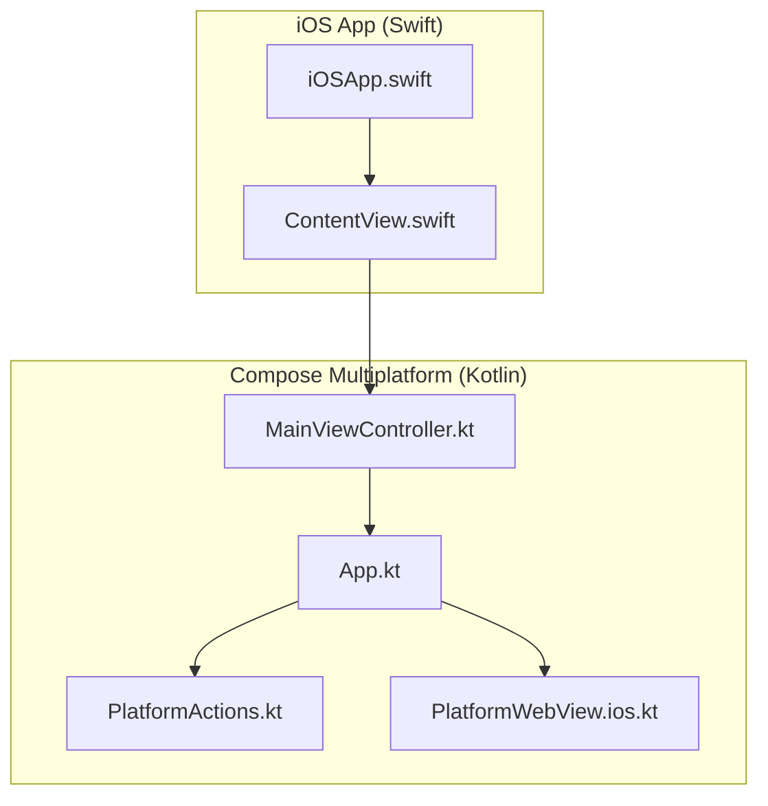
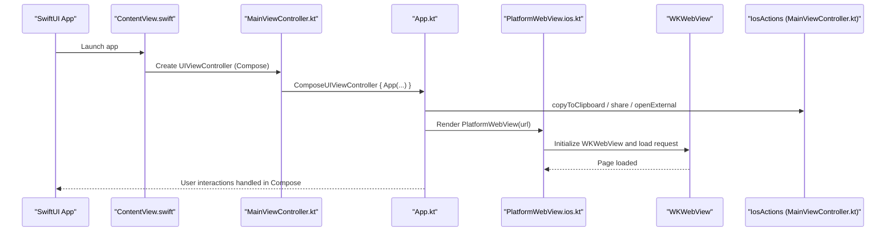
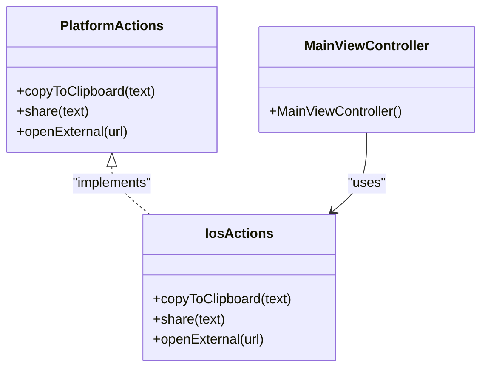
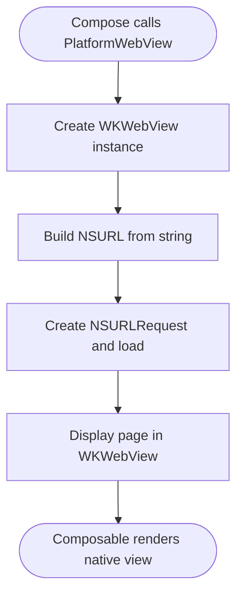
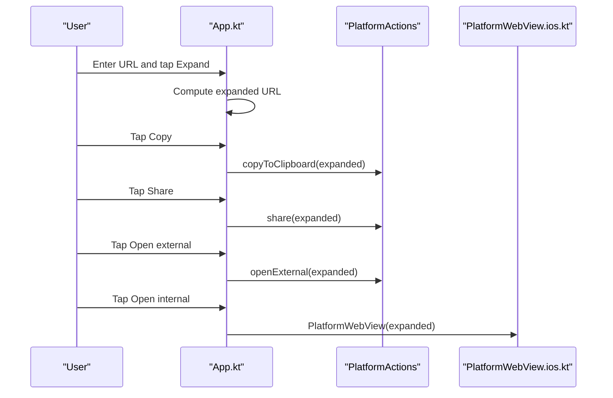
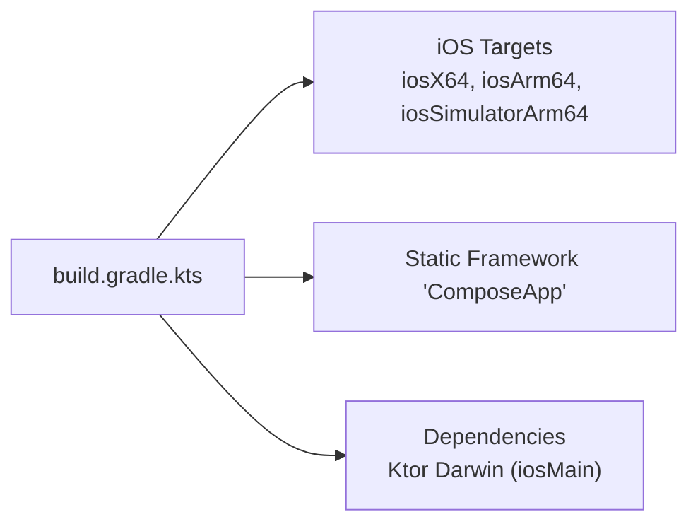

# iOS Implementation

<cite>
**Referenced Files in This Document**
- [MainViewController.kt](file://composeApp/src/iosMain/kotlin/com/brunoshiroma/url_expander/MainViewController.kt)
- [PlatformWebView.ios.kt](file://composeApp/src/iosMain/kotlin/com/brunoshiroma/url_expander/PlatformWebView.ios.kt)
- [PlatformActions.kt](file://composeApp/src/commonMain/kotlin/com/brunoshiroma/url_expander/PlatformActions.kt)
- [App.kt](file://composeApp/src/commonMain/kotlin/com/brunoshiroma/url_expander/App.kt)
- [iOSApp.swift](file://iosApp/iosApp/iOSApp.swift)
- [ContentView.swift](file://iosApp/iosApp/ContentView.swift)
- [build.gradle.kts](file://composeApp/build.gradle.kts)
</cite>

## Table of Contents
1. [Introduction](#introduction)
2. [Project Structure](#project-structure)
3. [Core Components](#core-components)
4. [Architecture Overview](#architecture-overview)
5. [Detailed Component Analysis](#detailed-component-analysis)
6. [Dependency Analysis](#dependency-analysis)
7. [Performance Considerations](#performance-considerations)
8. [Troubleshooting Guide](#troubleshooting-guide)
9. [Conclusion](#conclusion)

## Introduction
This document explains the iOS platform implementation of the URL Expander application. It covers how the SwiftUI host integrates with Compose Multiplatform, how the iOS-specific web view is implemented using WKWebView, and how platform actions (clipboard, sharing, external links) are provided to shared UI code. It also highlights iOS-specific considerations such as App Transport Security, view controller lifecycle, and Swift interoperability patterns.

## Project Structure
The iOS integration spans two layers:
- Native iOS app layer (Swift): hosts a SwiftUI app that embeds a Compose screen via UIViewControllerRepresentable.
- Compose Multiplatform layer (Kotlin): provides shared UI and platform-specific implementations for WebView and platform actions.

**Diagram sources**
- [iOSApp.swift:1-11](file://iosApp/iosApp/iOSApp.swift#L1-L11)
- [ContentView.swift:1-18](file://iosApp/iosApp/ContentView.swift#L1-L18)
- [MainViewController.kt:1-26](file://composeApp/src/iosMain/kotlin/com/brunoshiroma/url_expander/MainViewController.kt#L1-L26)
- [App.kt:1-127](file://composeApp/src/commonMain/kotlin/com/brunoshiroma/url_expander/App.kt#L1-L127)
- [PlatformWebView.ios.kt:1-23](file://composeApp/src/iosMain/kotlin/com/brunoshiroma/url_expander/PlatformWebView.ios.kt#L1-L23)
- [PlatformActions.kt:1-15](file://composeApp/src/commonMain/kotlin/com/brunoshiroma/url_expander/PlatformActions.kt#L1-L15)

**Section sources**
- [iOSApp.swift:1-11](file://iosApp/iosApp/iOSApp.swift#L1-L11)
- [ContentView.swift:1-18](file://iosApp/iosApp/ContentView.swift#L1-L18)
- [MainViewController.kt:1-26](file://composeApp/src/iosMain/kotlin/com/brunoshiroma/url_expander/MainViewController.kt#L1-L26)
- [App.kt:1-127](file://composeApp/src/commonMain/kotlin/com/brunoshiroma/url_expander/App.kt#L1-L127)
- [PlatformWebView.ios.kt:1-23](file://composeApp/src/iosMain/kotlin/com/brunoshiroma/url_expander/PlatformWebView.ios.kt#L1-L23)
- [PlatformActions.kt:1-15](file://composeApp/src/commonMain/kotlin/com/brunoshiroma/url_expander/PlatformActions.kt#L1-L15)

## Core Components
- SwiftUI host entry point and Compose embedding:
  - iOSApp defines the SwiftUI app scene.
  - ContentView wraps a Compose screen using UIViewControllerRepresentable, bridging into Kotlin’s MainViewController.
- Compose Multiplatform entry on iOS:
  - MainViewController creates the Compose UI and supplies iOS-specific PlatformActions.
- Shared UI logic:
  - App orchestrates state, user interactions, and delegates platform operations through PlatformActions.
- iOS WebView implementation:
  - PlatformWebView.ios.kt renders a WKWebView inside Compose using UIKitView.

**Section sources**
- [iOSApp.swift:1-11](file://iosApp/iosApp/iOSApp.swift#L1-L11)
- [ContentView.swift:1-18](file://iosApp/iosApp/ContentView.swift#L1-L18)
- [MainViewController.kt:1-26](file://composeApp/src/iosMain/kotlin/com/brunoshiroma/url_expander/MainViewController.kt#L1-L26)
- [App.kt:1-127](file://composeApp/src/commonMain/kotlin/com/brunoshiroma/url_expander/App.kt#L1-L127)
- [PlatformWebView.ios.kt:1-23](file://composeApp/src/iosMain/kotlin/com/brunoshiroma/url_expander/PlatformWebView.ios.kt#L1-L23)

## Architecture Overview
The runtime flow from SwiftUI to Compose and back to native iOS APIs:

**Diagram sources**
- [iOSApp.swift:1-11](file://iosApp/iosApp/iOSApp.swift#L1-L11)
- [ContentView.swift:1-18](file://iosApp/iosApp/ContentView.swift#L1-L18)
- [MainViewController.kt:1-26](file://composeApp/src/iosMain/kotlin/com/brunoshiroma/url_expander/MainViewController.kt#L1-L26)
- [App.kt:1-127](file://composeApp/src/commonMain/kotlin/com/brunoshiroma/url_expander/App.kt#L1-L127)
- [PlatformWebView.ios.kt:1-23](file://composeApp/src/iosMain/kotlin/com/brunoshiroma/url_expander/PlatformWebView.ios.kt#L1-L23)

## Detailed Component Analysis

### SwiftUI Host Integration
- iOSApp.swift defines the app entry point and window group.
- ContentView.swift uses UIViewControllerRepresentable to wrap the Compose screen created by MainViewController.
- The Compose view is embedded directly into SwiftUI without additional navigation controllers.

Key responsibilities:
- Provide a seamless bridge between SwiftUI and Compose.
- Ensure safe area handling at the SwiftUI level.

**Section sources**
- [iOSApp.swift:1-11](file://iosApp/iosApp/iOSApp.swift#L1-L11)
- [ContentView.swift:1-18](file://iosApp/iosApp/ContentView.swift#L1-L18)

### MainViewController Setup and Platform Actions
MainViewController.kt:
- Creates the Compose UI via ComposeUIViewController and passes an iOS-specific PlatformActions implementation.
- IosActions implements:
  - Copy to clipboard using UIPasteboard.
  - Share via UIActivityViewController presented from the key window’s root view controller.
  - Open external URLs using UIApplication.openURL.

Notes:
- No SFSafariViewController is used; external links are opened system-wide via openURL.
- UIActivityViewController is presented modally from the current root view controller.

**Diagram sources**
- [PlatformActions.kt:1-15](file://composeApp/src/commonMain/kotlin/com/brunoshiroma/url_expander/PlatformActions.kt#L1-L15)
- [MainViewController.kt:1-26](file://composeApp/src/iosMain/kotlin/com/brunoshiroma/url_expander/MainViewController.kt#L1-L26)

**Section sources**
- [MainViewController.kt:1-26](file://composeApp/src/iosMain/kotlin/com/brunoshiroma/url_expander/MainViewController.kt#L1-L26)
- [PlatformActions.kt:1-15](file://composeApp/src/commonMain/kotlin/com/brunoshiroma/url_expander/PlatformActions.kt#L1-L15)

### iOS WebView Implementation with WKWebView
PlatformWebView.ios.kt:
- Uses UIKitView to embed a WKWebView inside Compose.
- Initializes WKWebView and loads the provided URL via NSURL and NSURLRequest.
- Does not configure JavaScript execution or custom navigation delegates in this implementation.

**Diagram sources**
- [PlatformWebView.ios.kt:1-23](file://composeApp/src/iosMain/kotlin/com/brunoshiroma/url_expander/PlatformWebView.ios.kt#L1-L23)

Security and configuration considerations:
- JavaScript execution: Not enabled in this implementation. If needed, it can be configured on WKWebViewConfiguration before creating WKWebView.
- Navigation handling: No custom WKNavigationDelegate is attached; default navigation behavior applies.
- Memory management: WKWebView instances are managed by UIKitView lifecycle within Compose. For long-lived usage, consider explicit cleanup when the composable leaves the composition.

Memory management and cleanup guidance:
- When the WebView composable is removed from the composition, UIKitView will release its native view. If you add custom resources (e.g., observers), ensure they are released during teardown.
- Avoid retaining strong references to WKWebView outside the composable to prevent memory leaks.

**Section sources**
- [PlatformWebView.ios.kt:1-23](file://composeApp/src/iosMain/kotlin/com/brunoshiroma/url_expander/PlatformWebView.ios.kt#L1-L23)

### Shared UI Flow and Platform Delegation
App.kt:
- Manages input, expanded URL state, and toggles between text view and internal WebView.
- Delegates platform operations to PlatformActions:
  - Copy to clipboard
  - Share
  - Open external link
- Renders PlatformWebView when the user chooses “Open internal”.

**Diagram sources**
- [App.kt:1-127](file://composeApp/src/commonMain/kotlin/com/brunoshiroma/url_expander/App.kt#L1-L127)
- [PlatformWebView.ios.kt:1-23](file://composeApp/src/iosMain/kotlin/com/brunoshiroma/url_expander/PlatformWebView.ios.kt#L1-L23)
- [PlatformActions.kt:1-15](file://composeApp/src/commonMain/kotlin/com/brunoshiroma/url_expander/PlatformActions.kt#L1-L15)

**Section sources**
- [App.kt:1-127](file://composeApp/src/commonMain/kotlin/com/brunoshiroma/url_expander/App.kt#L1-L127)

## Dependency Analysis
- iOS build targets and framework output:
  - The Compose Multiplatform module builds static frameworks for iOS targets and depends on Ktor Darwin client for networking on iOS.
- Interop boundaries:
  - SwiftUI (Swift) -> Compose (Kotlin) via MainViewController.
  - Compose (Kotlin) -> UIKit (Swift) via UIKitView and direct platform APIs.

**Diagram sources**
- [build.gradle.kts:1-73](file://composeApp/build.gradle.kts#L1-L73)

**Section sources**
- [build.gradle.kts:1-73](file://composeApp/build.gradle.kts#L1-L73)

## Performance Considerations
- WKWebView initialization: Creating WKWebView instances can be costly. Reuse where possible if multiple views need to display content concurrently.
- Composition stability: Keep the URL stable across recompositions to avoid unnecessary reloads.
- Network requests: Offload URL expansion to background coroutines (already present in shared code) to keep UI responsive.
- Memory: Avoid holding large data in memory; rely on WKWebView’s built-in caching and clear references when navigating away.

[No sources needed since this section provides general guidance]

## Troubleshooting Guide
Common issues and resolutions:
- External links do not open:
  - Ensure the URL scheme is supported by the system.
  - Verify that openURL is called with a valid NSURL.
- Clipboard operations fail:
  - Confirm UIPasteboard access is permitted; some environments may restrict pasteboard writes.
- Sharing dialog does not appear:
  - Ensure there is a valid root view controller available to present UIActivityViewController.
- Web view shows blank or blocked content:
  - Check App Transport Security settings for HTTPS endpoints.
  - If JavaScript is required, enable it in WKWebViewConfiguration and handle navigation securely.

**Section sources**
- [MainViewController.kt:10-22](file://composeApp/src/iosMain/kotlin/com/brunoshiroma/url_expander/MainViewController.kt#L10-L22)
- [PlatformWebView.ios.kt:11-22](file://composeApp/src/iosMain/kotlin/com/brunoshiroma/url_expander/PlatformWebView.ios.kt#L11-L22)

## Conclusion
The iOS implementation integrates SwiftUI and Compose Multiplatform cleanly, providing a robust foundation for URL expansion and viewing. Platform actions are exposed via a simple interface and implemented using native iOS APIs. The WKWebView-based internal viewer is straightforward and secure by default. For advanced use cases, consider adding WKWebViewConfiguration for JavaScript, implementing WKNavigationDelegate for navigation control, and ensuring proper resource cleanup to optimize performance and memory usage.

[No sources needed since this section summarizes without analyzing specific files]