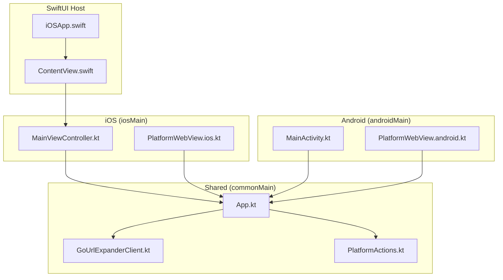
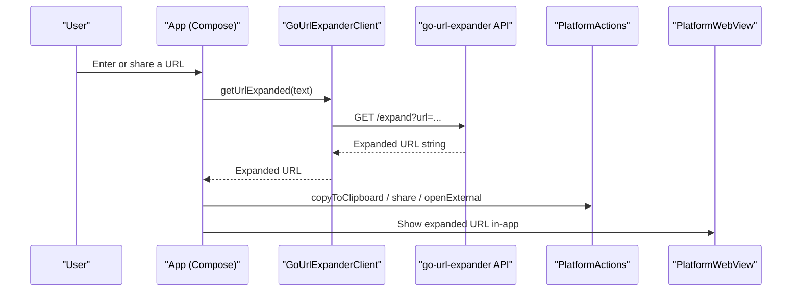
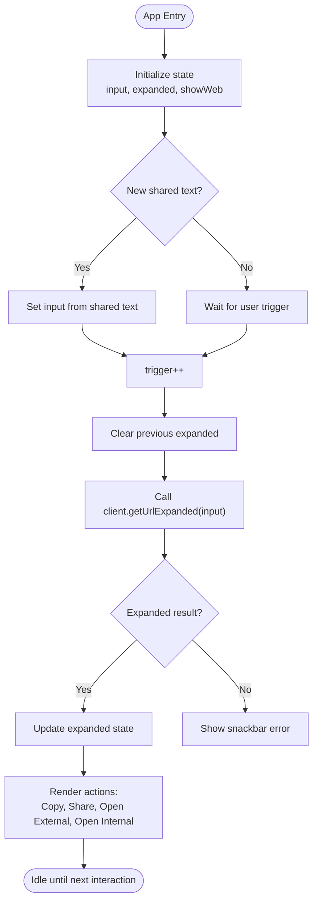
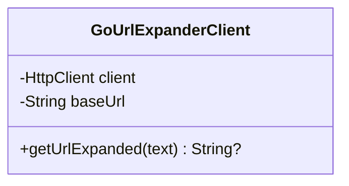
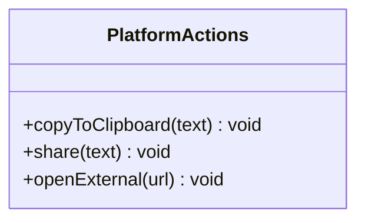
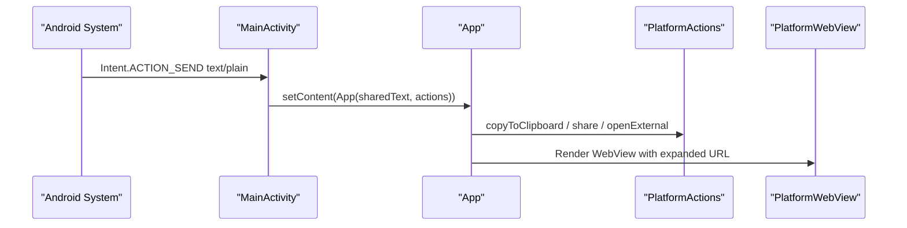
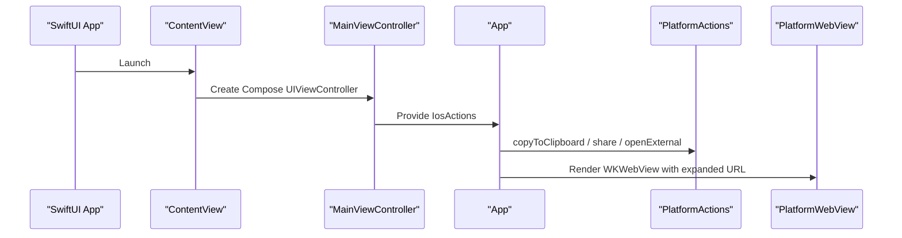
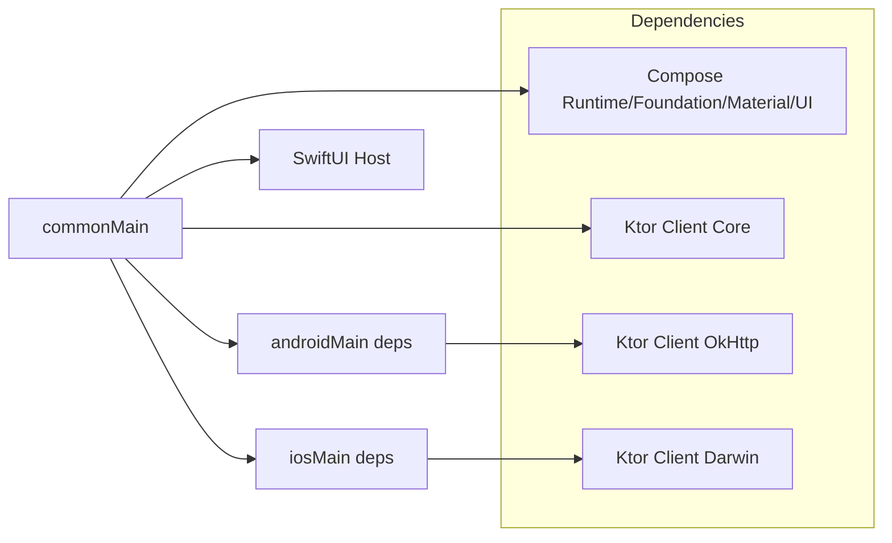

# Project Overview

<cite>
**Referenced Files in This Document**
- [README.md](file://README.md)
- [App.kt](file://composeApp/src/commonMain/kotlin/com/brunoshiroma/url_expander/App.kt)
- [GoUrlExpanderClient.kt](file://composeApp/src/commonMain/kotlin/com/brunoshiroma/url_expander/GoUrlExpanderClient.kt)
- [PlatformActions.kt](file://composeApp/src/commonMain/kotlin/com/brunoshiroma/url_expander/PlatformActions.kt)
- [MainActivity.kt](file://composeApp/src/androidMain/kotlin/com/brunoshiroma/url_expander/MainActivity.kt)
- [PlatformWebView.android.kt](file://composeApp/src/androidMain/kotlin/com/brunoshiroma/url_expander/PlatformWebView.android.kt)
- [MainViewController.kt](file://composeApp/src/iosMain/kotlin/com/brunoshiroma/url_expander/MainViewController.kt)
- [PlatformWebView.ios.kt](file://composeApp/src/iosMain/kotlin/com/brunoshiroma/url_expander/PlatformWebView.ios.kt)
- [build.gradle.kts](file://composeApp/build.gradle.kts)
- [iOSApp.swift](file://iosApp/iosApp/iOSApp.swift)
- [ContentView.swift](file://iosApp/iosApp/ContentView.swift)
</cite>

## Table of Contents
1. [Introduction](#introduction)
2. [Project Structure](#project-structure)
3. [Core Components](#core-components)
4. [Architecture Overview](#architecture-overview)
5. [Detailed Component Analysis](#detailed-component-analysis)
6. [Dependency Analysis](#dependency-analysis)
7. [Performance Considerations](#performance-considerations)
8. [Troubleshooting Guide](#troubleshooting-guide)
9. [Conclusion](#conclusion)

## Introduction
This project is a cross-platform mobile client for the go-url-expander service, built with Kotlin Multiplatform and Compose Multiplatform. It targets Android and iOS, sharing business logic and UI while delegating platform-specific operations (clipboard, share, external browser, and WebView) to native implementations. The app solves a common problem: users often receive shortened URLs that are hard to inspect or trust. By expanding them into their final destinations, this client helps users verify links before opening them, across platforms.

The client connects to an external URL expansion API hosted at https://go-url-expander.brunoshiroma.com. Users can paste or share a shortened URL, expand it, then copy, share, open externally, or view it in an in-app WebView.

## Project Structure
The repository follows a standard Kotlin Multiplatform layout:
- composeApp/src/commonMain: shared UI (Compose), HTTP client, and platform abstraction
- composeApp/src/androidMain: Android Activity, clipboard/share/open-external, and WebView implementation
- composeApp/src/iosMain: iOS entry point, clipboard/share/open-external, and WKWebView implementation
- iosApp: SwiftUI host that embeds the shared Compose framework

**Diagram sources**
- [App.kt:36-126](file://composeApp/src/commonMain/kotlin/com/brunoshiroma/url_expander/App.kt#L36-L126)
- [GoUrlExpanderClient.kt:13-23](file://composeApp/src/commonMain/kotlin/com/brunoshiroma/url_expander/GoUrlExpanderClient.kt#L13-L23)
- [PlatformActions.kt:7-14](file://composeApp/src/commonMain/kotlin/com/brunoshiroma/url_expander/PlatformActions.kt#L7-L14)
- [MainActivity.kt:15-60](file://composeApp/src/androidMain/kotlin/com/brunoshiroma/url_expander/MainActivity.kt#L15-L60)
- [PlatformWebView.android.kt:11-21](file://composeApp/src/androidMain/kotlin/com/brunoshiroma/url_expander/PlatformWebView.android.kt#L11-L21)
- [MainViewController.kt:9-25](file://composeApp/src/iosMain/kotlin/com/brunoshiroma/url_expander/MainViewController.kt#L9-L25)
- [PlatformWebView.ios.kt:13-22](file://composeApp/src/iosMain/kotlin/com/brunoshiroma/url_expander/PlatformWebView.ios.kt#L13-L22)
- [iOSApp.swift:3-10](file://iosApp/iosApp/iOSApp.swift#L3-L10)
- [ContentView.swift:5-17](file://iosApp/iosApp/ContentView.swift#L5-L17)

**Section sources**
- [README.md:1-18](file://README.md#L1-L18)
- [build.gradle.kts:10-48](file://composeApp/build.gradle.kts#L10-L48)

## Core Components
- Shared UI (App): A Compose screen that accepts user input, triggers URL expansion, displays results, and provides actions like copy, share, open external, and open internal WebView.
- HTTP Client (GoUrlExpanderClient): Extracts a URL from text and calls the external API endpoint /expand to retrieve the expanded destination.
- Platform Abstraction (PlatformActions): Defines clipboard, share, and open-external operations; each platform implements these natively.
- Platform WebViews: Native WebView components embedded via Compose interop for viewing expanded URLs in-app.

Key benefits:
- Shared business logic and UI reduce duplication between Android and iOS.
- Native integrations ensure best-in-class behavior for system features like clipboard, share sheets, and web rendering.
- Modern UI design using Material 3 and Compose Multiplatform.

**Section sources**
- [App.kt:36-126](file://composeApp/src/commonMain/kotlin/com/brunoshiroma/url_expander/App.kt#L36-L126)
- [GoUrlExpanderClient.kt:9-23](file://composeApp/src/commonMain/kotlin/com/brunoshiroma/url_expander/GoUrlExpanderClient.kt#L9-L23)
- [PlatformActions.kt:7-14](file://composeApp/src/commonMain/kotlin/com/brunoshiroma/url_expander/PlatformActions.kt#L7-L14)

## Architecture Overview
The application uses a layered architecture:
- Presentation layer: Compose UI in commonMain
- Domain/data layer: Ktor-based HTTP client calling the external API
- Platform layer: Native implementations for OS-specific features

**Diagram sources**
- [App.kt:56-61](file://composeApp/src/commonMain/kotlin/com/brunoshiroma/url_expander/App.kt#L56-L61)
- [GoUrlExpanderClient.kt:17-23](file://composeApp/src/commonMain/kotlin/com/brunoshiroma/url_expander/GoUrlExpanderClient.kt#L17-L23)
- [PlatformActions.kt:7-11](file://composeApp/src/commonMain/kotlin/com/brunoshiroma/url_expander/PlatformActions.kt#L7-L11)
- [PlatformWebView.android.kt:11-21](file://composeApp/src/androidMain/kotlin/com/brunoshiroma/url_expander/PlatformWebView.android.kt#L11-L21)
- [PlatformWebView.ios.kt:13-22](file://composeApp/src/iosMain/kotlin/com/brunoshiroma/url_expander/PlatformWebView.ios.kt#L13-L22)

## Detailed Component Analysis

### Shared UI: App
Responsibilities:
- Manage state for input, expanded result, and WebView visibility
- Trigger expansion when new shared text arrives or user taps Expand
- Provide actions: Copy, Share, Open External, Open Internal WebView
- Display success feedback via Snackbar

**Diagram sources**
- [App.kt:49-61](file://composeApp/src/commonMain/kotlin/com/brunoshiroma/url_expander/App.kt#L49-L61)
- [App.kt:99-121](file://composeApp/src/commonMain/kotlin/com/brunoshiroma/url_expander/App.kt#L99-L121)

**Section sources**
- [App.kt:36-126](file://composeApp/src/commonMain/kotlin/com/brunoshiroma/url_expander/App.kt#L36-L126)

### HTTP Client: GoUrlExpanderClient
Responsibilities:
- Extract a valid URL from arbitrary text using regex
- Call the external API endpoint /expand with the extracted URL
- Return the expanded URL on success, null otherwise

**Diagram sources**
- [GoUrlExpanderClient.kt:13-23](file://composeApp/src/commonMain/kotlin/com/brunoshiroma/url_expander/GoUrlExpanderClient.kt#L13-L23)

**Section sources**
- [GoUrlExpanderClient.kt:9-23](file://composeApp/src/commonMain/kotlin/com/brunoshiroma/url_expander/GoUrlExpanderClient.kt#L9-L23)

### Platform Abstraction: PlatformActions
Responsibilities:
- Define cross-platform operations: copyToClipboard, share, openExternal
- Expose expect PlatformWebView composable for platform-specific WebView

**Diagram sources**
- [PlatformActions.kt:7-11](file://composeApp/src/commonMain/kotlin/com/brunoshiroma/url_expander/PlatformActions.kt#L7-L11)

**Section sources**
- [PlatformActions.kt:7-14](file://composeApp/src/commonMain/kotlin/com/brunoshiroma/url_expander/PlatformActions.kt#L7-L14)

### Android Implementation
- MainActivity: Handles ACTION_SEND intents, sets up PlatformActions, and hosts the shared App.
- PlatformWebView.android: Wraps Android WebView inside Compose to display expanded URLs.

**Diagram sources**
- [MainActivity.kt:38-60](file://composeApp/src/androidMain/kotlin/com/brunoshiroma/url_expander/MainActivity.kt#L38-L60)
- [PlatformWebView.android.kt:11-21](file://composeApp/src/androidMain/kotlin/com/brunoshiroma/url_expander/PlatformWebView.android.kt#L11-L21)

**Section sources**
- [MainActivity.kt:15-60](file://composeApp/src/androidMain/kotlin/com/brunoshiroma/url_expander/MainActivity.kt#L15-L60)
- [PlatformWebView.android.kt:11-21](file://composeApp/src/androidMain/kotlin/com/brunoshiroma/url_expander/PlatformWebView.android.kt#L11-L21)

### iOS Implementation
- MainViewController: Provides IosActions implementing PlatformActions and exposes ComposeUIViewController.
- PlatformWebView.ios: Embeds WKWebView via UIKitView to render expanded URLs.
- SwiftUI host: iOSApp and ContentView bridge into the shared Compose UI.

**Diagram sources**
- [iOSApp.swift:3-10](file://iosApp/iosApp/iOSApp.swift#L3-L10)
- [ContentView.swift:5-17](file://iosApp/iosApp/ContentView.swift#L5-L17)
- [MainViewController.kt:9-25](file://composeApp/src/iosMain/kotlin/com/brunoshiroma/url_expander/MainViewController.kt#L9-L25)
- [PlatformWebView.ios.kt:13-22](file://composeApp/src/iosMain/kotlin/com/brunoshiroma/url_expander/PlatformWebView.ios.kt#L13-L22)

**Section sources**
- [MainViewController.kt:9-25](file://composeApp/src/iosMain/kotlin/com/brunoshiroma/url_expander/MainViewController.kt#L9-L25)
- [PlatformWebView.ios.kt:13-22](file://composeApp/src/iosMain/kotlin/com/brunoshiroma/url_expander/PlatformWebView.ios.kt#L13-L22)
- [iOSApp.swift:3-10](file://iosApp/iosApp/iOSApp.swift#L3-L10)
- [ContentView.swift:5-17](file://iosApp/iosApp/ContentView.swift#L5-L17)

## Dependency Analysis
Build configuration defines:
- Common dependencies: Compose runtime/foundation/material/ui, Ktor client core
- Android: Ktor client OkHttp
- iOS: Ktor client Darwin
- Targets: Android and multiple iOS architectures packaged as a static framework

**Diagram sources**
- [build.gradle.kts:28-48](file://composeApp/build.gradle.kts#L28-L48)

**Section sources**
- [build.gradle.kts:10-48](file://composeApp/build.gradle.kts#L10-L48)

## Performance Considerations
- Network requests are asynchronous via Ktor; avoid blocking the UI thread.
- Regex extraction is lightweight but should be used judiciously if processing large inputs.
- WebView rendering may be heavy; consider lazy initialization and reuse where appropriate.
- For iOS, WKWebView is efficient; ensure proper memory management when navigating frequently.

[No sources needed since this section provides general guidance]

## Troubleshooting Guide
Common issues and resolutions:
- No expanded result returned:
  - Ensure the input contains a valid http/https URL; the client extracts only such patterns.
  - Verify network connectivity and that the external API is reachable.
- Clipboard/share not working:
  - Confirm platform permissions and that the device supports the requested action.
- WebView fails to load:
  - Check URL validity and any content restrictions enforced by the target site.
- Android transient lifecycle:
  - The app finishes itself after stopping; this is intentional for quick expand-and-go workflows.

**Section sources**
- [GoUrlExpanderClient.kt:9-23](file://composeApp/src/commonMain/kotlin/com/brunoshiroma/url_expander/GoUrlExpanderClient.kt#L9-L23)
- [MainActivity.kt:50-60](file://composeApp/src/androidMain/kotlin/com/brunoshiroma/url_expander/MainActivity.kt#L50-L60)

## Conclusion
The Kotlin URL Expander project delivers a modern, cross-platform solution for expanding shortened URLs. By leveraging Kotlin Multiplatform and Compose Multiplatform, it shares UI and business logic while integrating seamlessly with native capabilities on Android and iOS. Users benefit from fast, reliable expansion of URLs through the go-url-expander service, with convenient options to copy, share, open externally, or preview within the app.

[No sources needed since this section summarizes without analyzing specific files]