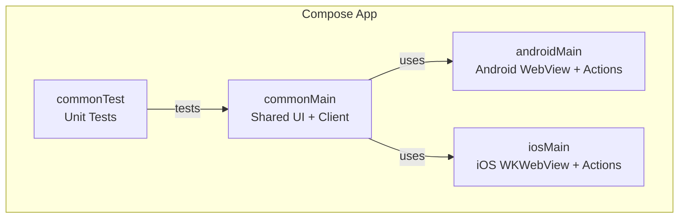
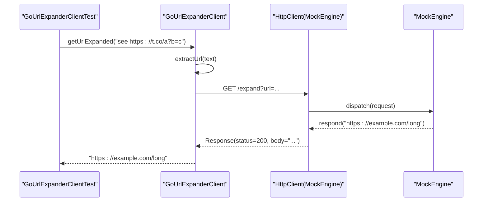
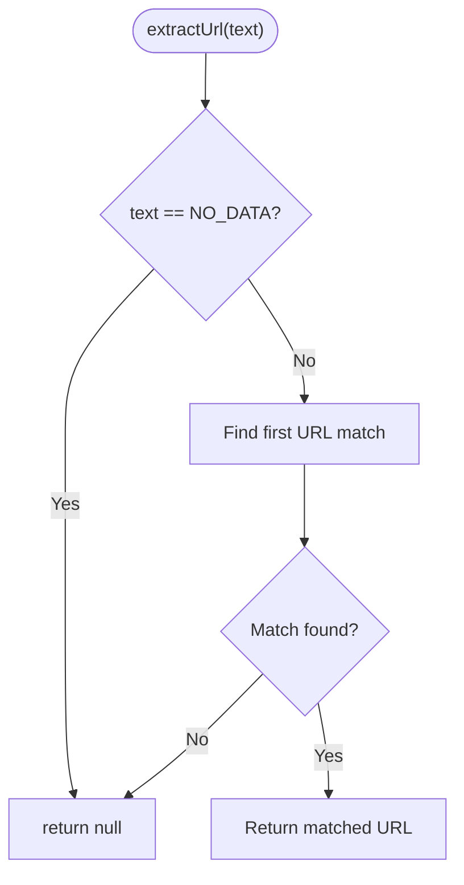
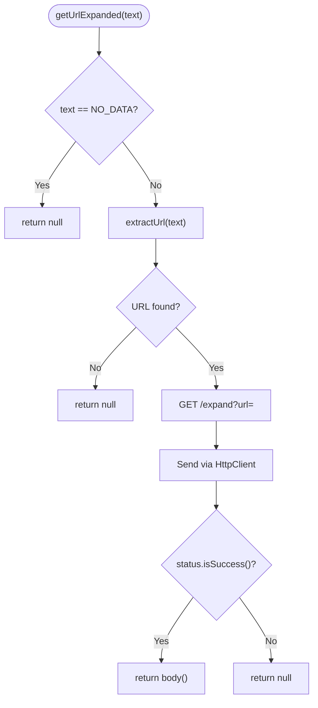
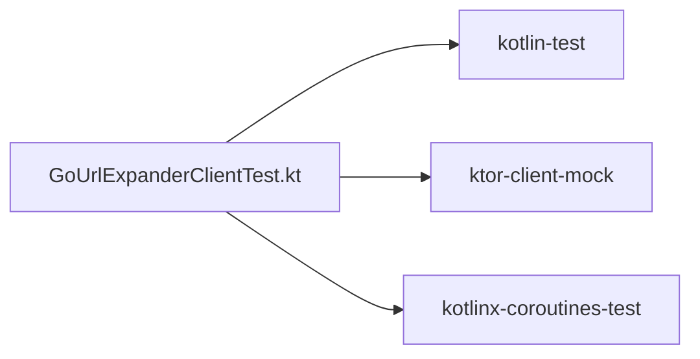

# Testing Strategy

<cite>
**Referenced Files in This Document**
- [README.md](file://README.md)
- [GoUrlExpanderClient.kt](file://composeApp/src/commonMain/kotlin/com/brunoshiroma/url_expander/GoUrlExpanderClient.kt)
- [GoUrlExpanderClientTest.kt](file://composeApp/src/commonTest/kotlin/com/brunoshiroma/url_expander/GoUrlExpanderClientTest.kt)
- [build.gradle.kts](file://composeApp/build.gradle.kts)
- [libs.versions.toml](file://gradle/libs.versions.toml)
</cite>

## Table of Contents
1. [Introduction](#introduction)
2. [Project Structure](#project-structure)
3. [Core Components](#core-components)
4. [Architecture Overview](#architecture-overview)
5. [Detailed Component Analysis](#detailed-component-analysis)
6. [Dependency Analysis](#dependency-analysis)
7. [Performance Considerations](#performance-considerations)
8. [Troubleshooting Guide](#troubleshooting-guide)
9. [Conclusion](#conclusion)

## Introduction
This document explains the testing strategy for the Kotlin URL Expander application. It focuses on:
- Unit testing shared business logic using Kotlin Multiplatform test infrastructure
- Using Ktor MockEngine to isolate HTTP client behavior
- Organizing tests under commonTest for cross-platform coverage
- Strategies for isolating platform-specific code and planning integration tests

The goal is to provide a clear, practical guide for writing robust tests that validate URL extraction, request construction, response handling, and error paths without depending on real network calls.

## Project Structure
The project uses a standard Kotlin Multiplatform layout with Compose Multiplatform:
- Shared UI and business logic live in commonMain
- Platform-specific implementations (Android, iOS) are isolated in androidMain and iosMain
- Tests for shared code live in commonTest and run on JVM via Gradle

**Diagram sources**
- [build.gradle.kts:28-48](file://composeApp/build.gradle.kts#L28-L48)

**Section sources**
- [README.md:1-18](file://README.md#L1-L18)
- [build.gradle.kts:28-48](file://composeApp/build.gradle.kts#L28-L48)

## Core Components
This section outlines the key components relevant to testing:
- GoUrlExpanderClient: encapsulates URL extraction and HTTP expansion via Ktor HttpClient
- GoUrlExpanderClientTest: unit tests validating URL extraction, request encoding, success path, and error path using MockEngine

Key responsibilities:
- extractUrl(text): finds the first URL inside arbitrary text using regex
- getUrlExpanded(text): returns null for empty/no-data inputs, extracts URL, performs GET request with parameter url, and returns body only on success

**Section sources**
- [GoUrlExpanderClient.kt:9-27](file://composeApp/src/commonMain/kotlin/com/brunoshiroma/url_expander/GoUrlExpanderClient.kt#L9-L27)
- [GoUrlExpanderClientTest.kt:12-43](file://composeApp/src/commonTest/kotlin/com/brunoshiroma/url_expander/GoUrlExpanderClientTest.kt#L12-L43)

## Architecture Overview
The testing architecture centers around isolating the HTTP layer using Ktor’s MockEngine while exercising shared logic in commonTest. The flow below shows how a test constructs an HttpClient with a MockEngine, invokes the client, and verifies outcomes.

**Diagram sources**
- [GoUrlExpanderClient.kt:17-23](file://composeApp/src/commonMain/kotlin/com/brunoshiroma/url_expander/GoUrlExpanderClient.kt#L17-L23)
- [GoUrlExpanderClientTest.kt:26-36](file://composeApp/src/commonTest/kotlin/com/brunoshiroma/url_expander/GoUrlExpanderClientTest.kt#L26-L36)

## Detailed Component Analysis

### Shared Business Logic: URL Extraction
- Purpose: Extract the first URL from arbitrary input text.
- Behavior:
  - Returns the matched URL if found
  - Returns null when no URL is present
- Test coverage:
  - Positive case: URL embedded in text
  - Negative case: No URL present

**Diagram sources**
- [GoUrlExpanderClient.kt:9-11](file://composeApp/src/commonMain/kotlin/com/brunoshiroma/url_expander/GoUrlExpanderClient.kt#L9-L11)
- [GoUrlExpanderClientTest.kt:14-18](file://composeApp/src/commonTest/kotlin/com/brunoshiroma/url_expander/GoUrlExpanderClientTest.kt#L14-L18)

**Section sources**
- [GoUrlExpanderClient.kt:9-11](file://composeApp/src/commonMain/kotlin/com/brunoshiroma/url_expander/GoUrlExpanderClient.kt#L9-L11)
- [GoUrlExpanderClientTest.kt:14-18](file://composeApp/src/commonTest/kotlin/com/brunoshiroma/url_expander/GoUrlExpanderClientTest.kt#L14-L18)

### HTTP Expansion: Request Construction and Response Handling
- Purpose: Expand a short URL by calling the remote service.
- Behavior:
  - If input equals a sentinel value, return null immediately
  - Extract URL; if none, return null
  - Build GET request to base URL with parameter url
  - Return body only if status indicates success; otherwise return null
- Test coverage:
  - Empty/no-data input returns null
  - Successful response returns expanded URL
  - Non-success status returns null
  - Verify correct URL encoding in the request

**Diagram sources**
- [GoUrlExpanderClient.kt:17-23](file://composeApp/src/commonMain/kotlin/com/brunoshiroma/url_expander/GoUrlExpanderClient.kt#L17-L23)
- [GoUrlExpanderClientTest.kt:20-42](file://composeApp/src/commonTest/kotlin/com/brunoshiroma/url_expander/GoUrlExpanderClientTest.kt#L20-L42)

**Section sources**
- [GoUrlExpanderClient.kt:13-27](file://composeApp/src/commonMain/kotlin/com/brunoshiroma/url_expander/GoUrlExpanderClient.kt#L13-L27)
- [GoUrlExpanderClientTest.kt:20-42](file://composeApp/src/commonTest/kotlin/com/brunoshiroma/url_expander/GoUrlExpanderClientTest.kt#L20-L42)

### Mocking External Dependencies
- Use Ktor MockEngine to simulate server responses without network I/O.
- In tests:
  - Construct HttpClient(MockEngine { ... })
  - Configure respond(...) with desired body and optional status
  - Assert returned values and captured request details (e.g., final URL)

Examples in this project:
- Verifying successful expansion and encoded query parameter
- Verifying non-success status yields null

**Section sources**
- [GoUrlExpanderClientTest.kt:26-42](file://composeApp/src/commonTest/kotlin/com/brunoshiroma/url_expander/GoUrlExpanderClientTest.kt#L26-L42)

### Test Organization Patterns
- Location: Tests for shared code reside in commonTest, enabling JVM-based execution across platforms.
- Naming: Co-located with the component under test (e.g., GoUrlExpanderClientTest.kt).
- Scope: Focus on pure functions and stateless clients; avoid platform-specific dependencies in commonTest.

**Section sources**
- [build.gradle.kts:36-40](file://composeApp/build.gradle.kts#L36-L40)
- [GoUrlExpanderClientTest.kt:1-11](file://composeApp/src/commonTest/kotlin/com/brunoshiroma/url_expander/GoUrlExpanderClientTest.kt#L1-L11)

### Platform-Specific Code Isolation
- Android and iOS specific implementations are kept separate in androidMain and iosMain.
- Tests in commonTest do not depend on platform APIs, ensuring portability and fast feedback.
- When adding new platform features, keep them out of commonMain unless they are truly shared.

**Section sources**
- [build.gradle.kts:41-47](file://composeApp/build.gradle.kts#L41-L47)

### Integration Testing Strategies
- Current scope: Unit tests for shared logic and HTTP client behavior via MockEngine.
- Future integration tests could:
  - Spin up a local test server or use a mock backend
  - Validate end-to-end flows between UI and client
  - Exercise platform-specific WebView interactions via platform test targets
- Keep integration tests separate from unit tests to maintain speed and isolation.

[No sources needed since this section provides general guidance]

## Dependency Analysis
The testing stack relies on:
- kotlin-test for assertions and test framework
- ktor-client-mock for MockEngine
- kotlinx-coroutines-test for coroutine test utilities

These are declared in the version catalog and added to commonTest dependencies.

**Diagram sources**
- [libs.versions.toml:14-16](file://gradle/libs.versions.toml#L14-L16)
- [build.gradle.kts:36-40](file://composeApp/build.gradle.kts#L36-L40)
- [GoUrlExpanderClientTest.kt:3-10](file://composeApp/src/commonTest/kotlin/com/brunoshiroma/url_expander/GoUrlExpanderClientTest.kt#L3-L10)

**Section sources**
- [libs.versions.toml:14-16](file://gradle/libs.versions.toml#L14-L16)
- [build.gradle.kts:36-40](file://composeApp/build.gradle.kts#L36-L40)

## Performance Considerations
- Prefer unit tests over integration tests for speed and reliability.
- Use MockEngine to avoid network latency and flakiness.
- Keep test data small and deterministic.
- Run tests frequently during development to catch regressions early.

[No sources needed since this section provides general guidance]

## Troubleshooting Guide
Common issues and resolutions:
- Missing test dependencies: Ensure commonTest includes kotlin-test, ktor-client-mock, and kotlinx-coroutines-test.
- Coroutines in tests: Wrap suspend test methods with runTest to properly manage test scopes.
- Unexpected request URLs: Inspect the captured request URL in MockEngine to verify parameter encoding and base URL usage.
- Non-deterministic behavior: Avoid relying on system time or external services; inject deterministic inputs and mocks.

**Section sources**
- [build.gradle.kts:36-40](file://composeApp/build.gradle.kts#L36-L40)
- [GoUrlExpanderClientTest.kt:20-42](file://composeApp/src/commonTest/kotlin/com/brunoshiroma/url_expander/GoUrlExpanderClientTest.kt#L20-L42)

## Conclusion
The testing strategy leverages Kotlin Multiplatform’s commonTest source set and Ktor’s MockEngine to validate shared business logic and HTTP interactions deterministically. By isolating platform-specific code and focusing tests on pure functions and stateless clients, the suite remains fast, portable, and reliable. Extending the suite with additional cases for edge conditions and future integration tests will further strengthen confidence in the URL expansion feature.

[No sources needed since this section summarizes without analyzing specific files]