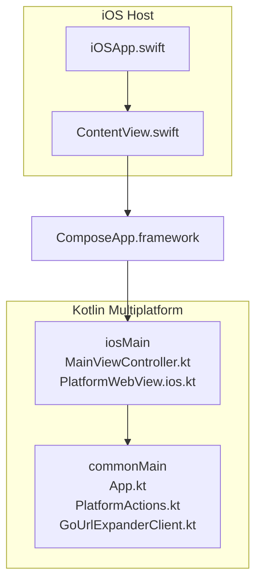
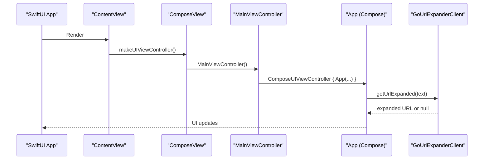
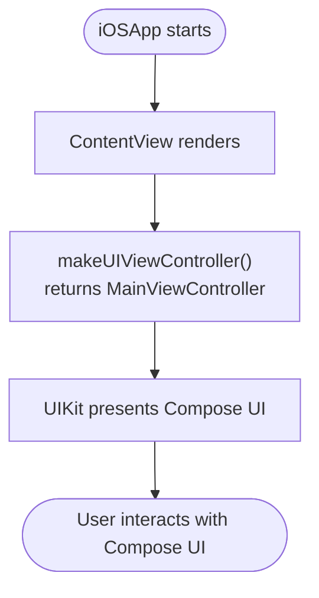
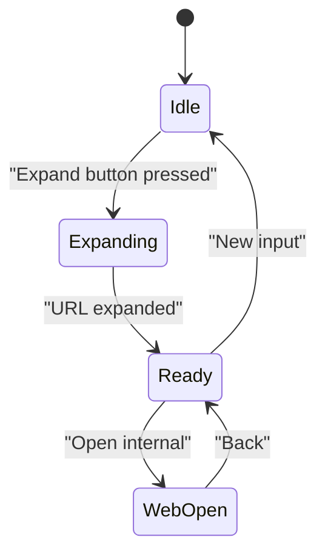
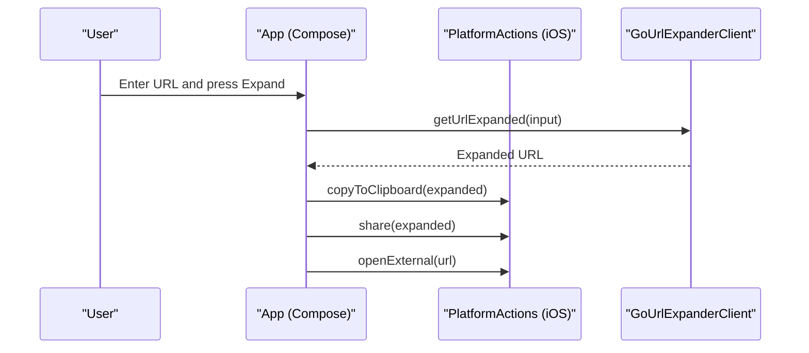
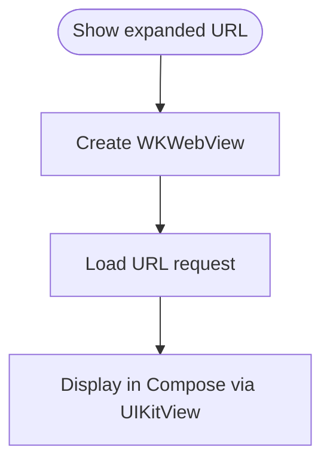
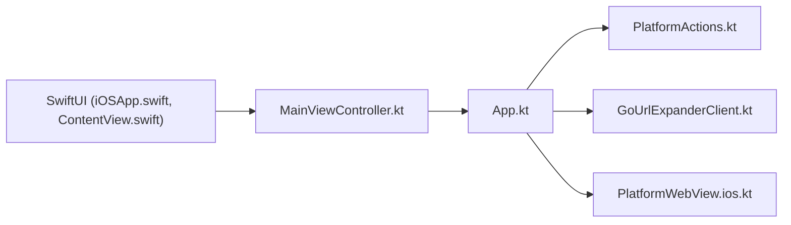

# iOS Host Application

<cite>
**Referenced Files in This Document**
- [README.md](file://README.md)
- [App.kt](file://composeApp/src/commonMain/kotlin/com/brunoshiroma/url_expander/App.kt)
- [PlatformActions.kt](file://composeApp/src/commonMain/kotlin/com/brunoshiroma/url_expander/PlatformActions.kt)
- [GoUrlExpanderClient.kt](file://composeApp/src/commonMain/kotlin/com/brunoshiroma/url_expander/GoUrlExpanderClient.kt)
- [PlatformWebView.ios.kt](file://composeApp/src/iosMain/kotlin/com/brunoshiroma/url_expander/PlatformWebView.ios.kt)
- [MainViewController.kt](file://composeApp/src/iosMain/kotlin/com/brunoshiroma/url_expander/MainViewController.kt)
- [ContentView.swift](file://iosApp/iosApp/ContentView.swift)
- [iOSApp.swift](file://iosApp/iosApp/iOSApp.swift)
- [build.gradle.kts](file://composeApp/build.gradle.kts)
</cite>

## Table of Contents
1. [Introduction](#introduction)
2. [Project Structure](#project-structure)
3. [Core Components](#core-components)
4. [Architecture Overview](#architecture-overview)
5. [Detailed Component Analysis](#detailed-component-analysis)
6. [Dependency Analysis](#dependency-analysis)
7. [Performance Considerations](#performance-considerations)
8. [Troubleshooting Guide](#troubleshooting-guide)
9. [Conclusion](#conclusion)
10. [Appendices](#appendices)

## Introduction
This document explains the iOS host application that embeds the Kotlin Multiplatform framework for a URL expander app built with Compose Multiplatform. It covers:
- How SwiftUI hosts Compose Multiplatform via a generated UIViewController entry point
- Xcode project setup and embedding the ComposeApp.framework
- The shared UI implementation and lifecycle management
- Platform-specific integration points (clipboard, share, external URL opening, WebView)
- Communication between Swift and shared Kotlin code

## Project Structure
The repository is organized into:
- composeApp: Kotlin Multiplatform module containing shared UI and platform implementations
- iosApp: Minimal SwiftUI host that embeds the Compose App framework

**Diagram sources**
- [iOSApp.swift:1-11](file://iosApp/iosApp/iOSApp.swift#L1-L11)
- [ContentView.swift:1-18](file://iosApp/iosApp/ContentView.swift#L1-L18)
- [MainViewController.kt:1-26](file://composeApp/src/iosMain/kotlin/com/brunoshiroma/url_expander/MainViewController.kt#L1-L26)
- [App.kt:1-127](file://composeApp/src/commonMain/kotlin/com/brunoshiroma/url_expander/App.kt#L1-L127)

**Section sources**
- [README.md:1-18](file://README.md#L1-L18)
- [build.gradle.kts:1-73](file://composeApp/build.gradle.kts#L1-L73)

## Core Components
- Shared UI (Compose): Defines the main screen, state, and user interactions.
- Platform abstraction: Declares platform operations and an expect/actual WebView.
- iOS entry point: Creates a Compose-backed UIViewController for SwiftUI to host.
- SwiftUI host: Wraps the Compose view inside a SwiftUI View.

Key responsibilities:
- App.kt: Manages input, expansion flow, and platform actions.
- PlatformActions.kt: Declares clipboard, share, and open URL capabilities.
- MainViewController.kt: Implements PlatformActions on iOS and exposes ComposeUIViewController.
- PlatformWebView.ios.kt: Renders WKWebView through Compose interop.
- ContentView.swift: Bridges SwiftUI to Compose via ComposeView.
- iOSApp.swift: App entry point rendering ContentView.

**Section sources**
- [App.kt:1-127](file://composeApp/src/commonMain/kotlin/com/brunoshiroma/url_expander/App.kt#L1-L127)
- [PlatformActions.kt:1-15](file://composeApp/src/commonMain/kotlin/com/brunoshiroma/url_expander/PlatformActions.kt#L1-L15)
- [MainViewController.kt:1-26](file://composeApp/src/iosMain/kotlin/com/brunoshiroma/url_expander/MainViewController.kt#L1-L26)
- [PlatformWebView.ios.kt:1-23](file://composeApp/src/iosMain/kotlin/com/brunoshiroma/url_expander/PlatformWebView.ios.kt#L1-L23)
- [ContentView.swift:1-18](file://iosApp/iosApp/ContentView.swift#L1-L18)
- [iOSApp.swift:1-11](file://iosApp/iosApp/iOSApp.swift#L1-L11)

## Architecture Overview
The runtime architecture connects SwiftUI to Compose Multiplatform and then to shared Kotlin logic.

**Diagram sources**
- [iOSApp.swift:1-11](file://iosApp/iosApp/iOSApp.swift#L1-L11)
- [ContentView.swift:1-18](file://iosApp/iosApp/ContentView.swift#L1-L18)
- [MainViewController.kt:1-26](file://composeApp/src/iosMain/kotlin/com/brunoshiroma/url_expander/MainViewController.kt#L1-L26)
- [App.kt:1-127](file://composeApp/src/commonMain/kotlin/com/brunoshiroma/url_expander/App.kt#L1-L127)
- [GoUrlExpanderClient.kt:1-29](file://composeApp/src/commonMain/kotlin/com/brunoshiroma/url_expander/GoUrlExpanderClient.kt#L1-L29)

## Detailed Component Analysis

### SwiftUI Integration with Compose Multiplatform
- The SwiftUI app defines an App struct that renders ContentView.
- ContentView wraps the Compose UI using a UIViewControllerRepresentable that instantiates the generated MainViewController from Kotlin.
- This allows Compose UI to run inside SwiftUI without manual UIKit bridging.

**Diagram sources**
- [iOSApp.swift:1-11](file://iosApp/iosApp/iOSApp.swift#L1-L11)
- [ContentView.swift:1-18](file://iosApp/iosApp/ContentView.swift#L1-L18)
- [MainViewController.kt:1-26](file://composeApp/src/iosMain/kotlin/com/brunoshiroma/url_expander/MainViewController.kt#L1-L26)

**Section sources**
- [iOSApp.swift:1-11](file://iosApp/iosApp/iOSApp.swift#L1-L11)
- [ContentView.swift:1-18](file://iosApp/iosApp/ContentView.swift#L1-L18)

### Xcode Project Setup and Framework Embedding
- Build the iOS framework using Gradle tasks for simulator and device targets.
- Add a Run Script build phase to embed and sign the Apple framework for Xcode.
- Link ComposeApp.framework in your Xcode target.

Steps:
1. Build the framework:
   - For iOS Simulator: gradle :composeApp:linkDebugFrameworkIosSimulatorArm64
   - For device: gradle :composeApp:linkDebugFrameworkIosArm64
2. In Xcode, add a Run Script build phase:
   - cd "$SRCROOT/.." && gradle :composeApp:embedAndSignAppleFrameworkForXcode
3. Ensure ComposeApp.framework is linked and embedded in the app target.

Notes:
- The framework is configured as static for iOS targets in the Gradle build script.
- The README documents the exact commands and the Xcode integration step.

**Section sources**
- [README.md:10-18](file://README.md#L10-L18)
- [build.gradle.kts:17-26](file://composeApp/build.gradle.kts#L17-L26)

### Framework Embedding Into Existing iOS Projects
To integrate ComposeApp.framework into an existing iOS project:
- Add the Run Script build phase as described above so the framework is built and signed during Xcode builds.
- Link ComposeApp.framework in the target’s General > Frameworks, Libraries, and Embedded Content.
- Import ComposeApp in Swift files where you need to call Kotlin-generated APIs (e.g., MainViewController).
- If you already have a UIKit-based app, present the MainViewController as a standard UIViewController.

Initialization considerations:
- No explicit global initialization is required beyond linking the framework.
- The first time Compose runs, it initializes the Compose runtime and any dependencies declared in commonMain.

**Section sources**
- [README.md:16-18](file://README.md#L16-L18)
- [MainViewController.kt:1-26](file://composeApp/src/iosMain/kotlin/com/brunoshiroma/url_expander/MainViewController.kt#L1-L26)

### ContentView Implementation and Lifecycle Management
- ContentView simply hosts ComposeView, which returns the MainViewController instance.
- The lifecycle is managed by UIKit/SwiftUI; Compose recomposes when state changes.
- The shared App composable manages:
  - Input text and expanded result state
  - Triggering URL expansion
  - Showing/hiding the internal WebView
  - Invoking platform actions (copy, share, open external)

**Diagram sources**
- [App.kt:34-126](file://composeApp/src/commonMain/kotlin/com/brunoshiroma/url_expander/App.kt#L34-L126)

**Section sources**
- [ContentView.swift:1-18](file://iosApp/iosApp/ContentView.swift#L1-L18)
- [App.kt:1-127](file://composeApp/src/commonMain/kotlin/com/brunoshiroma/url_expander/App.kt#L1-L127)

### Communication With Shared Kotlin Code
- SwiftUI calls into Kotlin via the generated MainViewController function exposed by the Compose framework.
- The shared App composable uses GoUrlExpanderClient to expand URLs over HTTP using Ktor.
- Platform-specific behavior is provided via PlatformActions implemented in iosMain.

**Diagram sources**
- [App.kt:34-126](file://composeApp/src/commonMain/kotlin/com/brunoshiroma/url_expander/App.kt#L34-L126)
- [PlatformActions.kt:1-15](file://composeApp/src/commonMain/kotlin/com/brunoshiroma/url_expander/PlatformActions.kt#L1-L15)
- [GoUrlExpanderClient.kt:1-29](file://composeApp/src/commonMain/kotlin/com/brunoshiroma/url_expander/GoUrlExpanderClient.kt#L1-L29)
- [MainViewController.kt:1-26](file://composeApp/src/iosMain/kotlin/com/brunoshiroma/url_expander/MainViewController.kt#L1-L26)

**Section sources**
- [App.kt:1-127](file://composeApp/src/commonMain/kotlin/com/brunoshiroma/url_expander/App.kt#L1-L127)
- [PlatformActions.kt:1-15](file://composeApp/src/commonMain/kotlin/com/brunoshiroma/url_expander/PlatformActions.kt#L1-L15)
- [GoUrlExpanderClient.kt:1-29](file://composeApp/src/commonMain/kotlin/com/brunoshiroma/url_expander/GoUrlExpanderClient.kt#L1-L29)
- [MainViewController.kt:1-26](file://composeApp/src/iosMain/kotlin/com/brunoshiroma/url_expander/MainViewController.kt#L1-L26)

### Platform-Specific WebView
- The shared UI declares an expect for PlatformWebView.
- On iOS, the actual implementation uses UIKitView to embed WKWebView and load the expanded URL.

**Diagram sources**
- [PlatformActions.kt:13-14](file://composeApp/src/commonMain/kotlin/com/brunoshiroma/url_expander/PlatformActions.kt#L13-L14)
- [PlatformWebView.ios.kt:1-23](file://composeApp/src/iosMain/kotlin/com/brunoshiroma/url_expander/PlatformWebView.ios.kt#L1-L23)

**Section sources**
- [PlatformActions.kt:1-15](file://composeApp/src/commonMain/kotlin/com/brunoshiroma/url_expander/PlatformActions.kt#L1-L15)
- [PlatformWebView.ios.kt:1-23](file://composeApp/src/iosMain/kotlin/com/brunoshiroma/url_expander/PlatformWebView.ios.kt#L1-L23)

## Dependency Analysis
The following diagram shows how components depend on each other across platforms.

**Diagram sources**
- [iOSApp.swift:1-11](file://iosApp/iosApp/iOSApp.swift#L1-L11)
- [ContentView.swift:1-18](file://iosApp/iosApp/ContentView.swift#L1-L18)
- [MainViewController.kt:1-26](file://composeApp/src/iosMain/kotlin/com/brunoshiroma/url_expander/MainViewController.kt#L1-L26)
- [App.kt:1-127](file://composeApp/src/commonMain/kotlin/com/brunoshiroma/url_expander/App.kt#L1-L127)
- [PlatformActions.kt:1-15](file://composeApp/src/commonMain/kotlin/com/brunoshiroma/url_expander/PlatformActions.kt#L1-L15)
- [GoUrlExpanderClient.kt:1-29](file://composeApp/src/commonMain/kotlin/com/brunoshiroma/url_expander/GoUrlExpanderClient.kt#L1-L29)
- [PlatformWebView.ios.kt:1-23](file://composeApp/src/iosMain/kotlin/com/brunoshiroma/url_expander/PlatformWebView.ios.kt#L1-L23)

**Section sources**
- [build.gradle.kts:1-73](file://composeApp/build.gradle.kts#L1-L73)

## Performance Considerations
- Network calls are asynchronous via Ktor; ensure UI remains responsive while expanding URLs.
- Avoid recomposition churn by keeping state minimal and only updating when necessary.
- WKWebView creation is lightweight but can be expensive if created frequently; reuse or cache when possible.
- Static frameworks reduce binary size and improve link times on iOS.

[No sources needed since this section provides general guidance]

## Troubleshooting Guide
Common issues and resolutions:
- Framework not found in Xcode:
  - Ensure the Run Script build phase runs before compiling and that ComposeApp.framework is linked and embedded.
- Build fails for iOS targets:
  - Verify Gradle tasks for the correct architectures (simulator vs device) are executed.
- WebView does not load:
  - Confirm the URL string is valid and non-empty before loading in WKWebView.
- Clipboard/share/open URL not working:
  - Check that PlatformActions is correctly implemented and invoked from the shared UI.

**Section sources**
- [README.md:10-18](file://README.md#L10-L18)
- [PlatformWebView.ios.kt:1-23](file://composeApp/src/iosMain/kotlin/com/brunoshiroma/url_expander/PlatformWebView.ios.kt#L1-L23)
- [MainViewController.kt:1-26](file://composeApp/src/iosMain/kotlin/com/brunoshiroma/url_expander/MainViewController.kt#L1-L26)

## Conclusion
The iOS host application integrates Compose Multiplatform seamlessly within SwiftUI by hosting a generated UIViewController. The shared UI handles business logic and network requests, while platform-specific behaviors are abstracted behind PlatformActions. By following the documented Xcode setup steps and linking ComposeApp.framework, you can embed the Kotlin Multiplatform framework into existing iOS projects and extend functionality with additional platform integrations as needed.

[No sources needed since this section summarizes without analyzing specific files]

## Appendices

### API Surface Summary
- SwiftUI entry points:
  - iOSApp.swift: App struct and WindowGroup
  - ContentView.swift: ComposeView wrapper
- Kotlin entry point:
  - MainViewController.kt: Exposes MainViewController for SwiftUI
- Shared UI:
  - App.kt: Main composable with state and actions
- Platform abstractions:
  - PlatformActions.kt: Clipboard, share, open URL
  - PlatformWebView.ios.kt: WKWebView implementation
- Networking:
  - GoUrlExpanderClient.kt: HTTP client for URL expansion

**Section sources**
- [iOSApp.swift:1-11](file://iosApp/iosApp/iOSApp.swift#L1-L11)
- [ContentView.swift:1-18](file://iosApp/iosApp/ContentView.swift#L1-L18)
- [MainViewController.kt:1-26](file://composeApp/src/iosMain/kotlin/com/brunoshiroma/url_expander/MainViewController.kt#L1-L26)
- [App.kt:1-127](file://composeApp/src/commonMain/kotlin/com/brunoshiroma/url_expander/App.kt#L1-L127)
- [PlatformActions.kt:1-15](file://composeApp/src/commonMain/kotlin/com/brunoshiroma/url_expander/PlatformActions.kt#L1-L15)
- [PlatformWebView.ios.kt:1-23](file://composeApp/src/iosMain/kotlin/com/brunoshiroma/url_expander/PlatformWebView.ios.kt#L1-L23)
- [GoUrlExpanderClient.kt:1-29](file://composeApp/src/commonMain/kotlin/com/brunoshiroma/url_expander/GoUrlExpanderClient.kt#L1-L29)